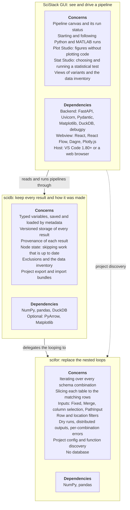

# Architecture & Layers

<!-- Ground truth (tests/declared deps win over prose). Verified against:
     pyproject [dependencies] of each package (the authoritative dependency graph);
     scidb/src/scidb/run/foreach.py (delegation to scifor.for_each; provenance graph
     written on save); scifor/tests/test_foreach_standalone.py;
     scidb/tests/test_integration.py; scidb/tests/test_hist_*.py.
     Roles diagram: third-party lists come from each pyproject plus the imports in
     scifor/src, scidb/src and scistack-gui/scistack_gui; webview libraries from
     scistack-gui/frontend/package.json.
     NOTE: two USER-FACING layers (scifor/scidb); everything else
     (sciduckdb, scicanonicalhash, scimatlab, scistacklog) is an internal
     package — see docs/internals/. -->

SciStack is a **layered stack of two user-facing packages**. Each one owns a
single responsibility, and `scidb` re-exports the layer below it, so you can
[enter at either level](../getting-started/choosing-a-layer.md): the low-level
iteration engine on plain tables, or the full provenance-tracked pipeline, with
the same core ideas throughout.

## The two layers

```
  scidb     typed, versioned variable storage + DB-backed for_each + provenance
    │  re-exports scifor
  scifor    pure batch iteration over condition combinations on plain tables
```

| Layer | Role | Depends on (user-facing) |
|---|---|---|
| `scifor` | Pure batch-iteration engine over plain tables/DataFrames | — |
| `scidb` | Typed versioned storage, DB-backed `for_each`, provenance and node state | `scifor` |

## scifor, scidb, and the GUI

The SciStack GUI is an application built on these two layers, not a third
library layer. Each box below lists what that level is responsible for and the
third-party software it needs. SciStack's own internal packages are left out.



All three levels need Python 3.10 or newer (plus `tomli` on Python 3.10). To run
MATLAB functions you also need MATLAB.

## What each layer owns

- **scifor**: the iteration engine. Given a schema (which columns are
  conditions) and inputs, it filters each table to the matching rows, calls your
  function, and collects the results. It has **zero** awareness of databases,
  versioning, or lineage, by design, so it runs standalone on a DataFrame.
- **scidb**: adds *identity, persistence and reproducibility*: typed variables,
  a versioned database, content hashing, filters and exclusions, and a
  `for_each` that loads inputs from the database, delegates the looping to
  scifor, and saves outputs together with their provenance graph. Node state
  (`check_node_state`) and `skip_computed=True` read that graph to recompute
  only what is out of date.

## The core flow: how a `for_each` call descends and returns

```
scidb.for_each(fn, inputs={Var}, outputs=[Out], subject=[...], ...)
  │  loads each input Var from the database into a DataFrame (by metadata)
  │  drops combos skip_computed finds already up to date
  ▼
scifor.for_each(...)
  │  for every combination: filter DataFrames → call fn → collect a result row
  ▲
scidb   saves each result as a new version of the Out variable(s), and the
        invocation that produced it, in one transaction
```

Run `scifor.for_each` directly and you get **just** the middle box, operating
on tables you supply yourself.

## Why it's layered this way

- **Enter at either level.** Because each layer is usable on its own, you adopt
  only the capability you need today (see
  [Choosing Your Layer](../getting-started/choosing-a-layer.md)).
- **Single responsibility.** scifor never touches a database. Bugs and changes
  stay contained to one layer.

## Under the hood: internal packages

The two layers above are built on a set of **internal packages** you normally
never import directly. They are documented separately in
[Internals](../internals/index.md); in brief:

| Internal package | What it provides | Reached through |
|---|---|---|
| `sciduckdb` | The DuckDB persistence layer (one table per variable) | `scidb` |
| `scicanonicalhash` | Deterministic content and function hashing behind versioning and provenance | `scidb` |
| `scimatlab` | The MATLAB bridge that exposes `scifor.*` / `scidb.*` to MATLAB | MATLAB usage |

**Next:** [Variables & Storage](variables.md) ·
[Lineage & Provenance](lineage.md) · [Skipping Computed Work](caching.md) ·
[Node States](node-states.md)
