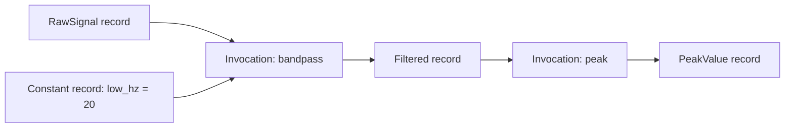

# Lineage & Provenance

<!-- Ground truth (tests win over prose). Verified against:
     scidb/src/scidb/provenance/graph.py (bipartite model; id recipes; idempotent writes);
     scidb/tests/test_provenance_graph.py, test_provenance_identity.py,
       test_provenance_read.py (get_provenance keys; None for a plain save);
     scidb/tests/test_direct_save_graph.py (plain save has no invocation; extra keywords
       make a synthetic __save__ invocation and a distinct variant);
     scicanonicalhash/src/scicanonicalhash/functions.py (AST hash, recursive through user
       callees, ignores comments/docstrings/formatting; installed code is opaque);
     scicanonicalhash/src/scicanonicalhash/hashing.py (canonical_hash);
     scimatlab/src/scimatlab/source_hash.py (MATLAB: SHA-256 of the .m file's raw bytes);
     scidb/src/scidb/inspect/api.py (Inspector.trace/provenance); docs/guide/inspect.md.
     lineage_fcn, LineageFcnResult, extract_lineage, manual() and scihist no longer exist. -->

**Provenance** is the record of how a value was produced: which function ran, which
inputs it read, and which settings it was given. `scidb` writes it every time
`for_each` saves a result, in both Python and MATLAB. Your functions stay plain
functions, with no wrapper or decorator needed for tracking. `scifor` on its own has
no database and records no provenance.

## The graph: records and invocations

Provenance is stored as a graph with two kinds of node:

- A **record** is a saved value, either a variable or a constant.
- An **invocation** is one unique function call: the function plus the exact inputs
  it was bound to.

Edges connect each invocation to the records it read and the records it produced.
Following them backward from any result leads to the data it started from.



Each execution of `for_each` also adds a **run** entry, the audit log of when work
actually happened. Invocations describe what was computed, and runs describe when.

## Identity

Everything in the graph except runs is identified by its content, so re-running an
identical pipeline reproduces the same ids and writes no duplicates:

| Thing | Its id comes from |
|---|---|
| Constant | Its value's content hash |
| Invocation | Function name and hash, run options (`as_table`, `distribute`), and all input bindings |
| Output record | Its type, schema version, content hash, producing invocation, and which output it is |

An input binding names the record that was read, including any column selection.
Change the code, an input, or a constant, and the invocation is a different one. That
is what lets [`skip_computed`](caching.md) and [node states](node-states.md) detect
changes.

Because all of this is in the database, provenance survives between sessions. A
pipeline computed today and extended next week has the same history as one run from
start to finish.

## Two kinds of hash

- **Function hash.** In Python, this is a hash of the function's parsed source.
  Comments, docstrings, and formatting don't affect it. It includes the user-written
  functions it calls, so editing a helper changes its callers' hashes too. Installed
  packages and the standard library aren't followed. In MATLAB, it's a hash of the
  `.m` file's raw bytes, so any edit to the file changes it, including a comment.
- **Content hash** (`canonical_hash`). This is a hash of a value. Lists keep their
  order, and dict key order is ignored. Arrays hash by content, data type, and shape,
  so `int32` and `int64` versions of the same numbers differ. DataFrames ignore column
  order and the index.

See [Internals: scicanonicalhash](../internals/scicanonicalhash.md) for the details.

## Reading provenance

Ask where one result came from:

/// tab | Python
```python
prov = db.get_provenance(Filtered, subject=1, session="A")
prov["function_name"]  # "bandpass"
prov["function_hash"]
prov["inputs"]         # the variable records it read
prov["constants"]      # {"low_hz": 20}
```
///

/// tab | MATLAB
```matlab
p = Filtered().provenance(subject=1, session="A");
disp(p.function_name)  % bandpass
disp(p.inputs)         % the variable records it read
disp(p.constants)      % low_hz = 20
```
///

To follow the whole history back to the raw data, use the
[`scidb` command](../guide/inspect.md) from a terminal:

```bash
scidb trace Filtered subject=1 session=A
```

The same query is available in Python through `Inspector`, which can also trace a
specific variant:

```python
from scidb.inspect import Inspector

insp = Inspector.open("experiment.duckdb")
tree = insp.trace("Filtered", subject=1, session="A")
```

## Values you save yourself

A value saved directly rather than through `for_each` depends on what you pass:

- **Only schema keys.** `Raw.save(data, subject=1, trial="A")` has no producing
  invocation, so it's the start of a history and `get_provenance` returns `None`.
- **Extra keywords.** `Raw.save(data, subject=1, trial="A", correction="outlier_removal")`
  records the keyword as a constant on a synthetic `__save__` invocation, and the
  value becomes its own variant. Use this to label a hand-corrected value so that it
  stays distinct from the original.

**Next:** [Skipping Computed Work](caching.md) · [Node States](node-states.md) ·
[Variables & Storage](variables.md) ·
[Inspecting a Database](../guide/inspect.md)
