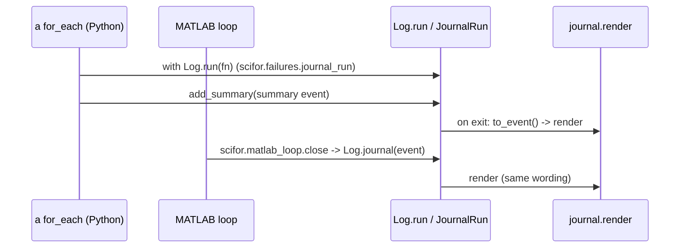
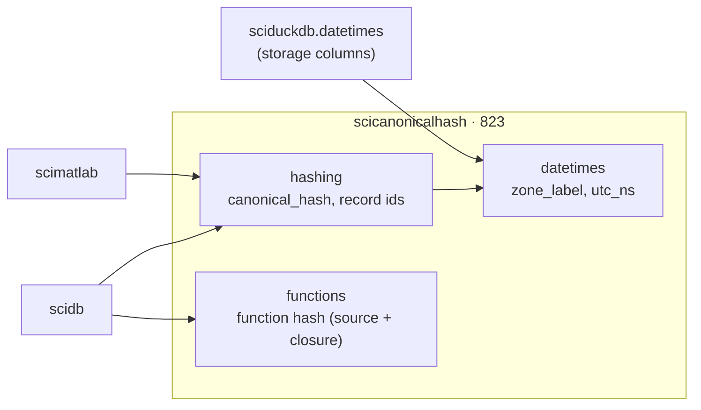

# 01 — Foundations: scistacklog, scicanonicalhash

Two leaf packages with no scistack dependencies. The first review also
covered scilineage and scipathgen; both are gone (D4, D1).

| Package | Source | Tests | Before |
|---|---:|---:|---:|
| scistacklog | 1,167 | 796 | 1,168 |
| scicanonicalhash | 823 | 1,106 | 567 |
| ~~scilineage~~ | — | — | 283 |
| ~~scipathgen~~ (`path-gen/`) | — | — | 107 |

---

## scistacklog

**Job.** The one logging facade (`Log`) and the scientist's journal. Every
layer logs through `Log.debug/info/warn/error(..., layer=...)`; a run is one
`with Log.run(name)` block, written to the journal file on exit.

**Shape.** `__init__.py` (871 lines: `Log`, `LAYERS`, the run context, the
formatter, the sinks) and `journal.py` (296: renders run events, owns the
blame wording). Public surface: `Log`, `LAYERS`, `debug_path_for`
(`__all__`).

**Flow: a run's journal block.**

*Python runs write through the context manager; MATLAB runs write one event
at the end (`matlab_loop.close`). Before P5 stage 3 MATLAB built the event
itself in `write_journal` and sent it through `Log.journal_json`; now Python
builds it, and `journal_json` has no caller left outside
`test_journal.py::test_journal_json_reads_matlab_events` (F13).*

**Contract.** Imported by every package (edges: scistackplot 37, scifor 18,
scistackstats 12, scidb 11, scistackplotdb 9, scistackstatsdb 3, scimatlab 1,
GUI 1). Only `Log` and `LAYERS` are used from outside; the journal is
reached only through `Log`.

**Assessment.**
- Sound. Only scistacklog reads the journal path
  (`test_only_scistacklog_reads_the_journal_path`), one owner of
  the blame wording (`journal.blame_headline`, used by `FailureGroup.to_dict`
  in Python and by MATLAB through Python).
- The README's layer list is tested against `LAYERS` (first review's one
  finding, done).
- `__init__.py` at 871 lines holds four classes and the facade. It reads
  top to bottom and nothing needs to change, but a split
  (`facade` / `run` / `sinks`) would make the run context, the part other
  packages lean on, easier to find. Low priority; not given an F id.

---

## scicanonicalhash

**Job.** The identity primitives: `canonical_hash` of a value,
`compute_function_hash` of a function's source (moved in from scilineage),
`generate_record_id`, and the datetime rules identity depends on
(`zone_label`, `utc_ns`, `is_missing_datetime`).

**Shape.** `hashing.py` 345, `functions.py` 249 (from scilineage),
`datetimes.py` 184, `__init__.py` 45. Ten names in `__all__`.

**Contract.** scidb (9 edges), scimatlab (5), sciduckdb (2, datetimes),
the GUI and scistackplot (1 each). The function hash is checked by
behaviour tests only (`tests/test_function_hash.py`): a pinned value cannot
hold across Python versions, because `ast.dump`'s text changes in 3.12
and 3.13.

**Assessment.**
- The merge of scilineage (D4) removed the third `canonical_hash` import
  name and the dead lineage classes. One name, one owner.
- The datetime rules have one owner and two consumers with different jobs:
  sciduckdb's `datetimes.py` (storage columns, tz companions) and
  `scimatlab.bridge.convert` (ticks across the bridge) both call it. That is
  the right shape; the first review had no datetime finding because the
  zone rules were added after it (2026-10-22).
- Nothing to change.

**F13 (small).** Delete `Log.journal_json` and its test: P5 stage 3 removed
its only caller (beta rule: no unused entry points).

---

## Against the first review

| ID | Change | State |
|---|---|---|
| (01, scistacklog) | README layer list tested | done |
| D4 (01) | scilineage merged into `scicanonicalhash.functions` | done |
| (01, scipathgen) | `path-gen/`, `scidb.paths`, `PathGenerator.m` deleted | done |
