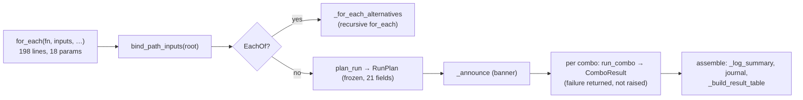
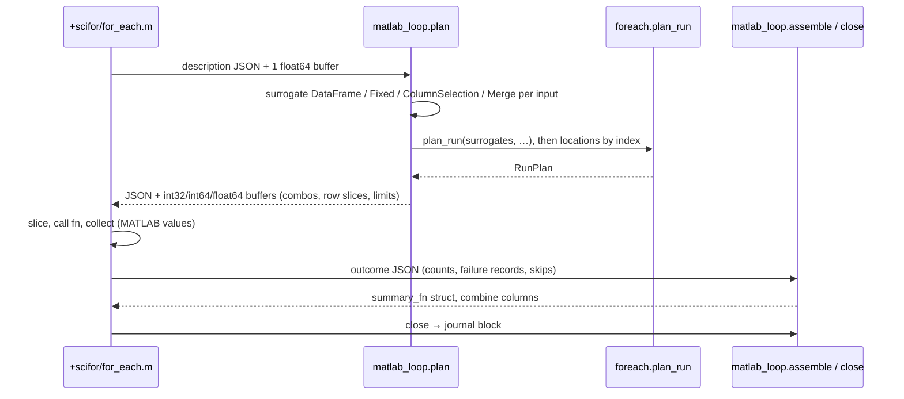

# 02 — scifor

| | Source | Tests | Before |
|---|---:|---:|---:|
| scifor | 13,062 | 10,625 | 9,187 |

**Job.** The pure loop: run a function over every combination of metadata,
over DataFrames, `PathInput` files and constants, with no database. Since
the tidy it also holds two things that are not the loop but must sit below
scidb:

- `scifor.project` — the model-free project runtime (root, machine roots,
  `scistack.toml`, discovery walk, display grammars, the entities-file
  grammar). Moved here from the GUI and scidb in P3 (B3/R3′).
- `scifor.matlab_loop` — the planner and summary for MATLAB's loop (P5
  stage 3). It is in scifor, not scimatlab, because importing scimatlab
  imports scidb, and MATLAB's standalone loop must not need scidb.

## Shape

```mermaid
flowchart TB
    subgraph engine["engine · 8,868"]
        fe["foreach · 3,637<br/>plan_run → run_combo → assemble<br/>+ inputs, merge, discovery, results"]
        ml["matlab_loop · 1,387<br/>plan / assemble / close for MATLAB"]
        pi["pathinput · 1,343"]
        fail["failures · 923<br/>ComboFailure, blame, journal_run"]
        small["options 214 · locations 393 · column_selection 386<br/>combine 419 · outputs 135 · hooks 89 · missing 61 · …"]
    end
    subgraph proj["project · 4,194 (12 modules)"]
        ef["entities_file · 1,316"]
        disc["discovery · 685"]
        cfg["config · config_file · root · machine<br/>aliases · colors · schema_order · names · source_edit"]
    end
    ml --> fe
    fe --> pi & fail & small
    fe --> proj
    pi --> proj
```

*`scifor.project` never imports the engine (`test_import_layers.py`). The
engine imports only `project.root` (the default project root); the package
facade also re-exports `project.discovery`. `matlab_loop` imports 14 private names from `foreach` (`_announce`,
`_log_summary`, `_compute_shared_limits`, …): same package, so allowed, but
it shows the phase interface is wider than `plan_run` / `assemble`.*

## Flows

**Python's loop** (P4 stage 1, R1):

**MATLAB's loop** (P5 stage 3, M3): the same `plan_run` and
`_log_summary`, run on *surrogate* frames.

*No per-row and no per-combo crossing; the only call during the loop is
the time-gated progress line.*

## Contract

| Consumer | What it imports | Edges |
|---|---|---:|
| scidb | the top-level API (43), `pathinput` (11), `project.*` (36), `failures` (5), `column_selection` (5), `schema_types` (4), `foreach` (3: `bind_path_inputs`, `resolve_pathinput_discovery`, `merge_parts`) | 117 |
| scistack-gui | almost only `scifor.project.*` (69 of 89 import lines) | 89 |
| scimatlab | `options`, `failures`, `pathinput`, `foreach.spread_nested_results` | 38 |
| MATLAB (`py.scifor.*`) | `matlab_loop` (5 entries), `pathinput`, `options`, `failures`, `schema_types`, `outputs` | — |

The hooks a layer above drives the loop with are one typed object,
`LoopHooks` (7 fields, R2). The option list is one declaration,
`FOR_EACH_OPTIONS`, which scidb, MATLAB and the GUI's command generator all
read (W3, M4, G5).

## Assessment

**Strengths**
- **The giant function is gone.** `for_each` went from 1,224 lines to 198;
  the run is three named phases over a frozen `RunPlan`. That is what made
  the MATLAB half (M3) possible at all.
- **One planner for two languages.** MATLAB's runs are planned by
  `plan_run` on surrogate frames: combos, `[]` resolution, discovery,
  locations, distribute target, column groups, share_limits grouping and
  the summary have one implementation.
- **Typed boundaries where the first review found loose ones:** `LoopHooks`
  instead of 8 underscore kwargs, `FOR_EACH_OPTIONS` instead of four option
  lists, `ComboFailure` / `FailureGroup` with `to_dict` / `from_dict`.
- `scifor.project` is fenced from the engine by a test.

**Weaknesses**
1. **`foreach.py` is still 3,637 lines, 102 top-level definitions.** The
   phases are named, but plan, per-combo input preparation, Merge, PathInput
   discovery, the result table (spread, distribute, dtype restore) and the
   dry-run printer share one module. The MATLAB planner's 14 private imports
   from it are the symptom: the real interface is "the planning helpers" and
   "the summary helpers", not one function each.
2. **Two row-matching rules in one package.** Python's loop filters with
   raw equality (`_filter_df_for_combo`: `col == value`); MATLAB's planner
   uses MATLAB's rule (`matlab_loop._key_mask`: a numeric column parses a
   text value). Likewise "no schema" means *no filtering* in Python and
   *filter by the iterated keys* in MATLAB (`TestSciforForEachNoSchema`).
   Each is owned once, but the two languages give different answers for the
   same call. Stage 3 kept MATLAB's contracts on purpose (its tests pin
   them); the divergence is now explicit and in one file, where before it
   was spread across two.
3. **`Merge` has three meanings** (F1). Python's loop concatenates
   constituents column-wise and raises on a shared column
   (`foreach.merge_parts`); MATLAB's loop inner-joins on shared columns
   (`merge_two_tables` in `+scifor/for_each.m`); `Merge.to_csv` /
   `csv_export` inner-joins on schema columns. The first review listed two;
   stage 3 made the MATLAB one visible because it is now the only thing in
   that file still deciding something about Merge.
4. **scifor knows about MATLAB.** `MATLAB_ONLY_OPTIONS`,
   `classify_for_each_args`, `frame_origin(extra_library_dirs=)`,
   `pathinput.matlab_error_id`, `matlab_loop`. Each is in scifor only
   because scimatlab cannot be imported without scidb (F12). The rules are
   correct and single-owner; the location is a workaround.

**Refactor candidates**

| # | Change | Removes |
|---|---|---|
| F1 | One `Merge` rule. Decide join-on-shared-columns vs refuse-on-shared-columns, put it in `scifor.merge` (a pure function over frames), make `merge_parts`, `csv_export` and the MATLAB loop call it (MATLAB through a case file: its join runs on MATLAB tables). | weakness 3 |
| F3 | Split `foreach.py` along its phases: `foreach/plan.py` (plan_run + helpers, the names `matlab_loop` imports), `foreach/combo.py` (inputs, Merge, column iteration), `foreach/assemble.py` (summary, result table), `foreach/__init__.py` (`for_each`). Give the shared helpers public names inside the subpackage. | weakness 1 |
| F3b | Record the two cross-language contracts (row matching, no-schema filtering) in a case file read by `scifor/tests` and MATLAB's suite, like `location-filter-cases.json`, so a future change to either is a visible decision. Unifying them is a user decision (MATLAB tests pin the current behaviour). | weakness 2 |

## Against the first review

| ID | Change | State |
|---|---|---|
| R1 | `plan_run` → `run_combo` → `assemble` | done (P4 stage 1) |
| R2 | `LoopHooks` | done |
| R3′ | `scifor.project` (model-free runtime) | done (P3) |
| R4 | `PathInput.bound_to(root)`; root decided once at entry | done (P3) |
| (02) | `Merge` semantics, 2 copies | **open, now 3** (F1) |
