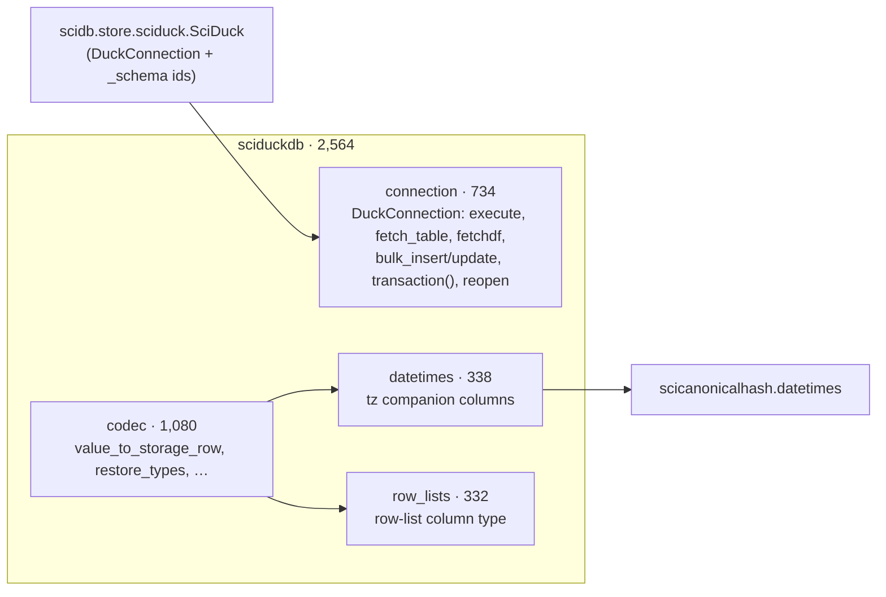

# 03 — sciduckdb

| | Source | Tests | Before |
|---|---:|---:|---:|
| sciduckdb | 2,564 | 1,800 | 3,136 |

**Job.** Two things, both DuckDB-specific and both below scidb:
- the **codec**: Python values ↔ DuckDB storage rows (types, nested lists,
  row lists, datetimes with tz companions);
- the **connection**: `DuckConnection`, a locked, logged DuckDB connection
  with a re-entrant `transaction()` context manager.

It creates no tables (D4): every table of a project database is declared in
`scidb.store.tables` and created by scidb. The first review found a third
job here, a dormant `save`/`load` API; it is deleted (D3).

## Shape

*The split is D1: one module per job. `SciDuck` (schema ids, variables,
groups) moved to `scidb.store.sciduck` and subclasses `DuckConnection`.*

## Contract

`__all__` names 32 symbols. Consumers: scidb (3 import sites: `store.sciduck`,
`store.database`, `inspect.api`) and scistackplotdb (`load.py`: tz columns,
`array_from_storage`, `is_row_list_meta`). No consumer calls an underscore
method of a sciduckdb object any more; the first review counted 153 such
calls (T3).

## Assessment

**Strengths**
- The interface the rest of the stack used privately is now public and
  documented (`execute`, `fetch_table`, `fetchdf`, `bulk_insert`,
  `transaction()`), per D2, and paired actions are context managers (design
  bar 2).
- Smallest it has been (−572 lines) with the dead API gone.
- One function-level import, one swallowing broad `except`.

**Weaknesses**
1. **Bulk Arrow inserts bypass the connection.** `RecordStore.write_batch_rows`
   and `provenance.save` register an Arrow table and insert through the raw
   `duckdb` handle (`duck.con.register` / `duck.con.execute`, 10 sites). They
   run inside the save's `transaction()`, so they are serialized, but they
   skip what every other statement gets: the contention log
   (`_log_contended`) and the autocommit-failure recovery. The connection
   has no method for "insert this frame" — so callers reach past it.
2. `query(sql)` is a one-line alias of `fetchdf(sql)`. Harmless;
   one name would do.

**Refactor candidates**

| # | Change | Removes |
|---|---|---|
| F14 | `DuckConnection.insert_frame(table, frame, conflict=None)` (register, insert, unregister under the lock, with the same logging), and migrate the 10 raw `.con` sites. Drop the `query` alias. | weaknesses 1–2 |

## Against the first review

| ID | Change | State |
|---|---|---|
| D1 | codec / connection / schema split | done (P2 stage 4) |
| D2 | public `DuckConnection` interface + `transaction()` | done |
| D3 | dormant `save`/`load`/`list_versions`/`delete` | deleted |
| D4 | one DDL owner (scidb) | done (P3) |
