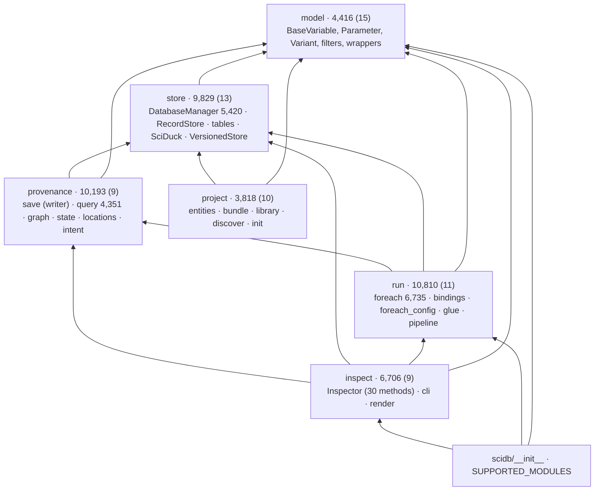
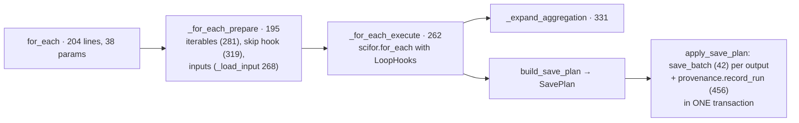
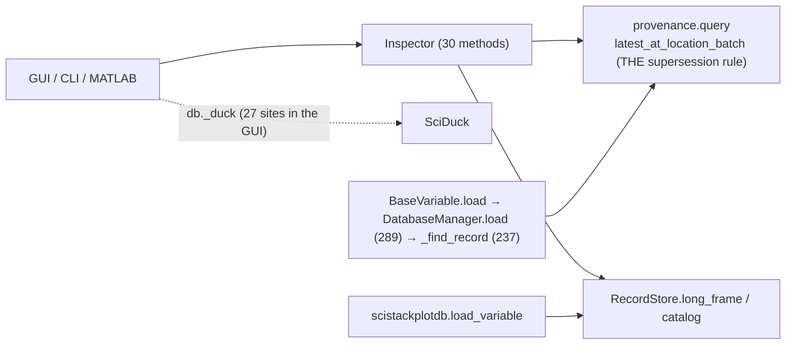

# 04 — scidb (layers, write path, read path)

| | Source | Tests | Before |
|---|---:|---:|---:|
| scidb | 46,798 | 50,604 | 47,870 |

The first review needed three documents for scidb (04a structure, 04b write
path, 04c read path). Most of what they asked for landed, so one document
covers it now.

**Job.** The core: variables and parameters with stable identity; a
DuckDB store of records; a bipartite provenance graph (records ↔
invocations); `for_each` over stored data with skip-computed, variants and
glue; the read side (`Inspector`, CLI); and the model-bound project runtime
(entities, bundles, libraries).

## Shape: six subpackages in a declared order

*(subpackage · lines (modules)). The order model → store → provenance →
[run, project] → inspect is enforced by `scidb/tests/test_import_layers.py`
(`import_layers.toml`), with an allow-list of upward imports that may only
shrink: **35 pairs today**. Edges counted inside scidb (top-level + lazy):
the downward ones dominate, but 7 of the 22 subpackage pairs are upward.*

### The upward edges, by cause

| Upward edge | Import sites (top / lazy) | Allow-listed reason, abbreviated |
|---|---:|---|
| store → provenance | 1 / 22 | `DatabaseManager` pass-throughs to `provenance.query` / `save` / `graph` (B2) |
| provenance → run | 2 / 11 | `run.bindings` (Binding), `run.foreach_config` (CallSite, RunOptions), `run.glue` ids — "bindings belongs below provenance" |
| model → store | 1 / 10 | `BaseVariable.save/load` reach `get_database()` |
| store → run | 1 / 4 | `run.bindings` (variant signature), `run.pipeline` (active pipeline) |
| store → inspect | 0 / 4 | `DatabaseManager` convenience returns an `Inspector` |
| model → run, provenance → inspect, model/store → csv_export | ≤2 each | conveniences |

Two causes cover most of them:
- **Identity types live in `run/`.** `Binding`, `CallSite`, `RunOptions` and
  the glue chain ids are what the provenance graph's id recipes hash. They
  were filed under `run` because `for_each` builds them, but `provenance`
  and `store` need them, so every reader imports upward.
- **`DatabaseManager` is still a facade over everything.** 89 methods (91
  before): it holds the connection and forwards to RecordStore, provenance,
  pipeline and Inspector. `RecordStore` (13 methods) took the save inserts
  and the long-frame reads (B2, PD1), but the pass-throughs stayed.

### Function-level imports grew

`pyscan` counts 524 function-level imports in scidb, against 214 at the
first review; `import_layers.toml` pins its own count at 517. The P4 stage 6
move into subpackages made every import absolute and broke cycles by moving
imports into functions. The fence works: no new cycle can appear without a
test failure. But the cycles were fenced, not removed.

## Flow: `scidb.for_each`

*The phases the first review asked for exist (W2: `SavePlan` →
`apply_save_plan`; W1: data and graph commit together, P0). `_save_results`
(710 lines) and `save_batch` (622) are gone. What is left is a module, not a
function, problem: `run/foreach.py` is 6,735 lines (6,631 before), the
largest Python file in the stack, with prepare, the skip gate, aggregation,
input loading, the save plan and the save in one file.*

`for_each`'s signature has 38 parameters (37 before). `FOR_EACH_OPTIONS`
declares them once (W3), and `RunOptions` / `Selection` bundle them
internally, but the public signature is still flat. That is a deliberate API
choice (keyword arguments for users), so it is noted, not given an F id.

## Flow: reads

*Q1 (one supersession rule) and PD1 (one bulk read) landed. Q2 landed in
part: `RecordStore` has the bulk read, but `DatabaseManager.load` /
`_find_record` are still the per-variable path. Q3 (route GUI reads through
`Inspector`) did not: the GUI still uses the private connection 27 times
(07).*

## Contract

- **Declared surface:** `scidb.SUPPORTED_MODULES` lists 46 modules: 2 public
  (`scidb`, `scidb.inspect`) and 44 "internals consumers import today",
  meant to shrink. Each consumer package has a `test_scidb_boundary.py`
  (GUI, scimatlab, scistackplotdb, scistackstatsdb).
- **Measured use:** the GUI imports 40 distinct scidb modules (40 at the first
  review); scimatlab 55 edges, scistackplotdb 14, scistackstatsdb 1,
  scistack 5.
- The boundary test checks imports. Attribute access to `db._duck` passes
  it.

## Assessment

**Strengths**
- **The one correctness issue is fixed** (T8/W1/P0): a provenance failure
  fails the save, and data + graph commit in one transaction.
- **One owner for the identity-bearing rules:** the supersession rule (Q1),
  the identity table (W4, 13 facts × 4 ids, asserted by a test), the save
  plan (W2), the table registry (D4/G4: every fixed table is a `TableDecl`
  that also says how bundles and `clear_data` treat it).
- **Layers exist and are tested**, where the first review found six
  clusters in a flat namespace with cycles.

**Weaknesses**
1. **Identity types are filed above their readers** (`run.bindings`,
   `run.foreach_config`, `run.glue` ids): the main cause of the provenance →
   run and store → run edges.
2. **`DatabaseManager` was not split** (B2 in part): 89 methods, and the
   reason for most store → provenance/run/inspect edges.
3. **`run/foreach.py` is 6,735 lines.** The phases are functions now, but
   one module holds all of them, plus the save plan.
4. **The connection is the de facto interface.** `._duck` is read at 96
   sites in 14 scidb modules outside `store/`, 27 times by the GUI and 6
   times by scistackplotdb. `SciDuck` is the real API; it is reached through a private
   attribute.
5. **`record_run` is 456 lines, 10 parameters**: the one write-path giant
   left (`_commit_graph`, 224 lines / 16 params, is its second half).
6. **Ambient pipeline registration** (B5): `db.pipeline(name)` still
   activates an ambient registration target that `for_each` reads.

**Refactor candidates**

| # | Change | Removes |
|---|---|---|
| F4 | An `identity` layer between `store` and `provenance` (or under `model`): move `Binding`, `CallSite`, `RunOptions`, glue chain ids and the id recipes there. Drop the matching allow-list lines; lower `lazy_baseline` as the function-level imports go back to the top. | weakness 1, most upward edges |
| F5 | Make the connection public: `DatabaseManager.connection` (a documented `SciDuck`) and a store-level helper for the GUI's own tables; migrate the 96 internal, 27 GUI and 6 scistackplotdb `_duck` sites; add an attribute check (`._duck`) to the boundary tests. | weakness 4 |
| F6 | Finish B2: `DatabaseManager` keeps the connection, `save`, `load` and the registries; pass-throughs to provenance / pipeline / Inspector move to their owners' callers. Target: the store → provenance/run/inspect allow-list lines go. | weakness 2 |
| F7 | Split `run/foreach.py` by phase (`prepare`, `skip`, `inputs`, `execute`, `aggregate`, `save_plan`), the same shape as F3 for scifor. Split `record_run` into its graph-building and commit halves over a typed `RunGraph`. | weaknesses 3, 5 |
| F8 | B5: `for_each(..., pipeline=pipe)` / `pipe.for_each(...)` only; remove the ambient target. | weakness 6 |

## Against the first review

| ID | Change | State |
|---|---|---|
| B1 | subpackages + layer test | done (P2, P4 stage 6); cycles fenced, not removed (F4) |
| B2 | split `DatabaseManager` | **in part**: `RecordStore`, `VersionedStore`; 89 methods remain (F6) |
| B3 | project runtime split by dependency | done (P3) |
| B4 | declared public API + boundary tests | done; the internal list is 44 modules |
| B5 | no ambient registration | **open** (F8) |
| B6 | stale shims and docs | done |
| W1 | provenance failure fails the save; one transaction | done (P0) |
| W2 | `SavePlan` → apply | done |
| W3 | one option declaration | done |
| W4 | identity table | done |
| W5 | "version keys" → "call-site keys" | done |
| Q1 | one supersession rule | done |
| Q2 | `RecordStore` read half | **in part** (bulk read only) |
| Q3 | GUI reads through `Inspector` | **open** (F5, 07) |
| Q4 | docstrings | done |
