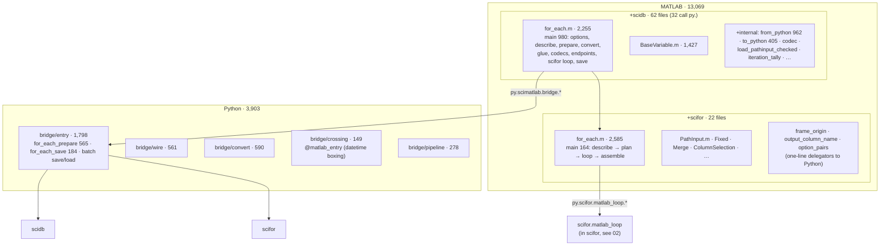
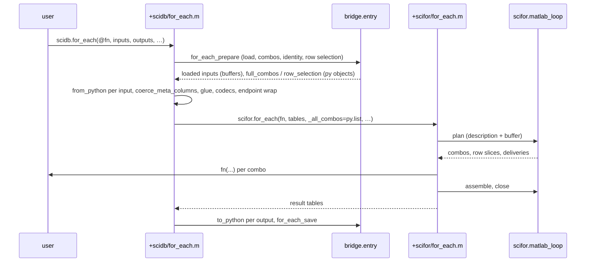

# 05 — scimatlab (Python bridge + MATLAB)

| | Python | MATLAB | Tests (Py / MATLAB) | Before (Py / MATLAB) |
|---|---:|---:|---:|---:|
| scimatlab | 3,903 | 13,069 | 5,250 / 15,900 | 3,501 / 14,884 |

The first review's 05 also covered scihist and scidb-net; both are deleted
(H1, N1).

**Job.** The whole stack from MATLAB: MATLAB classes and functions with the
Python API's names (`scidb.BaseVariable`, `scidb.for_each`,
`scifor.PathInput`, …), and the Python bridge they call through MATLAB's
in-process `py.` interface. The user's function runs in MATLAB; identity,
saving, provenance and now the loop's plan and summary run in Python.

## Shape

*`scimatlab.bridge` is a package with one job per module (M2). MATLAB's
standalone loop calls `scifor.matlab_loop`, not the bridge, because
importing anything under `scimatlab` imports scidb (`scimatlab/__init__` →
`bridge/__init__` → `entry` → scidb).*

## Flow: a MATLAB `scidb.for_each`

*Crossings per run: prepare, plan, assemble, close, save, plus one
`from_python` / `to_python` per input / output (one buffer per numeric
column). Since stage 3 the combos, row selections and PathOutput paths never
become MATLAB values.*

## Shared vs mirrored, now

| Concept | Owner | MATLAB | Kind |
|---|---|---|---|
| prepare, save, provenance, source hash | scidb / `scimatlab.source_hash` | calls the bridge | shared |
| run plan and summary (combos, `[]`, discovery, locations, distribute, groups, limits, paths, banner, summary, journal) | `scifor.matlab_loop` → `scifor.foreach` | describes tables, slices by Python's indices | **shared** (P5 stage 3) |
| `for_each` option names | `scifor.options` | `option_pairs` | shared (stage 2) |
| frame origin, output column name, PathInput error ids | scifor | one-line delegators | shared (stage 1/3) |
| failure record shape | `scifor.failures` | `failure_from_mexception.m` builds it (needs the MException) | shared shape; Python builds the groups |
| `classify_blame` | `scifor.failures` | local function in `failure_from_mexception.m` | **mirrored** |
| missing-value rule (for_columns "no data") | `scifor.missing` | `group_has_no_data` / `all_missing` | **mirrored** |
| `Merge` join | `scifor.foreach.merge_parts` (refuses shared columns) | `merge_two_tables` (inner join on shared columns) | **diverged** (F1) |
| `where=` filter | `scifor.filters` | `ColFilter.apply` on MATLAB tables | mirrored (value operation) |
| PathInput key-type policy | `scidb.run.foreach._load_pathinput_checked` | `+internal/load_pathinput_checked.m` ("MATLAB mirror") | **mirrored** |
| glue application | `scidb.run.glue` | `apply_matlab_glue` / `apply_one_glue` (MATLAB runs the bodies) | mirrored (must run in MATLAB) |
| plot_/stat_ endpoint wrapping | `scidb.run.foreach` wrappers | `plot_endpoint_call` / `stat_endpoint_call` | mirrored (must run in MATLAB) |
| schema-key column types | Python stringifies them in prepare | `coerce_meta_columns` turns them back | **two layers undoing each other** |

## Assessment

**Strengths**
- **The large mirror is gone.** `+scifor/for_each.m`'s main function went
  from 1,331 lines to 164; 37 local functions that re-derived Python's
  decisions are deleted, and a source test
  (`test_matlab_loop_source.py`) keeps them out.
- **Transfer is designed:** one JSON + one buffer in, one JSON + typed
  buffers out; selections cross as one index vector. The scidb path's
  per-combo conversions of combos, row selections and paths are gone.
- **Every small rule is called, not copied** (M1, M4, PathInput error ids).

**Weaknesses**
1. **`+scidb/for_each.m`'s main function is 980 lines** (1,015 before): the
   half of M3 stage 3 did not reach. It parses options, describes inputs,
   calls prepare, converts every input, restores schema-key types, applies
   glue, decodes codecs, wraps endpoints, runs the scifor loop, converts
   outputs and saves, in one function.
2. **`bridge.entry.for_each_prepare` is 565 lines, 20 parameters** (560 / 19
   before): M2 split the module, not the function.
3. **Rule twins remain** (table above): `classify_blame`, the missing-value
   rule, `load_pathinput_checked`, and the `Merge` join, which now disagrees
   with Python (F1).
4. **Stringify, then un-stringify.** Prepare stringifies schema-key columns
   so pandas filtering matches user strings; MATLAB then casts them back from
   the classes the user passed (`meta_original_classes`). Since stage 3 the
   MATLAB planner compares numeric columns with text values itself
   (`_key_mask`), so the round trip may no longer be needed on this path.
5. **The bridge's import graph forces workarounds** (F12). Because
   `import scimatlab.bridge.crossing` imports scidb, MATLAB scifor cannot
   use the one datetime-crossing owner (`@matlab_entry`) or `ndarray_to_buffer`;
   `scifor.matlab_loop` uses JSON + bytes instead, and several MATLAB-only
   rules live in scifor (02). Two mechanisms guarantee "no datetime crosses
   bare".

**Refactor candidates**

| # | Change | Removes |
|---|---|---|
| F2 | Finish M3 for `+scidb/for_each.m`: split the main function into named phases (`options`, `prepare`, `convert_inputs`, `apply_glue`, `wrap_endpoint`, `run_loop`, `save`), and split `for_each_prepare` the same way over a typed prepare result. | weaknesses 1–2 |
| F9 | Rule twins through case files (the `location-filter-cases.json` pattern): `missing-value-cases.json` (scifor.missing ↔ `all_missing`), `blame-cases.json` (classify_blame ↔ MATLAB), PathInput key-type cases (scidb ↔ `load_pathinput_checked`). The `Merge` join waits on F1. | weakness 3 |
| F10 | Test whether prepare's schema-key stringification is still needed now that the planner owns MATLAB's comparison rule; if not, delete both halves (stringify + `coerce_meta_columns`). | weakness 4 |
| F12 | Make the MATLAB-facing bridge importable without scidb: move `crossing` and `convert` to a scidb-free subpackage (or a `scimatlab_wire` distribution) and make `scimatlab/__init__` lazy-free of `entry`. Then `scifor.matlab_loop` uses `@matlab_entry`, and the MATLAB-only rules can move from scifor to that subpackage. | weakness 5 |

## Against the first review

| ID | Change | State |
|---|---|---|
| M1 | small rules called, not copied | done (P5 stage 1) |
| M2 | `bridge` package | done (module split; `for_each_prepare` unchanged, F2) |
| M3 | Python plans and assembles; MATLAB keeps the per-combo call | **done for `+scifor`** (stage 3, MATLAB suite green); `+scidb` main function untouched (F2); real-pipeline timing comparison pending |
| M4 | option parsing in Python | done (stage 2) |
| M5 | dead MATLAB + Log merge + rename | done |
| H1, N1 | scihist, scidb-net | deleted |
