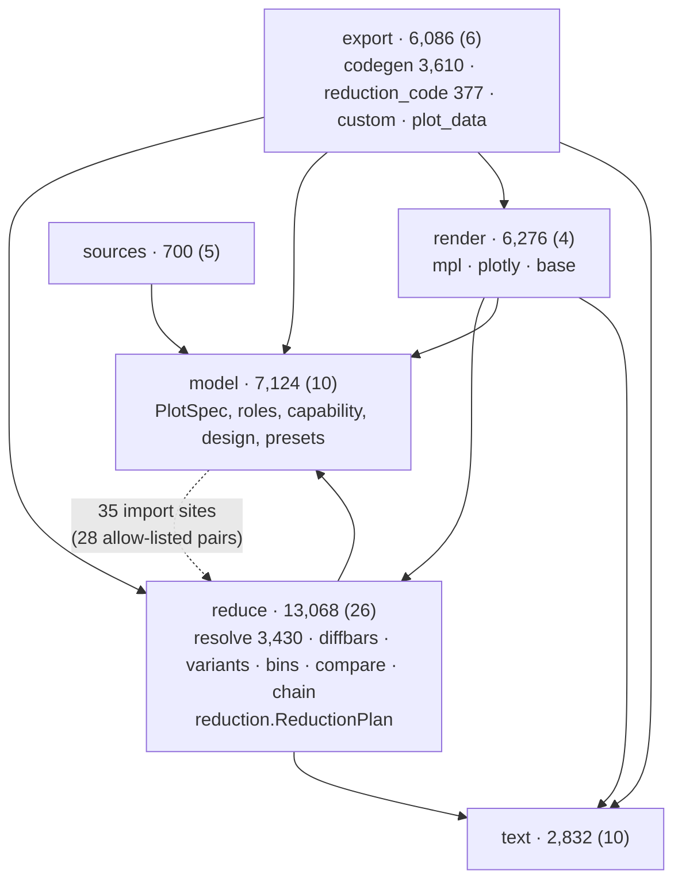
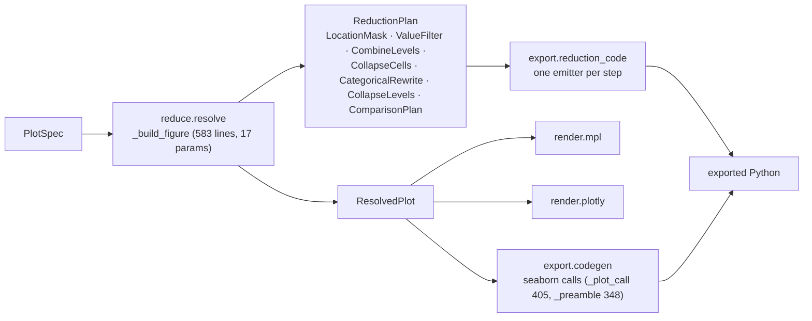

# 06 — Plotting & stats: scistackplot, scistackplotdb, scistackstats, scistackstatsdb

| Package | Source | Tests | Before |
|---|---:|---:|---:|
| scistackplot | 36,550 | 31,701 | 34,180 |
| scistackplotdb | 5,564 | 8,018 | 5,846 |
| scistackstats | 6,015 | 2,254 | 5,866 |
| scistackstatsdb | 407 | 250 | 406 |

csv-stats is in its own repository (D6) and out of scope here.

**Job.** Turn data into figures and statistics from serializable specs:
`PlotSpec` → `reduce.resolve` → `ResolvedPlot` → a renderer (matplotlib,
plotly) or exported code; `StatsSpec` → the stats engine. The `*db`
packages read the data from scidb.

## Shape of scistackplot

*Subpackages since P2 stage 7 (P1), with an import-layer test and a 28-pair
allow-list. The dotted edge is the one cycle: model → reduce has 15
top-level and 20 function-level import sites against reduce → model's 30
and 23.*

The allow-list says why, in its own words:
- "`Comparison` type lives in compare; belongs in model",
  "`DifferenceBar` … belongs in model", "`PanelOverride` … belongs in
  model" (`model.spec`, `model.presets`);
- "role defaults read this feature's own rules" (`model.roles` → 9 reduce
  modules);
- "capability probes this feature to decide which plots are available"
  (`model.capability` → 8 reduce modules and `export.plot_data`).

So each plot feature keeps its spec type and its defaults next to its
reduction rule in `reduce/`, and `model` reaches up to read them.

## Flow: a figure, preview and export

*P2 landed (P5 stage 6): the reduction is defined once, as typed steps that
`reduce` applies and `reduction_code` prints. Moving it fixed
several export-vs-preview bugs (listed in the P5 plan, stage 6). The drawing half of codegen
is a third renderer by design (D5), kept honest by the parity tests.*

## Contract

- scistackplot is imported by the GUI (36 edges), scistackplotdb (40),
  scistackstats (27), scistackstatsdb (1). Its only dependency is
  scistacklog (+1 scicanonicalhash).
- The location-filter cases have one owner,
  `docs/claude/location-filter-cases.json`; scifor, `reduce`, the executed
  codegen mask and the GUI's `locationSelection.ts` all run it (P3). The
  GUI's `groups.ts` mirror runs `ordered-groups-cases.json`, written by a
  Python test.
- scistackplotdb reads scidb through `RecordStore.long_frame` (PD1) and
  stores saved plots / presets / designs through `scidb.store.VersionedStore`
  (PD2).
- One private cross-package import in the whole stack lives here:
  `scistackplotdb.saved` imports `scistackplot.reduce.variants._ordinal_rank`.

## Assessment

**Strengths**
- **Specs, not pictures** remains the best-shaped part of the stack, and
  the reduction now has one statement instead of two.
- **Cross-language cases from one file** (location filter, ordered groups):
  the pattern the rest of the stack should copy (F9).
- The stats engine is small and flat (largest function 126 lines).
- `scistackplotdb` lost its bulk-read twin (PD1) and its private store
  (PD2).

**Weaknesses**
1. **model ↔ reduce cycle.** Feature types and defaults live with the
   reduction rules; `model` imports them (28 allow-listed pairs).
2. **`_build_figure` is 583 lines, 17 parameters** (542 before) and is the
   largest function in the plotting tower. `reduce/resolve.py` is 3,430
   lines (3,230 before). The step types made the *reduction* explicit; the
   figure assembly around it is still one function.
3. **codegen is still 3,610 lines** (3,480 before; the reduction moved out,
   new drawing features moved in). 9 `groupby` calls remain in `codegen.py`
   (14 before) next to `reduction_code.py`'s 7; whether each remaining one is
   drawing (seaborn needs it) or a reduction step not yet migrated is not
   recorded.
4. **One private cross-package import** (`_ordinal_rank`).
5. **The stats packages still have stub READMEs** (6 and 4 lines; S3).

**Refactor candidates**

| # | Change | Removes |
|---|---|---|
| F11 | Move each feature's spec types (`Comparison`, `DifferenceBar`, `PanelOverride`, …) into `model`, and give each feature one "rules" module below both `model` and `reduce` that `roles` and `capability` read. Target: the 28 allow-list pairs. | weakness 1 |
| F11b | Split `_build_figure` into per-figure phases over the plan it already records (`_with_plan_steps` shows the seams), and classify the 9 `groupby` sites in codegen: move any reduction into a step, comment the drawing ones. | weaknesses 2–3 |
| F15 (small) | Promote `_ordinal_rank` (public name in `reduce.variants`, or move it next to the variant ordinal rule); write the two stats READMEs (S3). Elsewhere: `scidb.project.library` opens the entities file with `tomllib` itself in two places; read it through `scifor.project.entities_file`. | weaknesses 4–5 |

## Against the first review

| ID | Change | State |
|---|---|---|
| P1 | subpackages + layer test | done (P2 stage 7); model ↔ reduce fenced, not removed (F11) |
| P2 | codegen prints `reduce`'s plan | done (P5 stage 6) |
| P3 | location-filter cases from one file | done (P5 stage 4) |
| PD1 | one bulk read | done |
| PD2 | `VersionedStore` in scidb | done |
| S1, S2 | csv-stats legacy API, floor | out of scope (D6) |
| S3 | stats READMEs | **open** (F15) |
