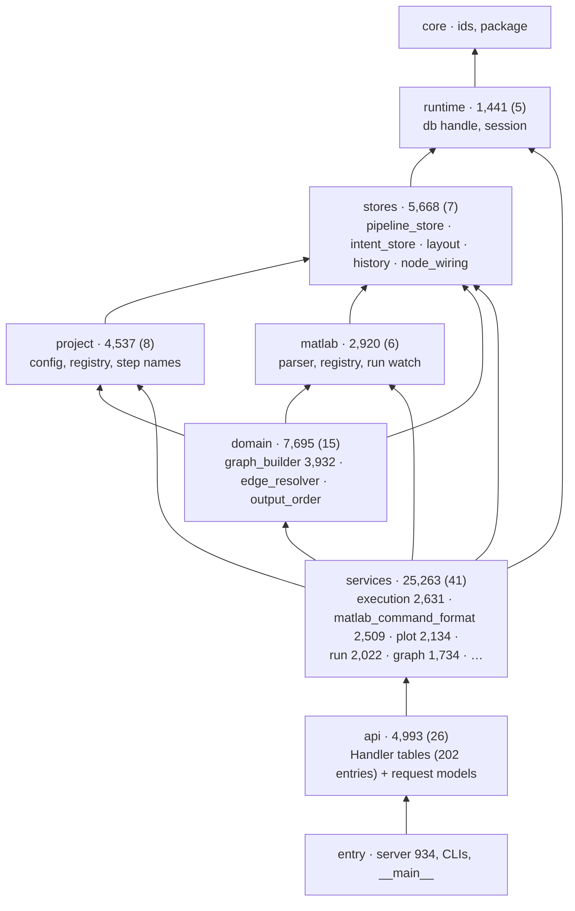

# 07 — GUI: scistack-gui (backend, VS Code extension, frontend)

| | Python | TypeScript | Tests (Py) | Before (Py / TS) |
|---|---:|---:|---:|---:|
| scistack-gui | 55,589 | 47,337 (frontend 41,986, extension 5,351) | 53,967 | 54,355 / 44,130 |

**Job.** The project UI: a pipeline canvas (functions, variables, glue,
edges), run and debug, Plot Studio and Stat Studio, project setup, bundles
and libraries. A Python backend serves 202 RPC handlers to a React frontend
hosted in a VS Code webview (or a browser).

## Shape of the backend

*The order is `scistack-gui/tests/import_layers.toml`; 14 allow-listed
upward pairs. The first review found a 17k-line ungrouped top level and
logic inside `api/`; both are fixed (G1, G2).*

### Most of the imports are function-level

1,378 function-level imports are pinned as the baseline (`pyscan`: 1,386;
1,354 at the first review). Almost all of them go *down* the order, so they
are not hiding cycles: services → stores 167, services → domain 109,
services → project 84, services → runtime 77, api → services 68, services →
matlab 52 (lazy counts). They break design-bar rule 6 (imports at module
top) for no layering reason; the likely cause is import time at server
start-up, which nothing measures.

## Flows

**Building the canvas** — `services/graph_service.build_graph`, **1,069
lines** (it was `api/pipeline._build_graph`, 1,088 lines; G1 moved it
unchanged, as planned). It reads stores, the provenance graph, intent,
layout and the MATLAB registry and emits the node/edge JSON.

**Running** — `services/run_service._run_in_thread`, **771 lines**, 10
params (unchanged since the first review): one function from "user
pressed Run" to the last progress event, for Python and MATLAB.

**MATLAB commands** — `matlab_command_service.generate_matlab_command`
(349 lines) gathers state and calls
`matlab_command_format.generate_matlab_command` (313 lines, **26
parameters**), which iterates `FOR_EACH_OPTIONS` (G5). The same pair
exists for whole pipelines (257 / 237 lines).

## Contract

- **scidb:** 177 edges; 40 distinct scidb modules (40 before), fenced by
  `test_scidb_boundary.py` against `scidb.SUPPORTED_MODULES`. Plus the
  private connection: `db._duck` at 27 sites in 12 modules (26 before):
  stores (layout, history, pipeline_store, intent_store, node_wiring), step
  names, output order, execution, graph, schema-key types, adoption,
  variables, bundles. The boundary test checks imports, not attributes.
- **scifor:** 89 edges, almost all `scifor.project.*` (G3: the config
  *meaning* moved there; no `tomllib` in the GUI).
- **Plot/stats tower:** scistackplot 36, scistackplotdb 23, scistackstats
  25, scistackstatsdb 15.
- **Frontend ↔ backend:** request types are generated
  (`frontend/src/generated/api-types.ts`, 2,107 lines, from the pydantic
  models; G8, P5 stage 5); `callBackend<M>` is typed by method.

## Frontend

| Area | Lines |
|---|---:|
| `components/PlotStudio/` | 19,390 (`PlotStudio.tsx` 6,970; 7,141 before) |
| `components/Sidebar/` | 8,606 |
| `components/DAG/` | 4,955 |
| `components/StatStudio/` | 1,809 |
| `generated/` | 2,107 |

`PlotStudio.tsx` still declares 63 `useState`s (63 before). A spec
reducer exists (`plotSpecReducer.ts`, 150 lines) and is used, so G7 has
started: the spec has one update path; the remaining state is UI state of
the rail groups.

## Assessment

**Strengths**
- **Declared once, generated twice** got stronger: Handler tables make
  both transports and lock policy (first review), and now the TS request and
  spec types are generated too, with a test that the generated file is
  current.
- **Layers exist and are tested**; `api/` is tables and models only.
- **Owners moved out of the GUI:** project config (G3), `_intent` and every
  application table as a `TableDecl` (G4), the option list (G5).

**Weaknesses**
1. **Three giant functions moved, not split:** `build_graph` (1,069),
   `_run_in_thread` (771), `server.main` (358). Between them they hold the
   canvas, the run and the server start-up.
2. **The scidb connection is the GUI's real database API** (27 `db._duck`
   sites). Every GUI store that owns a table reaches it this way.
3. **1,378 function-level imports**, almost all downward: a style debt the
   layer test pins rather than reduces.
4. **26-parameter formatter.** `matlab_command_format.generate_matlab_command`
   takes 26 positional/keyword values instead of a typed command request
   (design bar 4).
5. **PlotStudio.tsx is 6,970 lines** with 63 `useState`s (G7 in part).
6. 118 broad `except` blocks, 11 of which swallow (the most of any package;
   many are top-level RPC boundaries, which the design bar allows when they
   report).

**Refactor candidates**

| # | Change | Removes |
|---|---|---|
| F5 | (from 04) a public `SciDuck` handle and a scidb helper for application tables; the GUI stores use it instead of `db._duck`. | weakness 2 |
| F16 | Split the three giants by phase: `build_graph` → collect (stores, provenance, intent) → build nodes → build edges → layout; `_run_in_thread` → resolve targets → per-language run → report; `server.main` → parse → bootstrap → serve. | weakness 1 |
| F17 | Measure server start-up with imports hoisted (one service at a time); hoist every downward lazy import that costs nothing, and lower `lazy_baseline` with each. | weakness 3 |
| F18 | A frozen `MatlabCommandRequest` built by the service and passed to the formatter (one argument). | weakness 4 |
| F19 | Finish G7: one hook (or small reducer) per rail group; `PlotStudio.tsx` becomes layout + wiring. | weakness 5 |

## Against the first review

| ID | Change | State |
|---|---|---|
| G1 | logic out of `api/` | done (moved; F16 splits it) |
| G2 | homes for the top level | done (`stores/`, `matlab/`, `runtime/`, `project/`, `domain/`) |
| G3 | project-config meaning in `scifor.project` | done |
| G4 | scidb owns `_intent`; app tables declared | done |
| G5 | MATLAB command options from one declaration | done |
| G6 | GUI reads through `Inspector`, no `db._duck` | **open** (F5) |
| G7 | split PlotStudio | **in part** (reducer exists; F19) |
| G8 | generated TS types | done (P5 stage 5) |
| G9 | backend-internals doc | archived |
