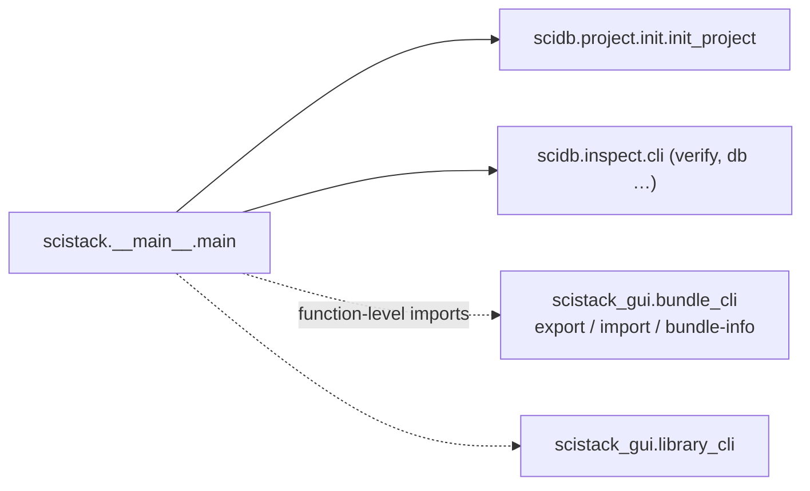

# 08 — scistack (the umbrella CLI)

| | Source | Tests | Before |
|---|---:|---:|---:|
| scistack | 184 | 95 | 542 |

**Job.** The `scistack` command: `init`, `export` / `import` /
`bundle-info`, `library …`, `install`, `verify`, and `db …` as an alias for
the `scidb` CLI. It installs the stack (its dependencies name scistack-db,
scimatlab and scistack-gui).

**Shape.** `__main__.py` (166) and `__init__.py` (18, version only). Every
command is someone else's code:

*The import edges in `tools/audit/out/imports.txt` show scistack → scidb
only: the two GUI imports are inside `main`, after argument dispatch.*

**Contract.** Users run `scistack …`; nothing imports the package.

## Assessment

- **Smaller and honest.** The taps (`scistack.user_config`, D7) and the stray
  root `src/scistack/` are gone (U2, U3).
- **The CLI depends on the GUI package** for bundles and libraries. That is
  the recorded user decision U1: every bundle and library command needs the
  GUI runtime (canvas import, code checks), so moving the parsers down would
  only move the dependency. Not a finding.
- The `db` alias (U4) is in the usage text; nothing else to document.

## Against the first review

| ID | Change | State |
|---|---|---|
| U1 | bundle/library CLIs out of the GUI | declined (user decision, P3) |
| U2 | taps | deleted |
| U3 | stray `src/scistack/` | deleted |
| U4 | `scidb` as the alias for database commands | in the usage text |
