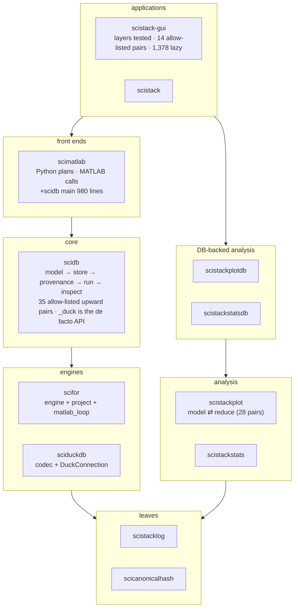

# 09 — Synthesis: what the tidy achieved, what it did not, what to do next

*Inputs: documents 01–08 of this folder, the first review's synthesis
(`docs/design-review/09-synthesis.md`), and the tidy plans P0–P5
(`.claude/plan-tidy-*.md`).*

## The short version

The tidy delivered what the first review asked for **at the level of
owners**: one owner per identity rule, per option list, per reduction, per
table declaration, per run plan across Python and MATLAB, plus tests that
hold each one. It delivered **much less at the level of structure**: the
layers are declared and fenced, but the cycles were moved into function
bodies rather than removed, and most giant functions were moved, not split.

| Theme (first review) | State now |
|---|---|
| T1 Project runtime has no home | **done**: `scifor.project` (model-free) + `scidb.project` (model-bound) |
| T2 Schema has two owners | **done**: scidb owns all DDL; every table is a `TableDecl` that also classifies it for bundles and `clear_data` |
| T3 The real interfaces are private | **done for imports** (2 private cross-package imports left), **open for attributes**: `._duck` at 96 scidb + 27 GUI + 6 plotdb sites (F5) |
| T4 Giant functions | **in part**: the ones on the plans' path are gone (both `for_each`s, `_save_results`, `save_batch`, `_find_record`, MATLAB `+scifor` main); 7 functions > 400 lines remain; the plans moved all seven into new homes (G1, M2, P1, P4 stage 6) and split none |
| T5 Concepts with >1 implementation | **11 of 12 rows resolved**; `Merge` now has 3 meanings (F1); 6 new rows found (below) |
| T6 Layers named, not enforced | **fenced**: scidb, scistackplot and the GUI have layer tests with allow-lists (35, 28, 14 pairs) that may only shrink; function-level imports grew (scidb 214 → 524) |
| T7 Dead code, stale docs | **done**: scidb-net, scihist, scilineage, scipathgen, `SciDuck.save/load`, taps, shims, stale walkthroughs. One new orphan: `Log.journal_json` (F13) |
| T8 Data and provenance in two transactions | **done** (P0): one transaction; a provenance failure fails the save |

## What changed in kind

- **One plan for two languages.** MATLAB's loop is planned by
  `scifor.foreach.plan_run`, run on surrogate frames built from MATLAB's
  description of its tables (`scifor.matlab_loop`). Selections cross as one
  index buffer. This is the first place the stack runs *one* algorithm for
  two runtimes rather than keeping two in step with parity tests.
- **Phases over typed plans:** `RunPlan` (scifor), `SavePlan` (scidb),
  `ReductionPlan` (scistackplot), `LoopHooks`, `FOR_EACH_OPTIONS`. Each
  replaced a giant function or a list kept in several places.
- **Generated, not mirrored:** TS request and spec types from pydantic,
  MATLAB command options from `FOR_EACH_OPTIONS`, the reduction's export
  code from its steps.
- **Cases from one file** for rules that must run natively in two
  languages (`location-filter-cases.json`, `ordered-groups-cases.json`).

## The T5 table, revisited

| Concept | Before | Now |
|---|---|---|
| "latest record" | 3 | 1 (`latest_at_location_batch`) |
| location filter | 4 | 4 implementations, 1 case file |
| `for_each` options | 4 | 1 declaration |
| the per-combo loop | 2 | plan + summary shared; the per-combo call mirrored by necessity |
| a figure | 3 | reduction once; drawing ×3 by design (D5) |
| path template | 3 | 1 |
| bulk load | 2 | 1 |
| **`Merge` semantics** | 2 | **3** (F1) |
| frame origin, output column name | 2 each | 1 each |
| reading `scistack.toml` | 3 | 1 (`scifor.project.config`); the entities file is opened by `scifor.project.entities_file` and twice more by `scidb.project.library` with `tomllib` (parsing goes through the owner, F15) |
| storing a variable | 2 | 1 |
| `canonical_hash` import name | 3 | 1 |
| *new:* missing-value rule | — | `scifor.missing` + MATLAB `all_missing` (F9) |
| *new:* blame classification | — | `scifor.failures.classify_blame` + MATLAB `classify_blame` (F9) |
| *new:* PathInput key-type policy | — | `scidb.run.foreach._load_pathinput_checked` + `load_pathinput_checked.m` (F9) |
| *new:* row matching, "no schema" filtering | — | Python and MATLAB contracts differ, each owned once in scifor (F3b) |
| *new:* schema-key column types | — | prepare stringifies, MATLAB un-stringifies (F10) |
| *new:* "no datetime crosses bare" | — | `@matlab_entry` boxing vs `matlab_loop`'s JSON-only wire (F12) |

The new rows are not regressions: most existed before and were hidden in
the 3,914-line MATLAB loop. Moving its decisions out made them visible.

## Why the structure lagged the owners

Three causes, each with evidence in the package documents:

1. **Types filed with their builder, not their readers.** scidb's identity
   types (`Binding`, `CallSite`, `RunOptions`, glue ids) live in `run/`
   because `for_each` builds them; `provenance` and `store` read them (04).
   scistackplot's feature types live in `reduce/` next to their rules;
   `model` reads them (06). In both packages this one choice accounts for
   most allow-listed edges.
2. **Facades that forward.** `DatabaseManager` (89 methods) forwards to
   provenance, pipeline and Inspector; the GUI and scidb's own subpackages
   use its private connection because no public one exists (04, 07).
3. **"Move, then split" stopped after the move.** G1 moved `build_graph`
   and `_run_in_thread` out of `api/` unchanged; M2 split `bridge.py` into
   modules but left `for_each_prepare`; P4 stage 6 moved scidb into
   subpackages and pushed the resulting cycles into functions. Each move was
   right; the second step was never scheduled.

## Ranked follow-ups

Ordered by how much each removes per unit of work, with correctness and
cross-language divergence first. Size: S < 1 session, M 1–2, L 3+.

| Rank | ID | Change | Size | Needs a user decision? | Doc |
|---:|---|---|---|---|---|
| 1 | F1 | One `Merge` rule for Python's loop, MATLAB's loop and `to_csv` | M | **yes**: join on shared columns, or refuse them | 02 |
| 2 | F5 | Public connection handle; migrate 129 `._duck` sites; attribute check in the boundary tests | M | no | 04, 07 |
| 3 | F4 | scidb `identity` layer below provenance; drop the allow-list lines it explains | M | no | 04 |
| 4 | F12 | scimatlab's MATLAB-facing wire importable without scidb; then `matlab_loop` uses `@matlab_entry`, and MATLAB-only rules leave scifor | M | no | 05, 02 |
| 5 | F9 | Case files for the three MATLAB rule twins (missing, blame, key-type policy) | S each | no | 05 |
| 6 | F10 | Test, then delete, prepare's schema-key stringify + MATLAB's un-stringify | S–M | no | 05 |
| 7 | F2 | Finish M3 on the scidb side: `+scidb/for_each.m` main (980 lines) and `for_each_prepare` (565) by phase | L | no | 05 |
| 8 | F6 | Finish B2: `DatabaseManager` without pass-throughs | L | no | 04 |
| 9 | F7 | Split `scidb/run/foreach.py` (6,735) by phase; `record_run` (456) over a typed run graph | L | no | 04 |
| 10 | F3 / F3b | Split `scifor/foreach.py` (3,637) by phase; record the two Python↔MATLAB contracts in a case file | M / S | F3b: whether to unify | 02 |
| 11 | F11 / F11b | scistackplot feature types into `model`; split `_build_figure` (583); classify codegen's 9 `groupby`s | M / M | no | 06 |
| 12 | F16 / F18 / F19 | GUI giants by phase; typed MATLAB command request; PlotStudio per rail group | L | no | 07 |
| 13 | F17 | Measure GUI start-up, then hoist downward lazy imports | M | yes: a start-up budget | 07 |
| 14 | F8 | No ambient pipeline registration | M | **yes**: a user-facing API change | 04 |
| — | F13, F14, F15 | `journal_json` orphan; `DuckConnection.insert_frame`; `_ordinal_rank` + stats READMEs | S | no | 01, 03, 06 |

Open from P5, not a refactor: one real MATLAB pipeline run with its timing
compared against a pre-change `scistack.log` (stage 3).

### Suggested grouping into plans

- **P6 — owners and seams** (ranks 1–6 + the S items): small to medium,
  mostly independent, each closes a cross-language or private-seam gap. F1
  first (it is the only behavioural divergence), F12 before F9 (F9's MATLAB
  side is easier once the wire is scidb-free).
- **P7 — split the giants** (ranks 7–12): mechanical but large; each split
  is behaviour-preserving and can be checked by the existing suites. Do F4
  before F7 so the split modules import downward from the start.
- **P8 — imports** (rank 13, then lowering every `lazy_baseline` as P6/P7
  remove cycles).

### Critic's pass: which of these are worth doing

*Added the same day at the user's request, as a deliberate second opinion
on the ranking above. The ranking measures structure; this pass asks what
each change buys a user or the next bug fix.*

The bugs this project has actually had (`MEMORY.md`, the fix-like commits in
`tools/audit/out/hotspots.txt`) are overwhelmingly **divergence** bugs: two
owners of one rule drifting apart (latest record, location filter, the
MATLAB mirror, datetimes across the bridge, zero-padded keys). Almost none
are "this function was too long". So a change pays when it removes or pins
a second owner, and rarely when it only moves code or meets a size target.
The tidy's real wins (P0's transaction, Q1, W3/M4, M3, P2, P3) were all of
the first kind.

| Tier | Findings | Why |
|---|---|---|
| **Do** (cheap, removes or pins a divergence) | F9 (case files for the MATLAB rule twins), F3b (write down the Python/MATLAB contract differences as cases), F10 (test first: is the stringify / un-stringify pair still needed?), F14 (10 raw `.con` sites skip the lock's logging and recovery), F13 (dead entry point) | Each targets the bug class this project actually has, at S size. |
| **Decide, then pin with a test** | F1 (`Merge`) | Real, but probably rare: Python only hits it when two constituents share a data-column name. A decision plus a cross-language case test is most of the value; the refactor is optional. |
| **Only when touching the code** | F2, F7, F16, F19, F11b, F18, F3 | Big splits of hot files (`+scidb/for_each.m`, `run/foreach.py`, `build_graph`, PlotStudio). The phases are already functions, so a split mostly helps navigation. Each costs a full test cycle and loses `git blame`. Extract the phase a bug fix touches, not the file. |
| **Not worth it now** | F4, F5, F6, F8, F11, F12, F17, F15 (beyond the READMEs) | They improve the metrics, not the behaviour. F5 renames a private attribute to a public one; the calls behind it are already locked. F4, F11 and F17 lower allow-list and lazy-import counts that cause no runtime problem. F6 and F8 are large API surgery with no recorded bug behind them. F12 removes a workaround that is safe as it is (JSON + bytes cannot carry a bare datetime). |

What this review measures badly, and what would measure value instead:
fix-commit rate per area over time, test-suite runtime, real run timings
(the stage-3 MATLAB pipeline comparison is still open and matters more than
any F item), and how often the GUI shows "probable" failures
(`[seam_fallback]` warnings in `scistack.log`).

## Target layering vs actual

*Between packages the layering matches the first review's target. Inside the
three large packages it is declared and tested, with known exceptions
listed one per line. Each line in an allow-list is a follow-up with a
written reason, which is the property the first review asked for.*

## Method notes

- "Before" numbers are `pyscan.js` on `git archive dd91f8da`; "now" is
  `tools/audit/run.sh` on the working tree (including uncommitted P5
  stage 3). The first review's own numbers were taken at slightly different
  points and with other counters (e.g. scidb lazy imports 569 there, 214 by
  `pyscan` on the same commit); this folder compares like with like.
- MATLAB function lengths come from an `awk` scan for `function` … `end` at
  column 0 (the files' convention); `pyscan` does not read MATLAB.
- Counts of `._duck`, imports by module and allow-list pairs are `grep`s;
  the commands are in the text of each document.
