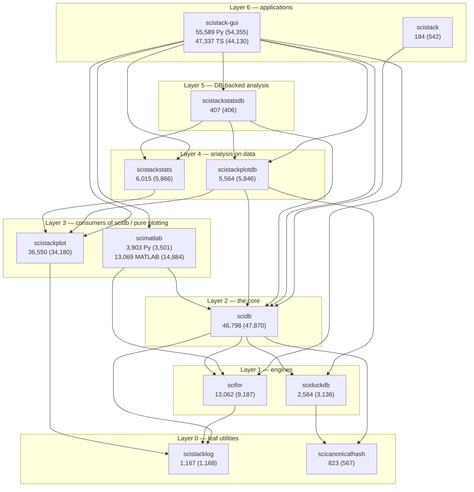

# Design review, after the tidy — the architecture we ended up with

*Written 2026-11-02 against `main` @ `8873ddc1` plus the uncommitted P5
stage 3 work (MATLAB loop planned by Python). The first review
(`docs/design-review/`) was taken at `dd91f8da`. Every number here is
measured, by the same tools on both trees, so the two can be compared:*

- *`tools/audit/run.sh` (sizes, function lengths, imports, broad excepts,
  duplicate names) on today's tree;*
- *`tools/audit/pyscan.js` on `git archive dd91f8da` for the "before"
  column;*
- *`grep -c` / `wc -l` for the rest, with the command in the text where it
  is not obvious.*

*`pyscan.js` is indent-based, not a parser: function lengths are
approximate, and its lazy-import count is not the count the
`import_layers.toml` baselines pin (those use `tools/import_layers.py`).
Both are given where they differ.*

## What this folder is

The same inventory as `docs/design-review/`, redone after plans P0–P5
(`.claude/plan-tidy-00-index.md`). Each package document answers the same
five questions (Job, Shape, Flows, Contract, Assessment) and adds a sixth:

6. **Against the first review** — which refactor IDs (R, D, B, W, Q, M, P,
   PD, S, G, U) landed, which landed in part, which did not, and what the
   change exposed that the first review could not see.

New findings get new IDs prefixed **F** (for "follow-up"), numbered across
the folder and collected in [09-synthesis](09-synthesis.md).

## Reading order

| # | Document | Packages |
|---|---|---|
| 01 | [Foundations](01-foundations.md) | scistacklog, scicanonicalhash |
| 02 | [scifor](02-scifor.md) | scifor (engine + `scifor.project` + `scifor.matlab_loop`) |
| 03 | [sciduckdb](03-sciduckdb.md) | sciduckdb |
| 04 | [scidb](04-scidb.md) | scidb (layers, write path, read path) |
| 05 | [scimatlab](05-scimatlab.md) | scimatlab (Python bridge + MATLAB) |
| 06 | [Plotting & stats](06-plot-and-stats.md) | scistackplot, scistackplotdb, scistackstats, scistackstatsdb |
| 07 | [GUI](07-gui.md) | scistack-gui (backend, extension, frontend) |
| 08 | [Umbrella](08-scistack-umbrella.md) | scistack |
| 09 | [Synthesis](09-synthesis.md) | what the tidy achieved, what it did not, ranked follow-ups |

Gone since the first review: **scidb-net**, **scihist**, **scilineage**,
**scipathgen** (`path-gen/`) and the stray `src/scistack/`. csv-stats lives
in its own repository and is out of scope (D6).

## The whole stack on one page

Box numbers are non-test source lines today (first review in brackets).
`A --> B`: A imports B (`imports.txt`, edge counts in 09). Nothing imports a
band above it; that was already true and is now tested per package.

*scifor grew by 3,875 lines because the model-free project runtime
(`scifor.project`, 4,194 lines) and the MATLAB planner
(`scifor.matlab_loop`, 1,387) moved in. Both are moves, not new features:
the GUI's config reader and scimatlab's for_each mirror shrank by
about the same amount.*

## Scoreboard (first review -> now)

| Measure | Before | Now | Note |
|---|---:|---:|---|
| Installable packages | 16 | 12 | four deleted (T7) |
| Functions > 400 lines (Python) | 11 | 7 | gone: both `for_each`s, `_save_results`, `save_batch`, `_find_record`; new: codegen `_plot_call` (405) |
| Functions > 200 / > 100 lines | 49 / 191 | 44 / 186 | the long tail barely moved |
| Broad `except` blocks / swallowing | 268 / 32 | 253 / 25 | |
| Function-level imports (pyscan) | 1,873 | 2,234 | scidb 214 -> 524: the subpackage split moved cycles into functions (F4) |
| Private cross-package imports | many (153 sciduckdb underscore calls alone) | 2 | T3 closed for imports |
| `db._duck` in the GUI | 26 | 27 | T3 still open for attributes (F5) |
| scidb modules the GUI imports | 40 | 40 | fenced by a test, not reduced |
| Concepts with >1 implementation (T5 table) | 12 rows | 11 resolved, 1 open (`Merge`, now 3 copies), 6 new rows | see 09 |
| MATLAB `+scifor/for_each.m` main function | 1,331 lines | 164 | P5 stage 3 |
| MATLAB `+scidb/for_each.m` main function | 1,015 lines | 980 | untouched (F2) |
