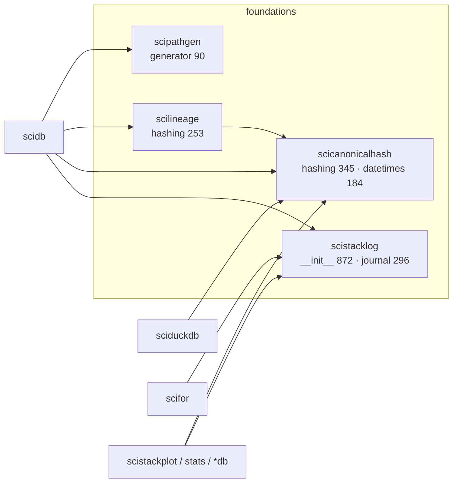
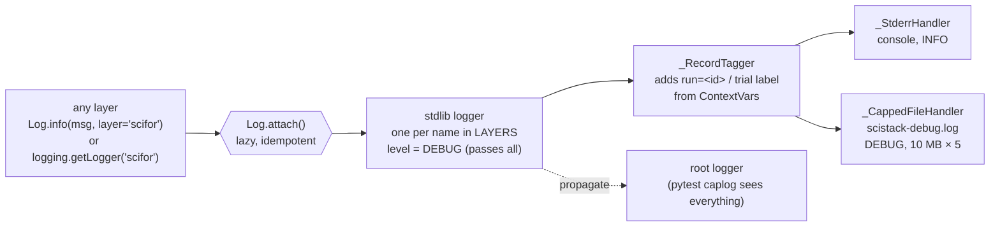
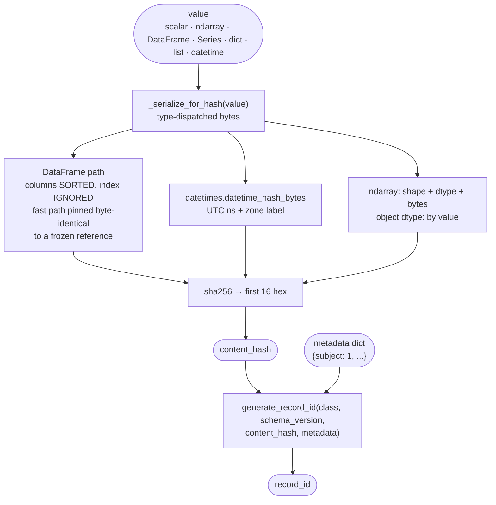
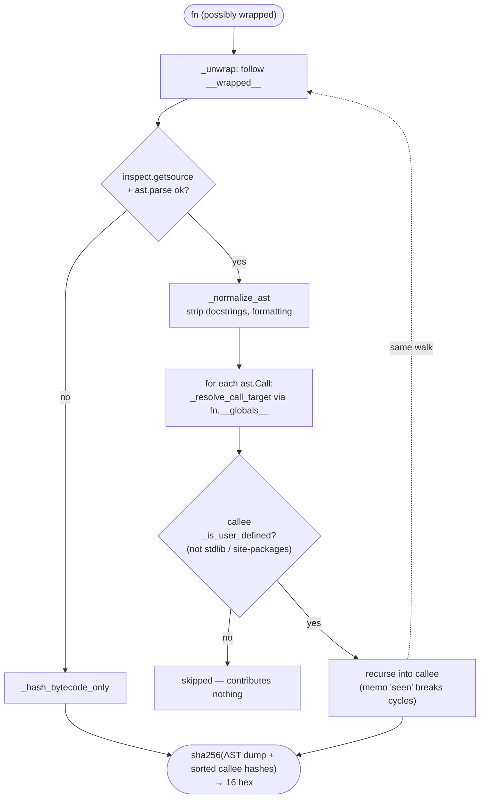

# 01 — Foundations: scistacklog, scicanonicalhash, scipathgen, scilineage

These four packages have no SciStack dependencies except on each other
(scilineage → scicanonicalhash). Together they are 2,125 lines. They matter
less for their size than for the two identities they define, which every
layer above relies on:

- **content identity** — `scicanonicalhash.canonical_hash(value)` and
  `generate_record_id(...)`: what makes two saved values "the same record";
- **code identity** — `scilineage.compute_function_hash(fn)`: what makes two
  runs "the same function".



_Module map. Arrows are imports. scistacklog is the only foundation package
used by both towers (data and plot/stats); scicanonicalhash is used by both
through different entry points (record identity in scidb/sciduckdb, datetime
zone labels in scistackplot)._

---

## scistacklog

**Job.** The one logging facade for every layer, Python and MATLAB. It turns
one stream of `logging` records into three sinks with three audiences, and owns
the per-run "journal" a scientist reads.

**Shape.** Two modules. `__init__.py` (872 lines) holds the `Log` classmethod
facade, the handlers, the timer, and `JournalRun`. `journal.py` (296 lines) is a
pure renderer: event dict → text block. Configuration is class-level state on
`Log` (`_path`, `_journal_path`, sink levels), guarded by an `RLock`.

### Flow: one log call, three sinks



_Filtering happens only on the handlers, never on the loggers, so a test's
`caplog` always sees every record. The `run=<id>` tag comes from a
`ContextVar` set by `Log.run`, which is how a line in the debug file is
matched to its journal block._

### Flow: the run journal

```mermaid
sequenceDiagram
    participant S as scifor.for_each<br/>(@journaled entry)
    participant J as failures.journal_run
    participant L as Log.run (ContextVar _RUN)
    participant R as JournalRun
    participant W as journal.render
    participant F as scistack.log

    S->>J: enter (fn name)
    J->>L: with Log.run(name)
    L->>R: create (only if outermost)
    Note over S,R: loop runs; failures, counts accrue
    S->>R: add_summary(summary event)
    S->>R: count("saved", n)  [scidb]
    L->>R: to_event() on exit
    L->>W: render(event)
    W->>F: append one block
    L->>L: same block → debug file as one [journal] record
```

_Only the **outermost** `Log.run` writes a block, so a scidb pipeline that runs
several `for_each` calls produces one journal entry per outer run, not one per
call. The failure "who can fix it" wording (`blame_headline`) lives here, but
the decision of blame lives in `scifor.failures.classify_blame` — the renderer
only phrases it._

### Contract (measured)

`Log` is the only symbol most callers use. 83 non-test files across 7
packages import it. The MATLAB `+scidb/Log.m` reaches it through a re-export
shim in `scidb.log`, which freezes the numeric level scale and call shapes.

### Assessment

**Strengths**

- One emit stream, sinks chosen by audience. The journal/debug split is a
  clear design idea and is documented with examples in the README.
- Lazy attach: importing it has no side effects.
- `Log.timer(live=True)` gives long operations a running narrative instead of
  only a post-mortem; this is reused across the GUI and scidb.

**Weaknesses**

- **Global mutable class state.** Paths and levels are class attributes on
  `Log`. Two databases in one process (the GUI's multi-session work) share one
  journal path; the last `set_path` wins. This is fine while one process
  serves one project, and becomes a constraint if that changes.
- **README drift.** The README lists 8 layers; `LAYERS` holds 12 (the plot and
  stats packages were added). Small, but it is the kind of second copy that
  CLAUDE.md note 4 warns about.
- The journal's run boundary is opened in **scifor** (`journal_run`), the
  counts are added in **scidb**, and the rendering is here. The ownership is
  correct (each layer adds what it knows) but there is no single place that
  documents which layer opens the run for a GUI run versus a script run.

**Refactor candidates:** none structural. Update the README's layer list from
`LAYERS` (or have a test assert they match).

> **Done (2026-11-01, e129c3bf):** README lists `LAYERS` exactly; `test_readme_lists_exactly_the_declared_layers` asserts it.

---

## scicanonicalhash

**Job.** Deterministic 16-hex-character hashes of values, and the record id
recipe built from them. This is the definition of "same content".

**Shape.** `hashing.py` (345): `canonical_hash`, `_serialize_for_hash`, and
`generate_record_id`. `datetimes.py` (184): the one spelling of a datetime
(UTC instant + zone label) shared by the hash and by sciduckdb storage.

### Flow: value → record id



_The record id is `sha256("class:…|schema:…|content:…|meta:<hash of metadata>")`.
Because the DataFrame serializer ignores column order and index, the same data
arriving via MATLAB or a different pandas path hashes identically. A
byte-identity test (`tests/test_hash_byte_identity.py`) pins the fast path to
a frozen copy of the old serializer, because any change here silently
changes every record id._

### Assessment

**Strengths**

- Small, dependency-free, and has the right kind of test (byte identity, not
  just "equal inputs give equal outputs").
- One datetime spelling shared by hash and storage — a good example of the
  one-owner rule in practice.

**Weaknesses**

- **Two import paths for one function.** `scilineage` re-exports
  `canonical_hash` (`from scilineage import canonical_hash`). Today it is the
  same object, so nothing can diverge, but it is a second name for a concept
  this package owns.
- `generate_record_id` lives here, but the decision of _what goes into_
  `metadata` (which schema keys, which spelling) is made in scidb. The recipe
  is split across two packages; that is reasonable, but worth naming in the
  scidb review.

**Refactor candidates:** drop the scilineage re-export.

> **Done (2026-11-01, e129c3bf):** scilineage is gone; the function hash lives in `scicanonicalhash.functions`.

---

## scipathgen

**Job.** `PathGenerator(template, root, **values)` — the cartesian product of
metadata values rendered into file paths.

**Shape.** One 90-line class, one consumer: `scidb/paths.py`, a 9-line
re-export. Nothing else in the repo (scidb, GUI, scimatlab) constructs a
`PathGenerator`.

### Assessment

The live path-template concept is **`scifor.PathInput`** (1,370 lines:
discovery, regex keys, zero-padding, aliases, machine roots). `PathGenerator`
is an earlier, simpler version of the same idea that nothing in the pipeline
uses. Two owners of "a path template filled from metadata" is exactly the
divergence CLAUDE.md note 4 describes, even if one of them is dormant.

**Refactor candidate:** mark `PathGenerator` hidden (per the "never delete,
mark hidden" rule) or re-express it as a thin wrapper over `PathInput`, so one
template grammar exists.

User's note: If `PathGenerator` is 100% obsolete and unreferenced elsewhere in the code, it should be deleted.

> **Done (2026-11-01, e129c3bf):** `path-gen/`, `scidb.paths`, `PathGenerator.m` and its MATLAB test deleted.

> **Answer (2026-11-01).** Checked across the whole repo. It is obsolete, but there
> are **two** of them, not one:
>
> - **Python `scipathgen.PathGenerator`.** Unused in code. Its one importer,
>   `scidb/paths.py`, is a 9-line re-export that nothing imports, and
>   `scidb/__init__.py` does not export it. The one script that calls it,
>   `examples/_archive/aim2/main.py` (`from scidb import PathGenerator`), is
>   archived and already fails. What is left is packaging and docs: the `scidb`
>   dependency and `override-versions-of` entry, `dev-install.sh`, three CI
>   files (`ci.yml`, `publish.yml`, `test-shards.sh`),
>   `test_version_single_owner.py`, 21 test files that do
>   `sys.path.insert(... "path-gen" ...)`, `scimatlab/setup.md`,
>   `setup_paths.m`, and about 8 user docs (`internals/scipathgen.md`,
>   `internals/index.md`, `concepts/architecture.md`, glossary, contributing,
>   installation, and two `docs/claude` files).
> - **MATLAB `scidb.PathGenerator`** (`+scidb/PathGenerator.m`, 218 lines).
>   It is a separate pure-MATLAB copy that never calls Python. Only its own
>   test, `TestPathGenerator.m`, uses it. It is a third owner of the same idea.
>
> Recommendation: delete both, in one commit, along with the references
> listed above. Releases already published to PyPI stay where they are.
> Status: waiting for your go-ahead.

---

## scilineage

**Job (today).** Function identity: `compute_function_hash(fn)` — an AST-based
hash of a function **and every user-defined function it transitively calls**,
so editing a helper changes its callers' hash. `compute_function_hash_with_sources`
returns the same hash plus the source closure, by the same walk.

### Flow: function → hash



_External callees contribute nothing on purpose: upgrading numpy does not
change your function's identity. A function whose source cannot be read (the
MATLAB in-process Python case, lambdas defined at a prompt) falls back to a
bytecode hash._

### Contract (measured)

scidb uses it in 3 places: `foreach_config.py` (module import),
`foreach.py:1561` and `glue.py:230` (both function-local imports).

### Assessment

**Strengths**

- The recursive closure hash is a genuinely good identity rule and the
  `_with_sources` variant guarantees the stored source matches the hash.

**Weaknesses**

- **The package name and README describe a package that no longer exists.**
  The README documents `@lineage_fcn`, `LineageFcnResult`, multi-output
  unpacking and caching; `__init__.py` says all of that was removed in favour
  of scidb's provenance graph. What remains is "function hashing".
- **`scidb-net` imports the removed API.** `scidbnet/client.py:148` imports
  `LineageFcnResult, extract_lineage, get_raw_value`; `server.py:22` imports
  `scilineage.lineage.LineageRecord`; `__init__.py:48` imports
  `configure_backend`. None of these exist, so `scidb-net` cannot import. It
  is reviewed in document 05.
- 253 lines in their own installable package with their own release, for one
  function.

**Refactor candidates**

- Rename/re-scope: either fold `compute_function_hash` into
  `scicanonicalhash` (one package that owns _all_ identity hashing: values and
  code), or keep scilineage but rewrite its README to "function identity".
- Decide scidb-net's fate (document 05) before touching scilineage, since it is
  the only consumer of the removed names.

> **Done (2026-11-01, e129c3bf):** merged into `scicanonicalhash.functions` (D4); scilineage deleted. Hash pinned by `test_function_hash_unchanged_by_move`.

---

## Foundations — summary

|                  | Strength                                    | Main weakness                                                               | Candidate                              |
| ---------------- | ------------------------------------------- | --------------------------------------------------------------------------- | -------------------------------------- |
| scistacklog      | clear sink-by-audience design               | global class state; README layer list drifted                               | test `LAYERS` vs README                |
| scicanonicalhash | byte-identity tested; one datetime spelling | re-exported under a second name                                             | drop re-export                         |
| scipathgen       | trivial, correct                            | a dormant second owner of path templates                                    | hide or wrap `PathInput`               |
| scilineage       | good recursive function identity            | name/README describe a removed system; scidb-net depends on the removed API | merge into hash package or re-document |
