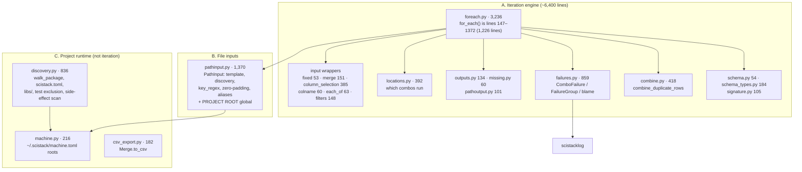
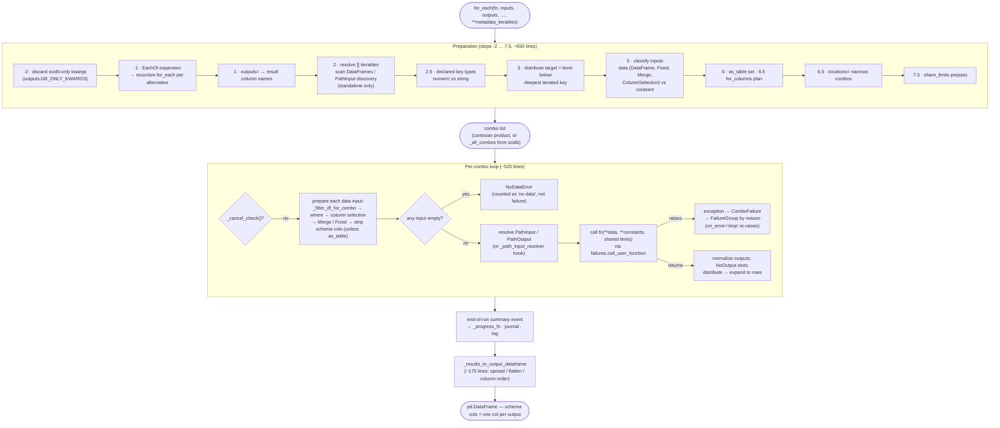
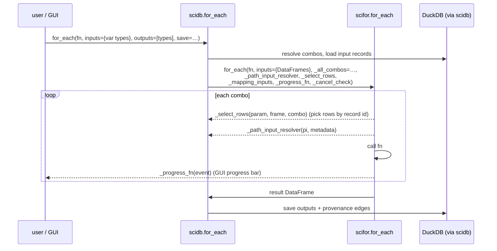

# 02 — scifor: the iteration engine

**Job.** Run a function once per combination of schema-key values
(subject × session × …), slicing each table input down to that combination's
rows, and collect every return value into one result table. It is meant to be
a **pure loop orchestrator**: no database, no saving. scidb's `for_each` loads
data, hands the loop to scifor, then saves what comes back.

**Size.** 9,187 source lines in 21 modules; 9,220 test lines. A MATLAB mirror,
`+scifor/for_each.m`, is 3,941 lines (in scimatlab).

---

## Shape

The 21 modules fall into **three groups that have different jobs**. Only the
first is "the iteration engine" the README describes.



_Module map. Group A is what the package name promises. Group B is the file
side of inputs and is reasonably part of iteration. Group C — reading
`scistack.toml`, walking user packages for code discovery, machine-specific
path roots — is **project configuration and code loading**; it lives in scifor
only because scifor is the lowest layer both scidb and the GUI import._

### Global state

| Global                    | Module         | Set by                                                      | Read by                         |
| ------------------------- | -------------- | ----------------------------------------------------------- | ------------------------------- |
| `_schema_keys`            | `schema.py`    | `set_schema()` (scidb's `configure_database`, user scripts) | `for_each`, distribute, ColName |
| `_project_root_override`  | `pathinput.py` | `set_project_root()` (GUI, scidb, MATLAB)                   | every `PathInput` resolve       |
| `_cache` (machine config) | `machine.py`   | first read                                                  | PathInput, discovery            |
| directory listing cache   | `pathinput.py` | PathInput discovery                                         | PathInput discovery             |

All four are process-wide. Passing `schema_keys=` to `for_each` overrides the
first for one call.

---

## Flow: one `for_each` call



_The steps are numbered in the source as comments (`# Step 2.6`, two different
`# Step 6.5`s), which is a sign that phases were inserted into one function
over time rather than extracted. Everything from preparation to result
assembly is one 1,226-line function body with 21 parameters._

## Flow: how scidb drives it (hooks)



_scifor stays database-free by exposing **underscore-prefixed hooks**; scidb
supplies closures that reach back into the database (dashed arrows). This
keeps the import direction clean, but the hooks are an unofficial interface:
they are not in the docstring's public parameters, and `_select_rows` exists
because scidb needs to select by record id, a concept scifor otherwise does
not know._

---

## Contract (measured)

| Consumer         |  Files | What it uses                                                                                                                                                                                                                       |
| ---------------- | -----: | ---------------------------------------------------------------------------------------------------------------------------------------------------------------------------------------------------------------------------------- |
| scidb            |     35 | `for_each` + hooks, wrappers (`Fixed`, `Merge`, `ColumnSelection`, `EachOf`, `PathInput`), `failures`, `locations`, `schema_types`, `combine`, `signature`, `discovery`                                                            |
| **scistack-gui** | **23** | mostly group C: `discovery` (`read_scistack_section`, `resolve_config_path`, `walk_package`, `AUTHORED_LIBRARIES_DIR`), `machine`, `pathinput.project_root`, plus `failures`, `signature`, `LocationFilter`, `EachOf`, `PathInput` |
| scimatlab        |      2 | `bridge.py` rebuilds every wrapper (`Fixed`, `Merge`, `ColumnSelection`, `PathInput`, `PathOutput`, `ColName`) from MATLAB wire form; `locations`, `failures`, `output_column_name`, project root                                  |
| scihist          |      1 | re-exports `Col`, `PathInput`, `get_schema`, `set_schema`                                                                                                                                                                          |

The GUI reaches past scidb into scifor almost entirely for **project
configuration** (group C), not for iteration. That is the measurable symptom
of group C living in the wrong package.

---

## Assessment

### Strengths

- **Clean dependency direction.** scifor imports only scistacklog. The hook
  design keeps it database-free, so it works standalone on plain DataFrames,
  and its 9,220 test lines can exercise it without DuckDB.
- **Several modules are explicit single owners and say so**:
  `failures.py` (what failed, where, and who can fix it — the wire shape the
  GUI, journal and MATLAB all read), `signature.py` (the one reader of a
  function's arguments, consolidated 2026-10-24), `schema_types.py` (the one
  numeric/string conversion rule), `outputs.py` (the one output-column naming
  rule shared with scidb), `combine.py`.
- **Failure handling is a real design**: skip-and-continue by default, typed
  blame (`no_data`, `user_value`, `setup`, `user_code`, `internal`), a
  traceback trimmed to the user's frame, and a `NoDataError` path so a sparse
  schema does not read as a crash.
- Input wrappers (`Fixed`, `Merge`, `ColumnSelection`, `EachOf`) are small
  value objects — easy to reason about individually.

### Weaknesses

1. **`for_each` is a 1,226-line, 21-parameter function.** Preparation, the
   per-combo loop, and result assembly share state through local variables.
   The numbered step comments include insertions (`2.5`, `2.6`, two `6.5`s).
   New features (for_columns, share_limits, locations, EachOf, NoOutput) were
   each added as a block inside it. This is the same shape the 2026-09-20
   architecture review identified in scidb's `for_each`, one layer down.

2. **The package holds three jobs** (see the module map). Group C (project
   config, package walking, machine roots — ~1,230 lines) has nothing to do
   with iteration, and is why the GUI imports scifor in 23 files.

3. **`PathInput` mixes a value object with process-global state.** The
   project root that every `PathInput` resolves against is a module global in
   `pathinput.py`, set by whichever caller ran last (GUI, scidb, MATLAB).
   `enter_project_root()` / `clear_project_root()` exist to manage it.

4. **The hook parameters are a second, unofficial API.** `_all_combos`,
   `_path_input_resolver`, `_mapping_inputs`, `_select_rows`,
   `_keep_no_output`, `_log_fn`, `_progress_fn`, `_cancel_check` are how
   scidb and the GUI actually use scifor. They are typed only by annotation,
   and their meaning is documented in scidb, not here.

5. **Two hand-maintained implementations.** The MATLAB `+scifor/for_each.m`
   (3,941 lines) mirrors the Python loop's semantics by hand. Every change
   to step order, NoDataError rules, or distribute must be made twice. The
   2026-09-20 review recorded this; it is still true.

6. **Two merge semantics.** `foreach._prepare_merge`/`merge_parts` concatenate
   combo-filtered constituents positionally after dropping schema columns;
   `csv_export.merge_to_dataframe` does a real inner join. The module
   docstring explains the difference, but it is two meanings of `Merge`.

### Refactor candidates

| #   | Change                                                                                                                                                                      | Removes                                                               |
| --- | --------------------------------------------------------------------------------------------------------------------------------------------------------------------------- | --------------------------------------------------------------------- |
| R1  | Split `for_each` into `plan(...) → RunPlan`, `run_combo(plan, combo) → ComboResult`, `assemble(plan, results) → DataFrame`. Keep the public function as a thin composition. | weakness 1; also gives MATLAB a phase-by-phase spec to mirror         |
| R2  | Replace the `_`-hooks with one typed `LoopHooks` dataclass (protocol) passed as a single argument.                                                                          | weakness 4                                                            |
| R3  | Move group C (`discovery`, `machine`, project root, `scistack.toml` reading) into a new low-level package (e.g. `sciproject`) that both scifor and the GUI import.          | weaknesses 2, 3; drops the GUI's scifor imports to the iteration ones |
| R4  | Make the project root an explicit argument of `PathInput` resolution (with the global as a default only at the outermost entry point).                                      | weakness 3                                                            |
| R5  | Generate or test MATLAB parity from R1's phase boundaries (golden-file tests per phase).                                                                                    | weakness 5 (partly)                                                   |

> **Done (2026-11-01, P3):** R3′ — no new package: `scifor.project` (root, machine, discovery, config, config_file, aliases, colors, schema_order, names, source_edit, entities_file); the engine may import it, it imports no engine module (`scifor/tests/test_import_layers.py`).
> **Done (2026-11-01, P3):** R4 — `PathInput.bound_to(root)`; `for_each(project_root=...)` in scifor and scidb decides the root once at entry and binds it into the inputs; the global pin is only the default (`scifor/tests/test_pathinput_explicit_root.py`).
R1 and R3 are independent and each is mechanical. R1 is the one that would
most reduce the cost of future iteration features.

User question: Is the improved maintainability/single responsibility of R3 worth adding an additional dependency to the lowest level on the stack with a public-facing API? Or would it be better from a distribution/import simplicity perspective to skip R3?

> **Answer (2026-11-01).** No separate package. Do R3 as a **subpackage
> boundary inside scifor** instead (call it R3′).
>
> **Why a new distribution buys nothing here.** A separate package is worth
> its cost when some consumer needs the code *without* the package it
> currently lives in. Every consumer of group C already depends on scifor:
>
> - scidb (`discover.py`, `config_file.py`, `project.py`, `entities.py`, and
>   6 more);
> - the GUI;
> - scimatlab (`stubs.py`, `bridge.py`);
> - scifor itself, because `PathInput` needs the machine roots and the project
>   root.
>
> So `sciproject` would remove no dependency edge. It would only add costs
> that you pay as maintainer: one more `pyproject.toml`, one more entry in
> each co-versioning list (`override-versions-of`,
> `test_version_single_owner.py`), one more CI shard, one more publish step,
> and one more line in `dev-install.sh`. Users install `scistack` and never
> see the difference.
>
> **What R3 was really for** is a visible boundary, so "iteration" and
> "project runtime" stop sharing one flat namespace. A subpackage gives that:
>
> ```
> scifor/
>   project/          # discovery.py, machine.py, config (scistack.toml), root.py
>   foreach.py, pathinput.py, ...   # the engine; PathInput imports scifor.project
> ```
>
> The GUI, scidb and scimatlab would import `scifor.project.*` for config and
> `scifor.*` for iteration, so the 23 GUI imports become self-describing. A
> one-way rule enforces the boundary: `scifor.project` must never import the
> engine. One import-graph test pins that, at no distribution cost.
>
> **When to revisit.** Promote `scifor/project/` to its own package only if
> something needs project config *without* the loop engine. A future
> config-only CLI or a non-Python tool are examples. Nothing does today.
>
> R3′ also suits R4. Once the project root lives in `scifor.project.root`,
> passing it to `PathInput` explicitly is a local change.
>
> *Update (2026-11-01):* `scifor/project/` also takes scidb's model-free
> project modules (aliases, colours, schema order, config file, names,
> source_edit, schema_map, and the TOML half of entities). See the answer
> under B3 in [04a](04a-scidb-structure.md).
