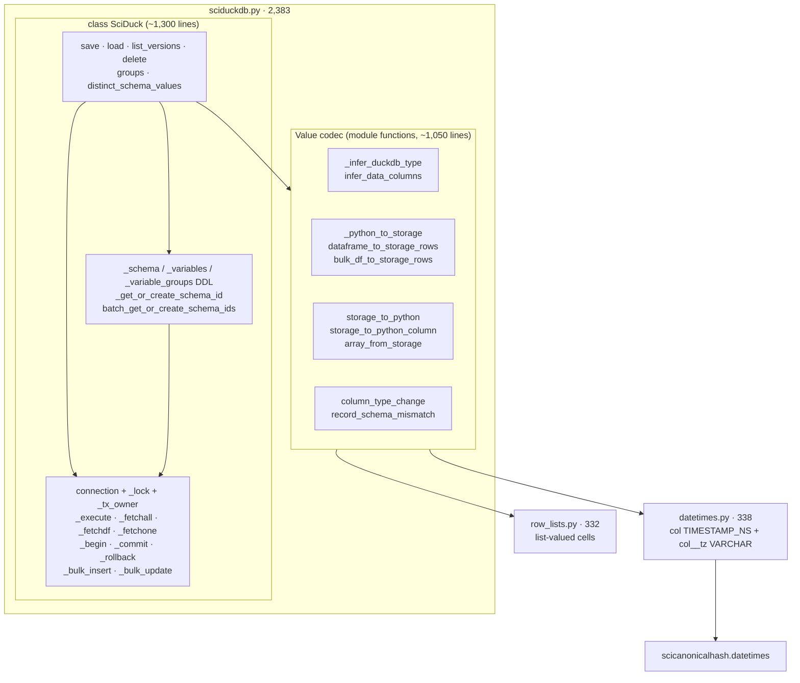
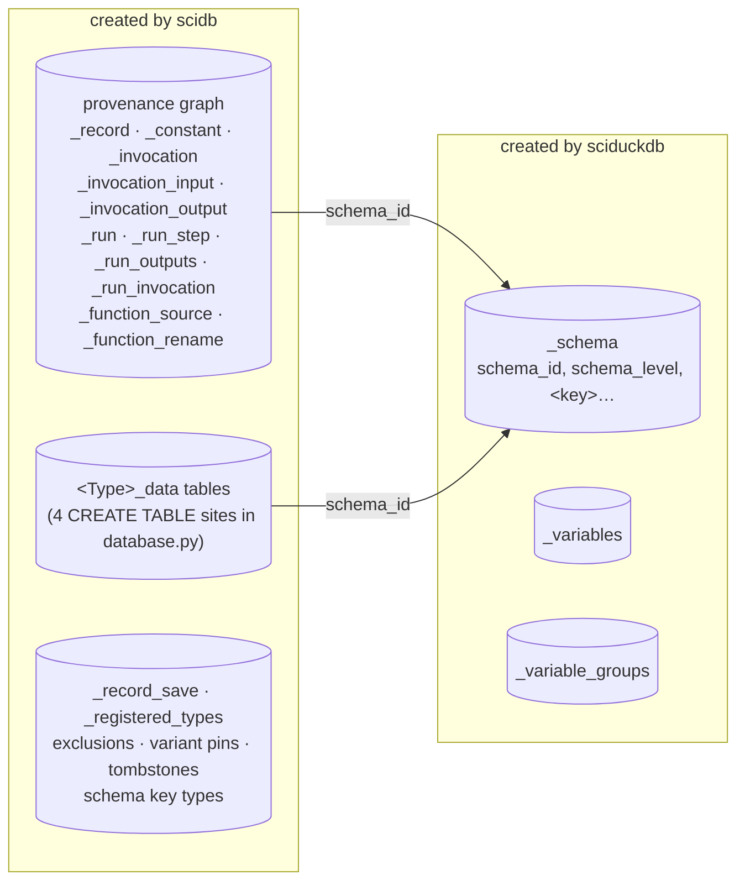
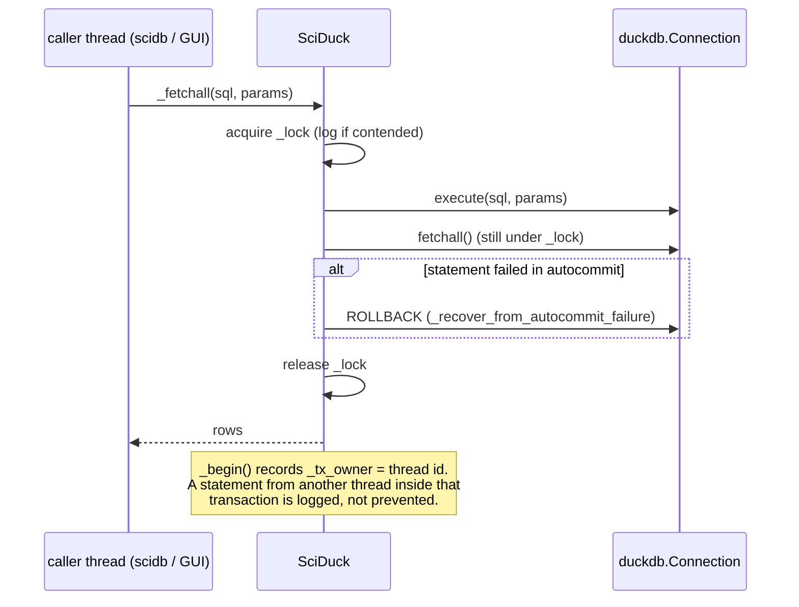
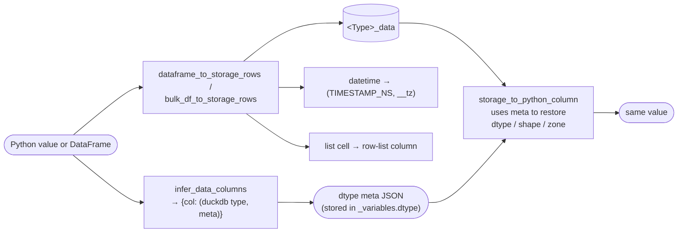

# 03 — sciduckdb: the DuckDB layer

**Job (as the README describes it).** "A thin DuckDB layer for managing
versioned scientific data": one table per variable, a hierarchical schema
(subject → session → trial), `save` / `load` with automatic versioning, and
lossless round-trips of Python values through queryable DuckDB types.

**Job (as the stack actually uses it).** Three narrower things:

1. a **locked connection** — one `duckdb` connection per database with
   statement-level locking, transaction tracking, and contention logging;
2. the **`_schema` table and schema-id allocation** — a location
   (`subject=1, session=pre`) ↔ an integer `schema_id`;
3. a **value codec** — Python/numpy/pandas values ↔ DuckDB column types and
   storage rows, including datetimes (`datetimes.py`) and list-valued cells
   (`row_lists.py`).

Its own `save` / `load` / `list_versions` / `delete` table API is **not used**
by any other package (details below).

**Size.** 3,136 lines in 4 modules: `sciduckdb.py` 2,383, `datetimes.py` 338,
`row_lists.py` 332, `__init__.py` 83. Tests: 2,300 lines.

---

## Shape

*Module map. Everything lives in one 2,383-line module: a codec written as free
functions, and a `SciDuck` class that is part connection wrapper, part schema
registry, part variable store. The box labelled `api` is the part nothing
outside this package calls.*

### Who owns which tables

*sciduckdb creates 3 tables; scidb creates the other ~20, including the
per-variable data tables. The two packages share one database and one
connection, so the line between "the DB layer" and "the core" is drawn
through the middle of the schema.*

---

## Flows

### Statement execution and locking

*The lock is per statement, not per transaction. DuckDB has one transaction
context per connection, so a second thread's statement can land inside the
first thread's `BEGIN … COMMIT`. `_tx_owner` makes that visible in the log;
the actual serialization of transactions is left to the callers (scidb, the
GUI's lock policy).*

### Value round-trip (the codec)

*The type metadata recorded at first save is what makes the load lossless
(an `int16` array comes back `int16`, a zoned datetime comes back in its own
zone). `column_type_change` / `record_schema_mismatch` decide what happens when
a later save's inferred type differs from the stored one.*

---

## Contract (measured)

What consumers actually use, by grep of non-test source:

| Surface | Used by | Count |
|---|---|---|
| `SciDuck(...)` constructor | scidb `database.py` | 2 sites |
| **private** connection methods (`_fetchall`, `_execute`, `_fetchdf`, `_fetchone`, `_table_exists`, `_begin`/`_commit`/`_rollback`, `_bulk_insert`, `_get_or_create_schema_id`, `con`) | scidb (11 files), scistackplotdb (3 files), GUI (2 files) | **153 calls** |
| public schema helpers (`distinct_schema_values`, `batch_get_or_create_schema_ids`, groups) | scidb | ~12 |
| codec functions (`infer_data_columns`, `dataframe_to_storage_rows`, `bulk_df_to_storage_rows`, `storage_to_python[_column]`, `column_type_change`, `record_schema_mismatch`, `array_from_storage`, tz helpers, `is_row_list_meta`, `schema_keys_from_db`) | scidb, scistackplotdb | ~15 symbols |
| `save` / `load` / `list_versions` / `delete` | **nobody** outside sciduckdb's own tests | 0 |

So the real interface is "the private methods plus the codec". The public
table API documented in the README is a second storage model — its own
per-variable tables and version numbering — that scidb replaced with the
provenance graph and `<Type>_data` tables, but which still ships and is still
tested.

---

## Assessment

### Strengths

- **The codec is good and is the one owner of value ↔ storage conversion.**
  Lossless round-trips (dtypes, shapes, NULL vs NaN, zoned datetimes,
  list cells) through types DBeaver can read is a real asset, and datetimes
  share their spelling with the record hash (`scicanonicalhash.datetimes`).
- **Concurrency is instrumented.** Contention, autocommit-failure recovery,
  and cross-thread transaction interleaving are all logged with context
  rather than surfacing as a bare "Current transaction is aborted".
- `read_only=True` gives readers (plotting, inspection) a connection that
  cannot contend for the write lock.

### Weaknesses

1. **The used interface is private.** 153 calls from three packages go
   through underscore methods. Nothing marks which private methods are
   stable, so any change inside `SciDuck` is a cross-package change.
2. **A dormant second storage model.** `save`/`load`/`list_versions` define
   how a variable is stored and versioned — the same concept scidb owns
   through `_record` + `<Type>_data`. Per CLAUDE.md note 4 that is two owners
   of one concept; the dormant one is also the one the README teaches.
3. **The table split cuts the schema in half.** sciduckdb creates `_schema`,
   `_variables`, `_variable_groups`; scidb creates everything else, including
   data tables, with raw `CREATE TABLE` strings in `database.py`. Neither
   package is "the schema owner".
4. **One 2,383-line module** holds three separable things (codec, connection,
   variable store). The codec functions are module-level and pure; they have
   no reason to share a file with the connection class.
5. **Transaction safety is a caller convention.** The per-statement lock does
   not serialize transactions; correctness depends on scidb and the GUI
   following a policy (the GUI's hand-maintained "must not hold the DuckDB
   lock" list, noted in the 2026-09-20 review).

### Refactor candidates

| # | Change | Removes |
|---|---|---|
| D1 | Split the module: `codec.py` (pure functions), `connection.py` (`DuckConnection`: locked execute/fetch, transactions), `schema.py` (`_schema` + id allocation). | weakness 4 |
| D2 | Promote the used private methods to a public, documented `DuckConnection` interface (`execute`, `fetch_all`, `fetch_df`, `transaction()` context manager). Callers migrate mechanically. | weakness 1; a `transaction()` context manager also makes weakness 5 enforceable |
| D3 | Hide `save`/`load`/`list_versions`/`delete` (mark hidden rather than delete), and rewrite the README around codec + connection. | weakness 2 |
| D4 | Decide one schema owner: either sciduckdb owns all DDL (scidb declares tables, sciduckdb creates them), or sciduckdb owns none (scidb creates `_schema` too). The second is smaller. | weakness 3 |

> **Done (2026-11-01, P2 stage 4):** D1 — `sciduckdb.py` split into `codec.py`, `connection.py` (`DuckConnection`) and `schema.py` (`SciDuck(DuckConnection)`). D2 — `execute`, `fetchall`, `fetchone`, `fetchdf`, `fetchdf_if_open`, `fetch_table`, `table_exists`, `bulk_insert`, `bulk_update`, `get_or_create_schema_id` are public and documented in the README; every hand-paired `_begin`/`_commit`/`_rollback` in source uses `transaction()`; `execute` returns `None` so a fetch outside the lock cannot be written.
> **Done (2026-11-01, P3):** D4 option 2 — sciduckdb creates no tables. `SciDuck` (schema ids, variables, groups) moved to `scidb.store.sciduck`; every fixed table is a `scidb.store.tables.TableDecl` (`scidb/tests/test_table_registry.py`).

> **Done (2026-11-01, e129c3bf):** D3 — `save`/`load`/`list_versions`/`delete` and their private helpers deleted. The codec round-trip tests now go through `tests/codec_roundtrip.py` (public codec functions in a real table). `_restore_types` became the public `restore_types`, so scidb no longer reaches into `_duck._restore_types`. README rewritten (codec, connection, schema ids). `_get_or_create_schema_id` stays: scidb calls it at 3 sites (promote in P2).

> **Partly done (2026-11-01, plan-tidy P0):** `SciDuck.transaction(label)` exists. It is re-entrant, an inner rollback dooms the outer level (`TransactionRolledBackError`), and `add_rollback_listener` is the cache hook. `_begin`/`_commit`/`_rollback` are depth-aware. `save_batch`, `_commit_graph` and `rename._write` use `transaction()`; the remaining `_begin` callers migrate with the rest of D2.

D1–D3 are internal and low-risk. D4 belongs with the scidb review, since
scidb's `database.py` is the other half.
