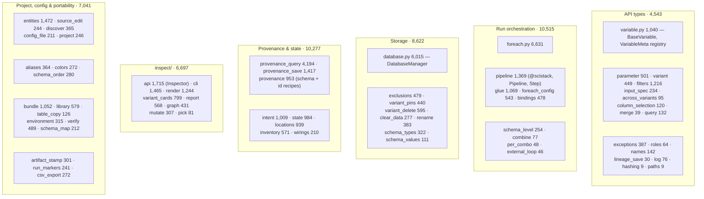
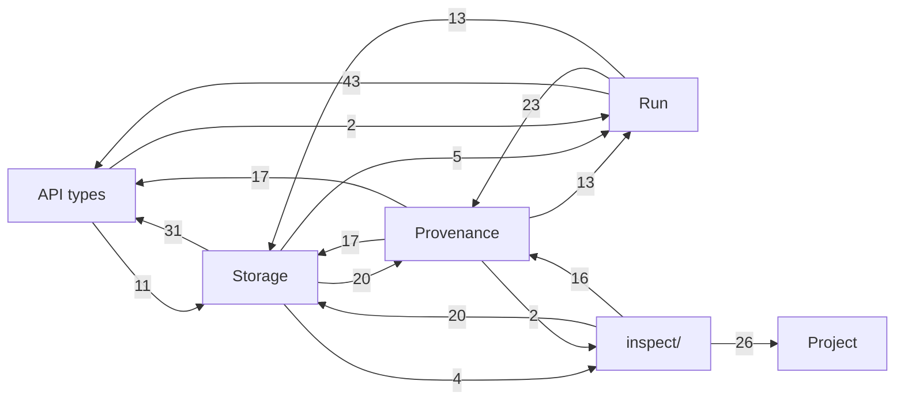

# 04a — scidb: structure

*Part 1 of 3. [04b](04b-scidb-write-path.md) follows a run from `for_each`
to saved records and provenance. [04c](04c-scidb-read-path.md) follows a load
and the query, state and inspection side.*

**Job.** scidb is the core of the stack, and the layer users write code
against. It defines:

- what a saved thing is (`BaseVariable` subclasses, `Parameter`, `PathInput`);
- how it is stored (DuckDB through sciduckdb);
- how a batch run turns inputs into outputs (`for_each`, which wraps scifor);
- the provenance graph that records which inputs and code produced every
  record.

Everything else (variants, staleness, plots) is derived from that graph.

**Size.** 47,918 source lines in 69 modules; 41,558 test lines. That is 27% of
all source in the repo. Three modules hold 35% of scidb:

| Module | Lines | Biggest function |
|---|---:|---|
| `foreach.py` | 6,631 | `_save_results` 712 lines, `for_each` 618 |
| `database.py` | 6,015 | `DatabaseManager.save_batch` 624, `_find_record` 404 |
| `provenance_query.py` | 4,194 | `variant_identity_batch` 300 |

`DatabaseManager` has 91 methods. `foreach.py` has 102 functions.

---

## The six clusters

scidb has no subpackages except `inspect/`. Every other module sits in one
flat namespace. Reading the module docstrings, the 69 modules fall into six
groups by job. The groups and their line counts are mine, not the code's:



*Each cluster is a different kind of job. "Project, config & portability"
covers `scistack.toml`, the entities TOML file, display aliases and colours,
and `.scistack` bundles. It holds none of the data model. It lives in scidb
because scidb is the lowest layer that knows about variables. Display
configuration (`aliases`, `colors`, `schema_order`) only feeds plotting.*

### The clusters import each other in every direction

Count of `from .x import` statements from one cluster into another, including
imports inside functions:



*Three pairs import each other: Storage ↔ Provenance (20 / 17),
Run ↔ Provenance (23 / 13), and Storage ↔ API (31 / 11). Also, the core imports
the read-only `inspect/` facade that is meant to sit on top of it:
`database.py:5989`, `variant_pins.py:161,221`, `variant_delete.py:206` and
`locations.py:519,675` all reach into `inspect.variant_cards` or
`inspect.graph`. No import order would let these clusters be stacked as layers.*

**How it works anyway: lazy imports.** scidb has **569 imports inside
functions** and 495 at module top. That is my count with
`^\s{4,}(from|import)`. The 2026-09-20 review reported 352, method not
recorded. Most of them break an import cycle. A typical case:
`BaseVariable` calls `from .database import get_database` inside each
method (`variable.py:442, 560, 710, 777, 849`), because `database.py`
imports `variable.py` at top level.

---

## Global state

| State | Where | What it holds |
|---|---|---|
| current database | `database.py` `_local` (thread-local) + `get_database()` / `set_current_database()` | the one `DatabaseManager` every `BaseVariable.save/load` without `db=` uses |
| variable class registry | `VariableMeta` (`variable.py`) | every `BaseVariable` subclass by name, with "same definition" rules for re-imports |
| active pipeline | `pipeline.py` `_active_stack`, `_all_pipelines` | makes `for_each` *register* a step instead of running it |
| ambient run context | `intent.py`: 3 `ContextVar`s (`_current_origin`, `_current_step`, `_current_output_names`) | which surface (GUI, script, MATLAB) and step a run belongs to |
| file-backed caches | `aliases`, `colors`, `entities`, `names` (×2), `schema_order` (×3) | mtime-keyed parses of project files |
| discovery cache | `state.py` `_discovery_cache` | PathInput discovery results for staleness |
| schema keys | `scifor.schema._schema_keys`, set by `configure_database` | iteration levels (see [02](02-scifor.md)) |

The ambient pipeline changes what `for_each` **does**. With a pipeline active,
the call registers a step and returns a `Step`. Without one, it runs. Nothing
at the call site shows which will happen.

---

## Contract: what other packages import

Distinct `scidb.*` modules imported by other packages (GUI, scistackplotdb,
scimatlab, scihist, scistackstatsdb, scistack), by number of import
statements:

| Module | Imports | | Module | Imports |
|---|---:|---|---|---:|
| `scidb` (top level) | 50 | | `provenance_query` | 8 |
| `scidb.log` | 29 | | `foreach_config` | 8 |
| `scidb.entities` | 20 | | `source_edit` | 7 |
| `scidb.intent` | 15 | | `variant`, `run_markers`, `pipeline`, `inventory`, `inspect.cli`, `combine` | 5 each |
| `scidb.database` | 15 | | `variable` | 4 |
| `scidb.names` | 13 | | `bindings`, `exclusions`, `environment`, `project`, `parameter`, `inspect.mutate` | 3 each |
| `scidb.library` | 11 | | 16 more modules | 1–2 each |
| `scidb.bundle` | 11 | | | |
| `scidb.provenance` | 10 | | | |

Consumers import **40 different scidb modules**. On top of that, the GUI uses
the private `db._duck` (the sciduckdb connection) 26 times. scidb does
export a curated surface: `__init__.py` (BaseVariable, for_each,
configure_database, filters, exceptions) and `inspect.Inspector`, whose
docstring calls it "the one read API the CLI, GUI and MATLAB bridge
consume". In practice the GUI goes around both, straight to
`provenance_query`, `provenance`, `foreach_config`, `bindings` and
`database` internals.

---

## Assessment

### Strengths

- **One source of truth for provenance.** The 2026-06 lineage simplification
  replaced several overlapping stores (`_lineage`, `version_keys` JSON,
  `_for_each_expected`) with one bipartite graph. Variants, staleness and
  "latest" are all derived from it. `docs/claude/database-model.md` is a
  current, canonical reference.
- **Content-addressed identity.** Re-running an identical pipeline reproduces
  every id. Inserts are `ON CONFLICT DO NOTHING`, and only a `_run` audit row
  is added. Idempotence makes the system safe to re-run.
- **Many modules are explicit single owners and say so.** Their docstrings
  open with "THE owner of …" / "the ONE owner of …". Examples: `schema_level`,
  `roles`, `names`, `schema_values`, `aliases`, `colors`, `config_file`,
  `table_copy`, `variant_delete`, and `CallSite` in `foreach_config`. The
  single-owner rule from CLAUDE.md is visibly applied at module scale.
- **Prepare / save is shared between Python and MATLAB.** `_for_each_prepare`
  and `_for_each_save_resolved` serve both the Python loop and MATLAB's own
  loop (`external_loop.py`), so the save half is not mirrored by hand
  (see [04b](04b-scidb-write-path.md)).
- **The read side has a designed facade** (`inspect.Inspector`). It returns
  plain dataclasses that the CLI renders, and the renderers are pure functions
  (`inspect/render.py`).

### Weaknesses

1. **No internal layering.** The six clusters import each other in cycles,
   held together by 569 function-level imports. The dependency graph cannot
   tell you what may change without affecting what. Even the read-only facade
   is imported by the core.
2. **Two god objects.** `DatabaseManager` (91 methods) covers:
   - schema-key types;
   - saving (`save`, `save_batch`, `save_variable`);
   - loading (`load`, `load_all_as_df`, `_find_record`);
   - variant listing and aggregation;
   - provenance pass-throughs (`get_provenance*`, `get_upstream_provenance`,
     `find_record_id`);
   - variable groups, CSV export, and display config (`dataset_aliases`,
     `dataset_colors`, `dataset_schema_key_order`).

   `foreach.py` (102 functions) mixes orchestration, input loading, endpoint
   artifact stamping, PathOutput placeholders and saving.
3. **Project configuration and portability live in the data core.** That is
   7,041 lines (15%) of config files, display aliases and colours, bundles,
   library metadata and environment installation. The same misplacement
   appears in scifor (group C in [02](02-scifor.md)). Between the two
   packages, "project runtime" has no package of its own.
4. **The public surface is unenforced.** Consumers import 40 modules plus
   `db._duck`. A refactor inside scidb has no boundary to stop at.
5. **Ambient state changes behaviour.** An active `Pipeline` turns
   `for_each` from "run" into "register". The `intent` ContextVars decide
   which surface a run belongs to. Both are invisible at the call site.
6. **Stale names and documents.**
   - The README says exclusions are "hashed and stored in `version_keys`".
     `version_keys` is gone (`database-model.md` §1).
   - The README's logging section describes one `scistack.log` at INFO. The
     current design has a journal plus `scistack-debug.log` at DEBUG
     ([01](01-foundations.md#scistacklog)).
   - The `ForEachConfig` docstring still says configs create "a new
     version_keys group".
   - `docs/claude/scidb-for-each-internals.md` (1,105 lines) and
     `scidb-identity-and-data-flow.md` (905 lines) still describe
     `_record_metadata` and `_for_each_expected`.
   - `scidb.hashing` and `scidb.paths` are re-export shims, a second name for
     `scicanonicalhash` and for `scipathgen`.

### Refactor candidates

| # | Change | Removes |
|---|---|---|
| B1 | Turn the six clusters into subpackages (`scidb.model`, `scidb.run`, `scidb.store`, `scidb.provenance`, `scidb.inspect`, `scidb.project`) with a declared order. Suggested: model → store → provenance → run → inspect, with project off to the side. Enforce the order with one import-graph test that allows lazy imports only from an explicit list. | weakness 1; makes cycles visible as test failures |
| B2 | Split `DatabaseManager` by job. Keep it as a thin facade that owns the connection, and delegate to `RecordStore` (save/load), `VariantIndex` (variant listing, latest) and `ProjectDisplay` (aliases/colours/key order, read from `scidb.project`). Delete the provenance pass-throughs in favour of `provenance_query`. | weakness 2 |
| B3 | Split the project cluster by **dependency**, not by topic: model-free modules move to `scifor.project`, model-bound ones gather in `scidb.project`. See "Decision: where project runtime lives" below. | weakness 3 |
| B4 | Declare scidb's public API: `scidb` (user-facing), `scidb.inspect` (read), and a short list of supported internals for the GUI. Add a test in the GUI that fails on imports outside that list. | weakness 4 |
| B5 | Make deferred registration explicit: `pipe.for_each(...)` or `for_each(..., pipeline=pipe)` only, with no ambient registration. | weakness 5 (pipeline half) |
| B6 | Refresh the README and the two stale `docs/claude` walkthroughs, or mark them archived and point to `database-model.md`. Drop the `hashing`/`paths` shims. | weakness 6 |

> **Done (2026-11-01, P2 stages 1–3):** B1 test half — `scidb/tests/test_import_layers.py` enforces model → store → provenance → [run, project] → inspect through `tools/import_layers.py`; 39 upward pairs allow-listed with reasons; 517 function-level imports pinned. B4 — `scidb.SUPPORTED_MODULES` plus a `test_scidb_boundary.py` in scistack-gui, scistackplotdb, scimatlab and scistackstatsdb; GUI `._duck` uses pinned at 27.
> **Done (2026-11-01, P3):** B3 — model-free half in `scifor.project`; model-bound half in `scidb.project` (entities, discover, init, library, bundle, environment, verify, table_copy, schema_map). entities split into `scifor.project.entities_file` (grammar) + `scidb.project.entities` (materialize).

> **Done (2026-11-01, e129c3bf):** B6 — `scidb.hashing` and `scidb.paths` deleted; `scidb-for-each-internals.md` and `scidb-identity-and-data-flow.md` archived to `docs/claude/archive/`; README exclusion and Logging sections refreshed.

**Open question (answered below, 2026-11-01).** Where should "project runtime"
live: config, entities, display settings, discovery, bundles? Today it is
split between scifor group C (~1,230 lines) and scidb's project cluster
(~7,000 lines). The answer decides B3 and scifor's R3′ together.

User question (asked in chat, 2026-11-01): is a new package the answer now
that two existing packages are involved, or should everything move from scidb
to scifor? Pick based on the maintainability vs. simplicity tradeoff.

> **Answer (2026-11-01).** No new package. Not everything can move to
> scifor. The split is dictated by what each module imports, so the decision
> mostly makes itself.
>
> **Why not everything into scifor.** scifor cannot import scidb: that would
> be a cycle, and scifor has to stay database-free. Seven of the project
> modules build on scidb's data model:
>
> | Module | Depends on |
> |---|---|
> | `entities` | `variable`, `parameter` (materializes `BaseVariable` classes) |
> | `discover` | `variable`, `parameter`, `pipeline`, `roles` (classifies them) |
> | `project` | `entities` |
> | `library` | `entities`, `project` |
> | `bundle` | `entities`, `names`, `project`, `schema_map`, `environment`; copies DB tables through `table_copy` |
> | `environment` | `bundle` |
> | `verify` | `bundle`, `environment`, `duckdb`, `numpy` |
>
> These have to stay in scidb.
>
> **Why not a new package.** It is the same test as R3 in
> [02](02-scifor.md). A separate distribution pays off only when some
> consumer needs the code *without* the package it would otherwise live in.
> Every consumer of these modules (scidb, the GUI, scimatlab,
> scistackplotdb) already depends on both scifor and scidb. A new package
> removes no dependency edge and adds a release unit.
>
> **Rule: each module goes in the lowest package whose code it needs, as a
> `project` subpackage.**
>
> ```
> scifor/project/        model-free: imports only scistacklog and scifor
>   (from scifor)  discovery (walk_package, scistack.toml, libs/, test exclusion)
>                  machine (roots) · project root (out of pathinput.py)
>   (from scidb)   config_file · aliases · colors · schema_order · names
>                  source_edit · schema_map
>                  entities_file  ← the TOML grammar/parse half of entities.py
>
> scidb/project/         model-bound: builds on Variables, Parameters, the DB
>                  entities (materialize classes from entities_file)
>                  discover · project (init) · library · bundle
>                  environment · verify · table_copy
> ```
>
> The three that are not really "project" leave the cluster: `csv_export`
> goes to the store, and `artifact_stamp` and `run_markers` go to the run
> cluster.
>
> **Why the model-free half goes down into scifor rather than staying in
> scidb.** Every module listed for `scifor/project/` already imports only
> `scifor.*` and the logger. I checked each one; none imports `pandas`,
> `duckdb` or a scidb data-model module. The deciding reason is **import
> cost**, and it is the same reason `discovery.py` went into scifor in
> 2026-08: `import scidb.<anything>` runs `scidb/__init__.py`, which imports
> `database` and so loads DuckDB, sciduckdb and pandas. Reading `[aliases]`
> or locating `scistack.toml` should not cost that. It matters for GUI
> startup and the MATLAB bridge. In `scifor.project` these modules load
> light, and they sit next to the code they already lean on (`discovery`,
> `pathinput`).
>
> **Costs, stated plainly.**
> - The name "scifor" stops describing all of the package: it will hold
>   plot-display grammars (aliases, colours). The subpackage name carries
>   the meaning, and the README should say "iteration engine + project
>   runtime".
> - `entities.py` (1,472 lines) has to be split at its parse/materialize
>   seam. That is the only non-mechanical step. `_make_variable_class` and
>   the `Parameter` construction are the scidb half; the TOML grammar,
>   validation and PathInput specs are the scifor half.
> - Under the beta rule there are no re-export shims: imports change in
>   scidb, the GUI and scimatlab in the same commit.
>
> **When to revisit.** If something ever needs project config without the
> loop engine (a config-only CLI, a non-Python tool), promote
> `scifor/project/` to its own distribution. At that point a new package
> *would* remove a dependency edge.
