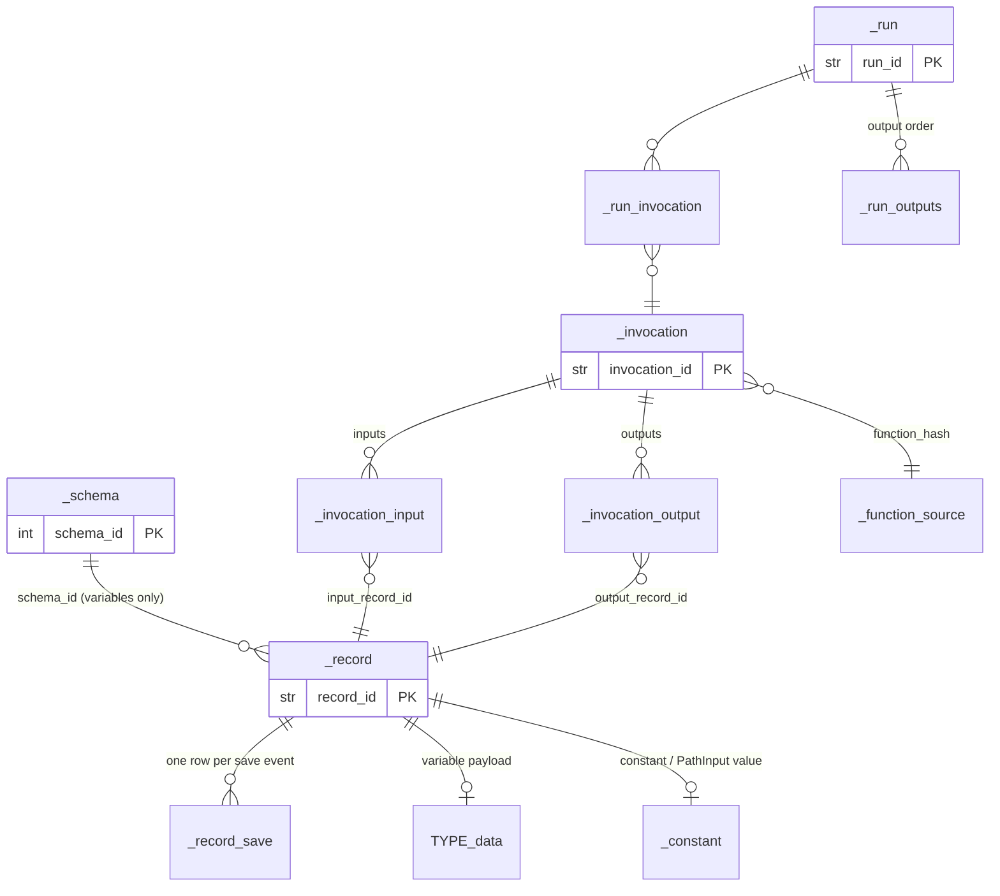
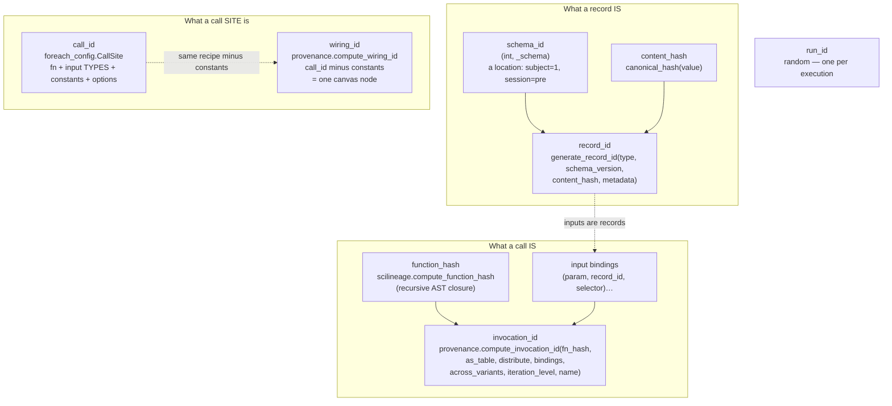
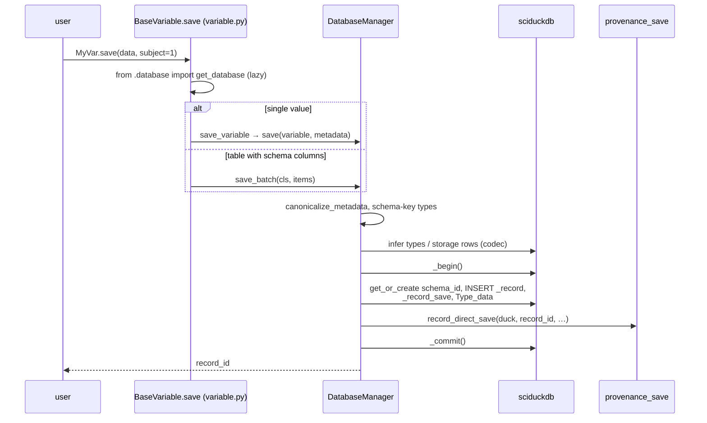
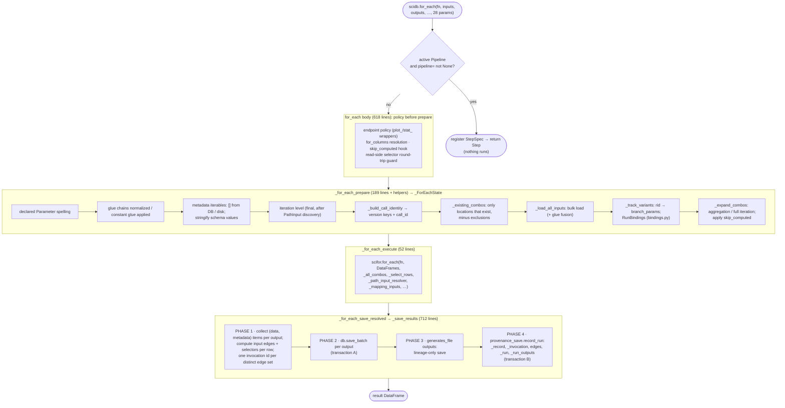
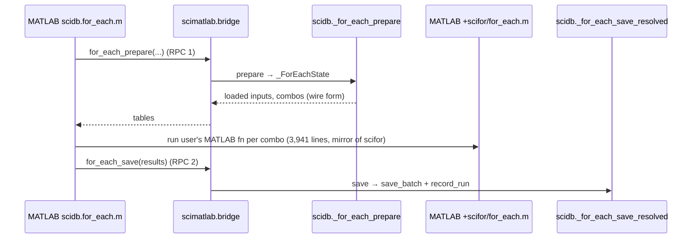

# 04b — scidb: the write path

*Part 2 of 3. Structure is in [04a](04a-scidb-structure.md); the read side
is in [04c](04c-scidb-read-path.md).*

This document follows data **into** the database, by two routes:

1. a **direct save**: `MyVar.save(data, subject=1)`;
2. a **batch run**: `for_each(fn, inputs, outputs, ...)`, which loads inputs,
   runs `fn` per combination through scifor, then saves outputs and records
   provenance.

It also names every identity the write path computes, because most of the
complexity is in deciding *what counts as the same thing*.

---

## The tables being written

Full reference: `docs/claude/database-model.md`. This is the subset that the
flows below touch.

*A bipartite graph: **records** (things) and **invocations** (function
calls), joined by input and output edges. `_record`, `_invocation` and the
edges are content-addressed and insert-once. `_record_save` and `_run` are
append-only audit logs: they say **when**, while the graph says **what**.
`<Type>_data` holds the values. `sciduckdb` creates `_schema`, and scidb
creates everything else ([03](03-sciduckdb.md#who-owns-which-tables)).*

---

## The identities

*Read top to bottom, from most concrete to most abstract.*

- *A **record id** says "this value at this location, as this type".*
- *An **invocation id** says "this exact function code applied to these
  exact input records". Because it is content-addressed, re-running identical
  code on identical inputs produces the same invocation, and nothing new is
  written.*
- *A **call id** says "this function wired to these input types with these
  constants". Changing `low_hz=20` to `30` gives a new call id, which is a new
  variant.*
- *A **wiring id** drops the constants, so all `low_hz` variants of one step
  share one canvas node.*
- *The **run id** is the only random id: it marks one execution in the
  audit log.*

**Who owns which recipe.** Each id has one recipe function in scidb.
`CallSite` (`foreach_config.py:216`) documents that four readers used to
re-spell the call-id rules, and now all map onto it. `compute_wiring_id`
moved into scidb on 2026-09-20 for the same reason (recommendation 1 of the
architecture review). This is the area where the single-owner rule has done
the most work.

---

## Flow 1: direct save

*A direct save is **one transaction**: the data row and its provenance
(a "save" invocation, `compute_save_invocation_id`) commit together. Two
entry points (`save` for one value, about 160 lines, and `save_batch` for
many, 624 lines) cover the same concept.*

---

## Flow 2: `for_each` — the three phases

*The 2026-09-20 review asked for the 975-line `for_each` to be split into
prepare, execute and save phases over a typed state. That has partly
happened. `_ForEachState` exists and `_for_each_execute` is small. But the
body is still 618 lines of pre-prepare policy, and `_save_results` is now the
largest function in the package at 712 lines.*

### Flow 2b: the same phases when MATLAB runs the loop

*`external_loop.py` names this seam. Prepare and save are **shared** with
Python. Only the loop in the middle is mirrored by hand, so the MATLAB
mirror problem is confined to scifor's semantics
([02](02-scifor.md), weakness 5).*

---

## Assessment

### Strengths

- **Idempotent, content-addressed writes.** Identical re-runs write no new
  graph rows. Only the audit tables grow.
- **One recipe per identity**, with the history of why written into the
  docstrings (`CallSite`, `compute_wiring_id`).
- **Round-trip guards.** `check_selector_round_trip` (write side) and a
  read-side guard in `for_each` assert that what a run selected is what
  provenance records. That is a structural test running in production.
- **Failed saves raise** (`OutputSaveError`) instead of being logged and
  dropped. This follows the project rule "never drop data silently".
- **Prepare and save are shared with MATLAB**, so most of the write path has
  one implementation.

### Weaknesses

1. **A `for_each` save is not atomic, and a provenance failure is
   swallowed.**
   - Phase 2 commits the data (`save_batch`: `database.py:2734` begin,
     `:2841` commit) before phase 4 opens a separate transaction for the
     graph (`provenance_save.py:1226` begin, `:1410` commit).
   - Phase 4 runs inside `try: … except Exception as e: Log.error(...)`
     (`foreach.py:6334–6366`). The comment there reads "Provenance graph is
     additive during migration — never fail the save". The migration
     finished in 2026-06, and the graph is now the only source of truth
     ([04a](04a-scidb-structure.md#strengths)).

   So any exception in `record_run` leaves records that have data but no
   invocation edges, and the run still reports success. Provenance cannot
   explain those records, and staleness and variant logic will misread them.
   A direct save has neither problem: both writes sit in one transaction
   (`database.py:3780` to `:3855`).
2. **Two oversized functions carry the save.** `_save_results` (712 lines)
   and `save_batch` (624 lines) share state through long argument lists. The
   2026-09-20 review counted 17 parameters for `_save_results`. Its phases are
   comment banners (`# PHASE 1 … 4`), not functions.
3. **`for_each` has 28 parameters**: 23 named, plus 4 underscore hooks, plus
   `**metadata_iterables`. They mix:
   - data selection (`where`, `locations`, `schema_filter`);
   - run options (`as_table`, `distribute`, `on_error`, `on_duplicate`);
   - GUI concerns (`step`, `parameter_names`, `finalized`, `_progress_fn`);
   - registration (`pipeline`).
4. **Several id kinds with overlapping recipes.** `call_id`, `wiring_id` and
   `invocation_id` each fold in a slightly different set of the same inputs
   (function, inputs, constants, run options, iteration level). Each fold-in
   decision is dated in a docstring ("folded in ONLY when non-empty, so every
   id computed before 2026-09-20 is unchanged"). The recipes are correct but
   accreted: there is no one table of "which facts are in which id".
5. **Stale vocabulary in the code.**
   - "version keys" remains the internal name for call-site identity
     (`ForEachConfig`, `_build_call_identity`), although the table column it
     named is gone.
   - `_save_results` phase 4 says it "runs additively alongside the legacy
     `_lineage` writes above". Those writes no longer exist.

### Refactor candidates

| # | Change | Removes |
|---|---|---|
| W1 | Remove the migration-era `except Exception` around `record_run`, so a provenance failure fails the save (`OutputSaveError`, like data failures). Then wrap phases 2–4 in **one** transaction, through sciduckdb's proposed `transaction()` context manager ([03](03-sciduckdb.md) D2). Tests: a `record_run` that raises must roll back the data; and there must be no record without an output edge after any run. | weakness 1 |
| W2 | Make the save phases real functions over a `SavePlan` (phase 1 output) → `apply(plan, db)` (phases 2–4). The same split works for `save_batch` (plan rows → write rows). | weakness 2 |
| W3 | Group `for_each` options into typed bundles: `RunOptions` (already exists in `foreach_config`) for identity-bearing options, `Selection` for where/locations/schema_filter, `RunContext` for GUI hooks (progress, cancel, step, origin). Keep keyword sugar at the top. | weakness 3; also feeds scifor's R2 `LoopHooks` |
| W4 | Write a single identity table (doc, plus a test that asserts it): each row is one fact (function hash, input types, input record ids, constants, as_table, distribute, across_variants, iteration level), each column is one id. Generate the recipes' field lists from it. | weakness 4 |
| W5 | Rename "version keys" to "call-site keys" throughout, and remove the stale `_lineage` comment. | weakness 5 |

> **Done (2026-11-01):** W1. `record_run` failures fail the save; phases 2–4 run in one re-entrant `SciDuck.transaction` (all-or-nothing, decision D-2026-11-01-2). D2's first piece (`transaction()`) landed with it. Tests: `sciduckdb/tests/test_transaction.py`, `scidb/tests/test_save_provenance_failure.py`.

W1 is the only one of these that is a correctness issue rather than a
maintainability one. I'd do it first, and it is small.
