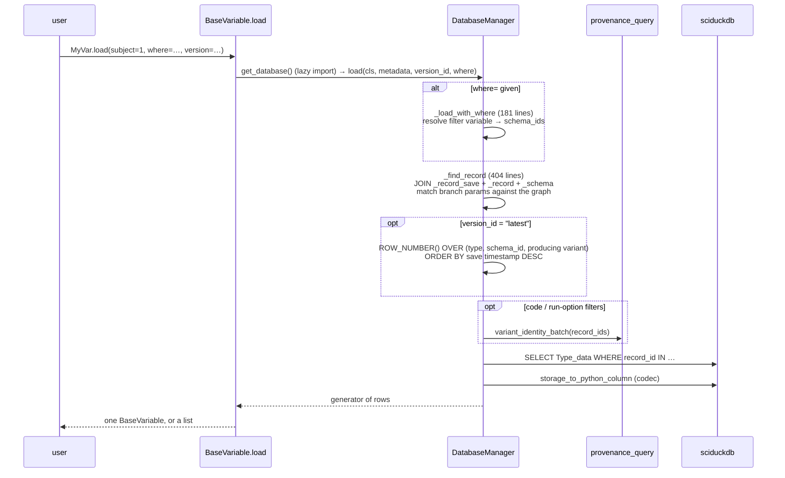
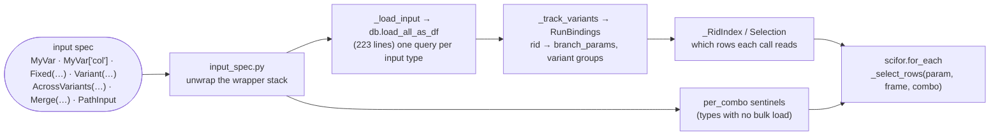
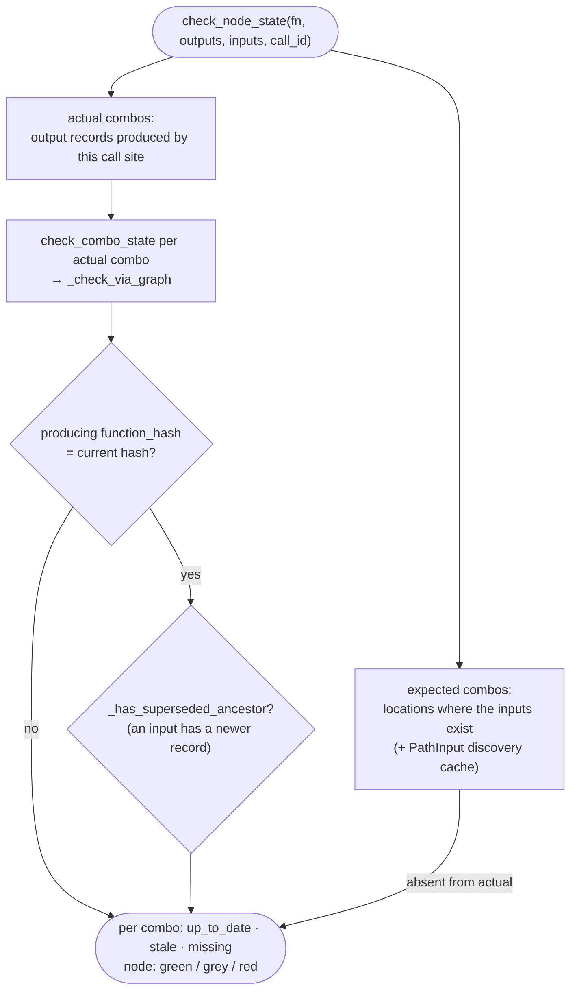
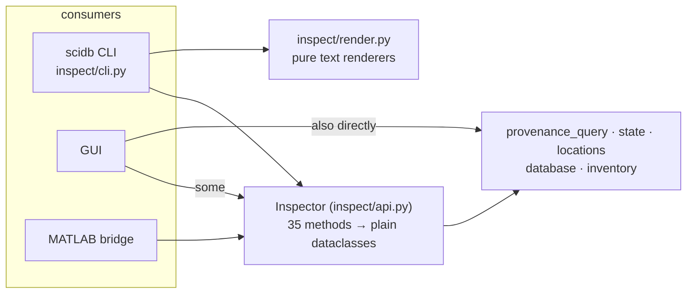

# 04c — scidb: the read path

*Part 3 of 3. Structure is in [04a](04a-scidb-structure.md); the write path is
in [04b](04b-scidb-write-path.md).*

The read side answers four kinds of question. Each one has its own entry
point:

| Question | Entry point | Module(s) |
|---|---|---|
| "Give me the data" | `MyVar.load(...)`, `for_each` input loading | `variable.py` → `database.py` (`load`, `load_all_as_df`, `_find_record`, `_load_with_where`) |
| "Which variants exist, and what is each one called?" | `list_versions`, variant listing, variant cards | `database.py`, `provenance_query.py`, `inspect/variant_cards.py` |
| "Is this step up to date?" | `check_node_state`, `check_combo_state`, location status | `state.py`, `locations.py` |
| "What should the next run do?" (intent) | `intent.resolve` | `intent.py` |

All of them read the same thing: the provenance graph described in
[04b](04b-scidb-write-path.md#the-tables-being-written), plus the data tables.

---

## Flow 1: `MyVar.load(subject=1)`

*"Latest" is not a stored flag. It is computed at read time: the newest
save-event per (type, location, producing variant). The producing variant is
derived from the graph (the producing invocation's constants). For one match,
`load` returns a single instance; for several, it returns a list. Several
variants at one location with no selector raise `AmbiguousVersionError`.*

## Flow 2: loading `for_each` inputs

*A run loads each input **once, in bulk**, then gives scifor a `_select_rows`
hook that picks a combination's rows by record id. The typed objects in
`bindings.py` (`Binding`, `RecordPool`, `InputBinding`, `Selection`,
`RunBindings`) are the "rid spine" from the 2026-09-20 plan. They are the
one representation of "which records fed this call", used by both loading and
the save path's edges.*

## Flow 3: "is this step stale?"

*Staleness compares what the graph recorded with what would happen now. A
record is stale if its function's code changed, or if an ancestor has a newer
record at the same location. `locations.py` (939 lines) adds a fourth level
of detail on top of this: per variable, per variant, per location.*

## Flow 4: the Inspector facade

*Inspector's docstring says it is "the one read API the CLI, GUI, and MATLAB
bridge consume". The CLI and MATLAB use it that way. The GUI uses it in
places, but also imports `provenance_query` (8 imports),
`provenance`, `state`, `locations` and `database` directly
([04a](04a-scidb-structure.md#contract-what-other-packages-import)).*

---

## Assessment

### Strengths

- **Everything is derived, nothing is predicted.** Latest, variants,
  staleness and branch params are all computed from the graph plus save
  events. That removes a whole class of "stored state disagrees with
  reality" bugs.
- **Bulk loading with a row-selection hook** keeps runs fast, and keeps
  scifor database-free.
- **The rid spine** (`bindings.py`) gives "which records fed this call" one
  typed representation, shared by loading and saving.
- **The Inspector pattern is right.** A facade returns dataclasses and
  renderers are pure functions. The renderers can be tested against
  hand-built fixtures.
- **Two different questions are named as different.** `variant_identity_batch`
  documents that the *display* question ("what do I call each of these
  records?") is deliberately not the *supersession* question ("does this
  record replace that one?").

### Weaknesses

1. **"Latest" has five implementations.**

   | Where | What it computes |
   |---|---|
   | `DatabaseManager._find_record` | SQL `ROW_NUMBER()` over (type, schema_id, producing variant) (`database.py:3217`) |
   | `DatabaseManager.get_latest_record_id_for_variant` | the same rule, for one record |
   | `state._get_latest_record_at_location` | raw SQL, newest at (type, schema_id) ignoring variant; `schema_id = ?`, so never matches NULL |
   | `provenance_query.latest_at_location_batch` | a batch version whose docstring says it "**mirrors**" the previous two, and notes a NULL-handling difference from one of them |
   | `provenance_query.variant_identity_batch` | `is_latest` for display, per location |

   Two of these answer the genuinely different display question, and that
   distinction is documented. The other three are copies of one rule
   (single-record, batch, and raw-SQL variants). Their behaviour already
   differs on NULL `schema_id`. This is exactly the multiple-owner divergence
   CLAUDE.md note 4 describes.
2. **The load functions are very large.** `_find_record` is 404 lines,
   `load` 290, `load_all_as_df` 223, `_assemble_df_from_records_and_data` 201,
   and `_load_with_where` 181. Together that is about 1,300 lines inside
   `DatabaseManager`, with branches for `where=`, branch-param filters, code
   filters, run-option filters, spread layout and the iterator path.
3. **The read facade is optional.** Because the GUI can import
   `provenance_query` and `state` directly, `Inspector` is not a boundary.
   Read logic sometimes lives in the GUI's own services instead (doc 07 will
   measure this).
4. **Stale docstrings on the read side.**
   - `check_node_state` describes "output records … whose
     `version_keys.__fn` matches fn".
   - `_get_latest_record_at_location` explains itself in terms of
     `version_keys` and `__fn`.

   Both refer to the pre-migration model.
5. **Two module-scale answers to "status".** `state.py` (per node / per combo)
   and `locations.py` (per variable / variant / location) are documented as
   different granularities. Both enumerate expected versus actual locations
   independently. This needs a closer look in the synthesis before calling it
   a duplication.

### Refactor candidates

| # | Change | Removes |
|---|---|---|
| Q1 | One owner of the supersession rule: a batch function in `provenance_query` that returns `{record_id: latest_variant, latest_any}`. Make `_find_record`'s SQL, `get_latest_record_id_for_variant` and `state._get_latest_record_at_location` call it, or share one SQL fragment it exports. Pin the NULL-`schema_id` behaviour with a test. Keep `variant_identity_batch.is_latest` separate, as the documented display rule. | weakness 1 |
| Q2 | Extract the load path from `DatabaseManager` into a `RecordStore` read half: `select_records(type, Selection) → record frame` then `materialize(records) → data frame`, with filters as composable steps. | weakness 2; this is the read half of B2 in 04a |
| Q3 | Route all GUI reads through `Inspector`, adding methods where the GUI needs them, and add the B4 import-boundary test. | weakness 3 |
| Q4 | Fix the `version_keys` docstrings as part of W5 ([04b](04b-scidb-write-path.md)). | weakness 4 |

---

## scidb — summary of all three parts

| | Biggest strength | Biggest weakness | First move |
|---|---|---|---|
| Structure (04a) | one graph as the only source of truth | six clusters with cyclic imports; 40 modules imported by consumers | B1 subpackages + import-order test |
| Write (04b) | content-addressed, idempotent writes; one recipe per id | **`for_each` provenance failures are swallowed, and data and graph commit separately** | W1 (small, correctness) |
| Read (04c) | everything derived; Inspector pattern | "latest" implemented five times | Q1 |
