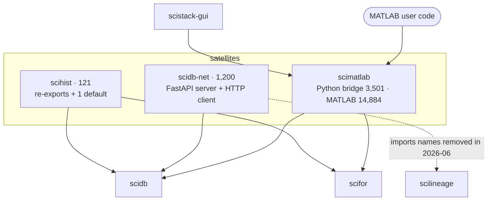
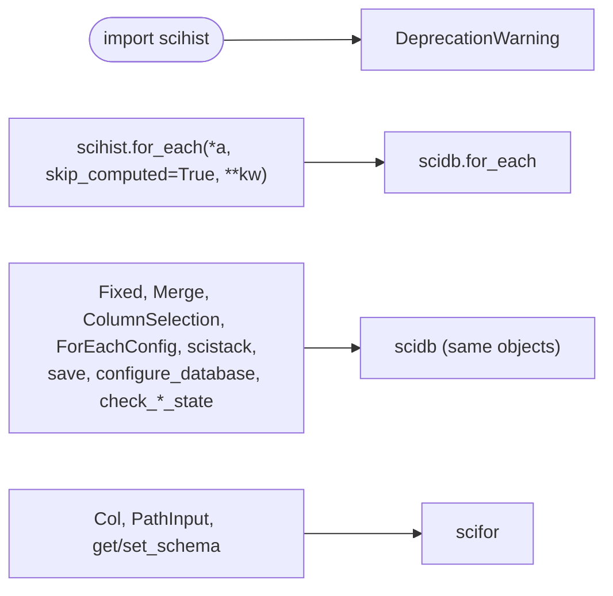
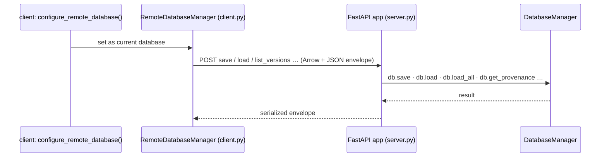
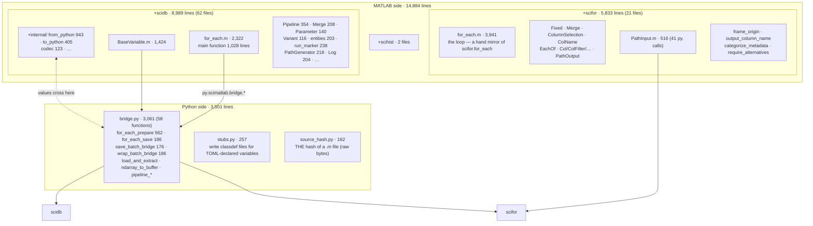
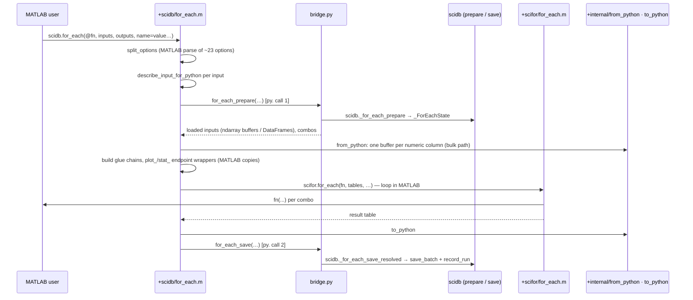

# 05 — scidb satellites: scihist, scidb-net, scimatlab

Three packages sit directly on top of scidb. They are very different in size
and health:

| Package | Source | Tests | State |
|---|---:|---:|---|
| scihist | 121 Py | 7,961 Py | deprecated shim; no non-test importer |
| scidb-net | 1,200 Py | 324 Py | **cannot be imported**; CI builds it but skips its tests and publishing |
| scimatlab | 3,501 Py + 14,884 MATLAB (85 `.m` files) | 4,802 Py + 16,044 MATLAB | live; the MATLAB front end of the whole stack |

*Only scimatlab has real consumers: MATLAB users, and the GUI (8 imports,
mostly classdef stub materialization and source hashing). Neither scihist nor
scidb-net is imported by any other package's source.*

---

## scihist

**Job (today).** None of its own. It is a deprecation shim:
- `scihist.for_each` is `scidb.for_each` with `skip_computed=True` as the
  default;
- everything else is re-exported from scidb and scifor;
- importing it emits a `DeprecationWarning`.

There is also a MATLAB `+scihist` package: `for_each.m` (35 lines) and
`configure_database.m`.

### Assessment

- **Its docstring is wrong about its users.** It says it remains "for
  existing imports (e.g. `scistack-gui` and the MATLAB `+scihist` bridge)".
  The GUI does not import it. GUI source only mentions it in comments
  (`server.py:218, 898`; `db.py:455`).
- **It conflicts with the project's beta rule** ("no deprecation, no
  migrations"). It is a deprecation layer kept for back-compat.
- **The real asset is its 7,961 lines of tests.** Behind the shim they test
  `scidb.for_each`, `skip_computed`, staleness (`test_state*.py` ×6),
  `Fixed`, `Merge`, `generates_file` and variant tracking. These are scidb
  tests living in the wrong package. They run in CI against scidb through a
  one-line alias.

**Refactor candidate H1.**
1. Move `scihist/tests/*` into `scidb/tests/`, changing `scihist.for_each(...)`
   to `scidb.for_each(..., skip_computed=True)`.
2. Then delete the package, the MATLAB `+scihist` folder, and their
   CI/publish/dev-install entries.

Users lose nothing, and the tests end up beside the code they test.

> **Done (2026-11-01, P1):** tests moved to `scidb/tests/test_hist_*.py` (MATLAB ones to `scimatlab/tests/matlab/scidb/TestHist*.m`); scihist and `+scihist` deleted; the GUI emits `scidb.configure_database`.

---

## scidb-net

**Job (as designed).** Put `DatabaseManager` behind a FastAPI server, and
give clients a drop-in `RemoteDatabaseManager`. Then `BaseVariable.save/load`
can work against a shared lab machine over HTTP.

*This is the design as written. It cannot run today; see below.*

### Assessment

- **Broken on import.** `server.py:22` does
  `from scilineage.lineage import LineageRecord`, and `__init__.py` imports
  `server`, so `import scidbnet` raises. `client.py:148` and `__init__.py:48`
  import `LineageFcnResult`, `extract_lineage`, `get_raw_value` and
  `configure_backend`. All of these were removed from scilineage in the
  2026-06 migration ([01](01-foundations.md#scilineage)).
- **It targets a `DatabaseManager` API that has moved on.** The server calls
  `db.load_all(...)`, which does not exist (`load_all_as_df` does), and
  `db.has_lineage`, `get_provenance` and `get_pipeline_structure`, which are
  pass-throughs that 04a recommends removing. Its README promises "thunk
  caching", another removed concept.
- **CI already treats it as dead.** `test-shards.sh:35` reads
  `"scidb-net|outdated, slated for removal"`, and `publish.yml:62` reads
  `# scidb-net is excluded — outdated, slated for removal.` But `ci.yml:124`
  still *builds* it on every run, and `dev-install.sh:40` still installs it.
- **The idea also conflicts with the storage design.** A network
  `DatabaseManager` would need to re-implement every one of the 91 methods,
  or forward them. If remote access is wanted again, the boundary should be
  the `Inspector`/`RecordStore` facades proposed in 04a/04c, not the god
  object.

**Refactor candidate N1.** Delete scidb-net (package, CI build line,
`dev-install.sh`, docs). If multi-machine access returns as a requirement,
design it against the facades from B2/Q2, not against `DatabaseManager`.

> **Done (2026-11-01, P1):** scidb-net deleted with its CI, dev-install and docs entries.

---

## scimatlab

**Job.** Make the whole stack usable from MATLAB:
- MATLAB classes and functions with the same names as the Python API
  (`scidb.BaseVariable`, `scidb.for_each`, `scifor.PathInput`, …);
- a Python bridge module the MATLAB side calls through MATLAB's in-process
  `py.` interface.

The user's MATLAB function runs **in MATLAB**. Hashing, identity, saving and
provenance run in Python.

### Shape

*The MATLAB tree mirrors the Python package names (`+scidb`, `+scifor`), so
user code reads the same in both languages. 30 of the 62 `+scidb` files make
no `py.` call at all, and of `+scifor`'s 21 files only 7 do. Those files are
pure-MATLAB implementations: either genuinely MATLAB-only concerns (table
coercion, figure export) or **copies of rules whose Python version is
documented as the one owner**.*

### Flow: a MATLAB `scidb.for_each`

*The design keeps the expensive and identity-bearing parts in Python and
shared: load, combos, identity, save, provenance. The data crossing is
engineered for few crossings, one `py.bytes` buffer per numeric column
(`docs/claude/matlab-bridge-transfer-paths.md`). What is mirrored is
everything between the two `py.` calls: the loop, input wrappers, endpoint
wrappers, glue application and option parsing.*

### What is shared vs. mirrored

| Concept | Python owner | MATLAB | Kind |
|---|---|---|---|
| prepare: load, combos, identity | `scidb._for_each_prepare` | called via bridge | **shared** |
| save + provenance | `scidb._for_each_save_resolved` | called via bridge | **shared** |
| `.m` source hash | `scimatlab.source_hash` | calls Python | **shared** (consolidated after a BOM/code-page bug) |
| PathInput resolution | `scifor.PathInput` | `PathInput.m`, 41 `py.` calls | mostly shared |
| failure record shape | `scifor.failures` | `failure_from_mexception.m` emits the same wire shape | shared shape, separate builder (unavoidable: MException) |
| the per-combo loop | `scifor.for_each` (1,226 lines) | `+scifor/for_each.m` (3,941 lines) | **mirrored**; parity tests exist (`test_matlab_for_each_parity.py`, `test_bridge_spread_parity.py`) |
| frame classification | `scifor.failures.frame_origin` | `frame_origin.m`: "The ONE MATLAB frame classifier" | **mirrored** |
| output column naming | `scifor.output_column_name` | `output_column_name.m`: "same rule as Python's" | **mirrored** |
| input wrappers | `scifor` `Fixed`, `Merge`, `ColumnSelection`, `ColName`, `EachOf` | pure-MATLAB classes, rebuilt in Python by `bridge.py` from wire form | **mirrored** value objects |
| plot_/stat_ endpoint wrapping | `scidb.foreach._make_plot_wrapper` / `_make_stat_wrapper` | `plot_endpoint_call` / `stat_endpoint_call` in `for_each.m` | **mirrored**; `foreach.py` says "WRAPPING is language-specific" |
| `for_each` options | `scidb.for_each` signature (28 params) | `split_options` in `for_each.m` | **mirrored** |
| `PathGenerator` | `scipathgen` | `PathGenerator.m` (pure MATLAB) | mirrored, and both unused ([01](01-foundations.md#scipathgen)) |

### Assessment

**Strengths**
- **Single owners in Python for everything identity-bearing.** Prepare,
  save, provenance and the source hash are not duplicated. `source_hash.py`
  is a model of how a cross-language rule should be owned: one recipe, both
  sides call it, and the reason is written down.
- **Data transfer is designed, measured and documented.** It uses the
  buffer-per-column bulk path, and the transfer doc has tables of crossing
  costs and hang diagnostics.
- **The same nouns in both languages.** A MATLAB user reads the Python docs
  and vice versa.
- **Parity tests exist** for the mirrored loop.

**Weaknesses**
1. **The mirrored region is large.** About 6,300 lines of MATLAB `for_each`
   (3,941 + 2,322) re-implement the loop, option parsing, endpoint wrapping
   and glue application. Every feature in scifor's or scidb's `for_each`
   must be added twice. The parity tests catch drift only for the behaviours
   they cover.
2. **Small rules are copied, not called.** `frame_origin.m` and
   `output_column_name.m` restate scifor single-owner rules in MATLAB. Each
   one is short, but each is a second owner (CLAUDE.md note 4), and their
   headers say so ("same rule as Python's").
3. **`bridge.py` is one 3,061-line module of 58 functions**, with
   `for_each_prepare` alone at 562 lines. It mixes:
   - RPC entry points;
   - wire-format reconstruction of every scifor wrapper;
   - data conversion (`ndarray_to_buffer`, `split_flat_to_lists`,
     `convert_nested_dicts_*`, `datetimes_to_matlab`);
   - pipeline registration.
4. **Dead and duplicate MATLAB.** `+scidb/PathGenerator.m` (unused, see
   01), `+scihist` (shim of a shim), and `+scidb/Log.m` (204 lines) beside
   `+scifor/Log.m` (171 lines): two MATLAB logging facades over one Python
   `Log`.
5. **`MatlabLineageFcn`** is a class named after the removed lineage-wrapper
   system. It is still used as an identity proxy for node colouring (the GUI
   imports it once).

**Refactor candidates**

| # | Change | Removes |
|---|---|---|
| M1 | Call, don't copy, the small rules: have `frame_origin.m` and `output_column_name.m` call their scifor functions over `py.` (they run once per failure / once per output, so crossing cost is irrelevant). | weakness 2 |
| M2 | Split `bridge.py` into `bridge/entry.py` (the RPCs MATLAB calls), `bridge/wire.py` (wrapper reconstruction), `bridge/convert.py` (data transfer) and `bridge/pipeline.py`. | weakness 3 |
| M3 | Once scifor's R1 splits `for_each` into `plan` / `run_combo` / `assemble`, move **plan** and **assemble** to Python for MATLAB too. MATLAB would keep only the per-combo call (MATLAB must run the function) and the row slicing. That shrinks the mirror to the part that has to be in MATLAB. | weakness 1, most of it |
| M4 | Move option parsing to Python: MATLAB passes the raw name/value pairs, and Python validates them against `scidb.for_each`'s signature. | `split_options` mirror |
| M5 | Delete `PathGenerator.m` and `+scihist` with their Python twins (01, H1). Merge `+scidb/Log.m` into `+scifor/Log.m`, or make one a one-line alias. Rename `MatlabLineageFcn` to what it is (`MatlabFunctionIdentity`). | weaknesses 4, 5 |

> **Done (2026-11-01, P1):** M5, delete half — `PathGenerator.m` and `+scihist` deleted. The `Log.m` merge and the rename remain.

M3 is the large one, and it depends on scifor R1 landing first. M1, M2, M4
and M5 are independent and small.

---

## Satellites — summary

| | Verdict | First move |
|---|---|---|
| scihist | shim with valuable tests in the wrong place | H1: move tests to scidb, delete |
| scidb-net | dead and unimportable; CI half-knows | N1: delete |
| scimatlab | sound core (identity, save and transfer shared in Python), large hand-mirrored loop | M1 + M5 now; M3 after scifor R1 |
