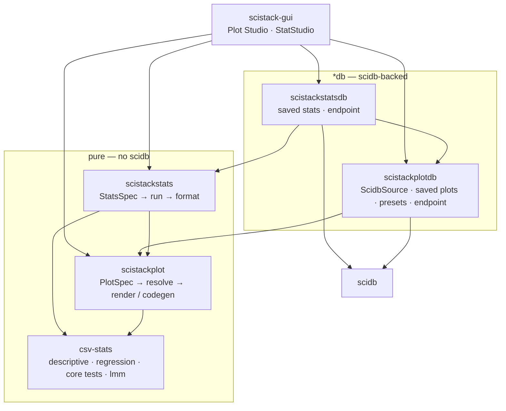
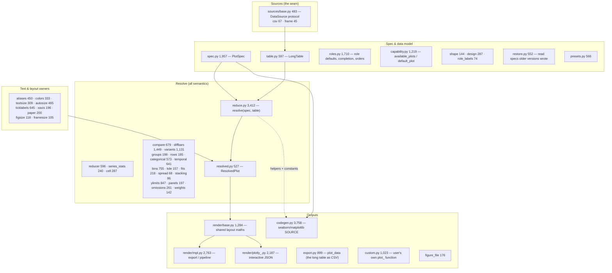
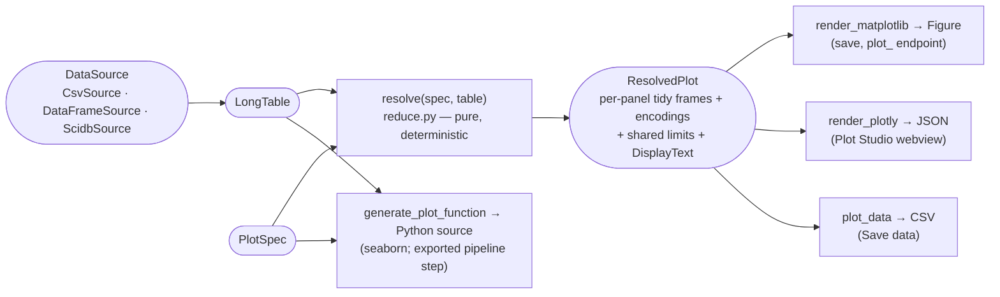
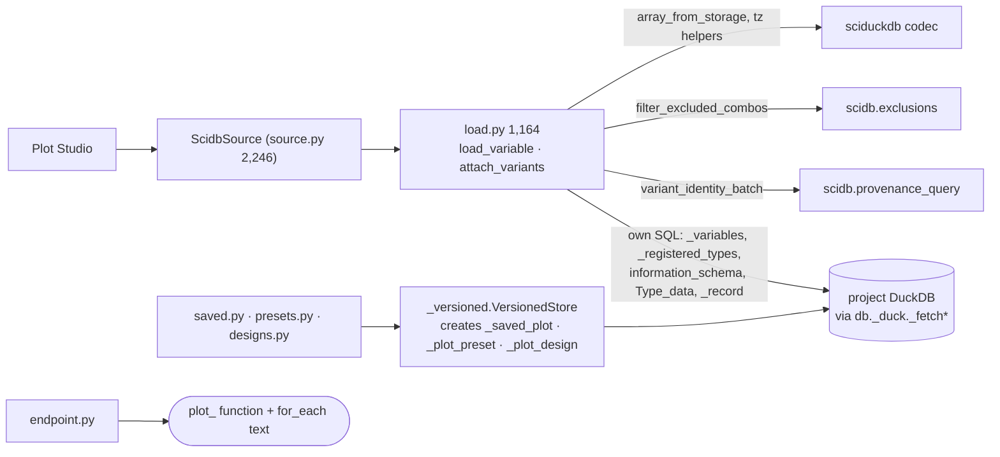
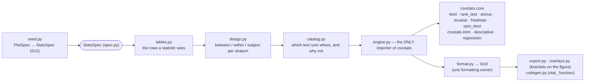

# 06 — The plot/stats tower: csv-stats, scistackplot, scistackplotdb, scistackstats, scistackstatsdb

**Job.** Turn data into figures and statistics tables. There are two rules:

- a figure, or a table, is a **serializable spec** (`PlotSpec`, `StatsSpec`);
  the picture or the numbers are a view of it;
- each tower has a **pure** package that knows nothing about scidb, and a
  `*db` sibling that feeds it from a scidb project.

This mirrors scifor (pure loop) and scidb (database), and it is the reason
the GUI's Plot Studio works on a lone CSV and on a full project alike.

| Package | Source | Tests | Knows about |
|---|---:|---:|---|
| csv-stats (`csvstats`) | 4,252 | 3,086 | numpy, pandas, scipy (+ statsmodels, pingouin for `[full]`) |
| scistackplot | 36,044 (55 modules) | 30,752 | pandas, numpy, csv-stats, scistacklog, scicanonicalhash; matplotlib optional |
| scistackplotdb | 6,028 | 7,950 | scistackplot + scidb + sciduckdb |
| scistackstats | 6,015 | 2,199 | csv-stats + scistackplot |
| scistackstatsdb | 406 | 223 | scistackstats + scistackplotdb + scidb |

csv-stats is its own git repository, checked out inside the monorepo and
listed in `.gitignore` (`/csv-stats/`). It is the user's published package,
pinned as `csv-stats>=0.5.0` by scistackplot and `>=0.4.0` by scistackstats.

*Arrows are imports. scistackstats depends on scistackplot. It does not use
plot drawing: it uses the **data-design model** that lives there (`LongTable`,
roles, variants, `design_fingerprint`, `PlotSpec`'s `Filter`/`Role`). That is
how "statistics from the same design a figure draws" is implemented.*

---

## scistackplot

### Shape

55 modules in one flat namespace, except `render/` and `sources/`. Grouped by
job (the grouping is mine):

### Flow: spec → figure, three ways

*The design decision that makes this tower work: **all data reduction happens
once, above the renderer split** (`docs/claude/plotting-library-design.md`
"The resolve pipeline"). The two renderers are translators, so the
interactive view and the saved figure cannot disagree. The code generator is
the deliberate exception. It emits **literal seaborn code**, so an exported
pipeline has no runtime dependency on scistackplot. That makes it a third
statement of the same figure, kept equal to the preview by export-vs-render
parity tests (`test_legend_parity.py`, `test_compare_export.py`,
`test_difference_bars_export.py`, …). The rule "export must match preview"
is a standing user decision.*

### Assessment

**Strengths**
- **The cleanest architecture in the repo.** A pure spec, one reduction
  above the renderers, a three-method `DataSource` protocol as the only seam
  to data, and goldens on `ResolvedPlot`.
- **Single-owner discipline at module scale.** At least 20 module docstrings
  open with "the one owner" / "the ONE owner": aliases, colors, textsize,
  paper, bins, kde, categorical, temporal, stacking, rows, omissions,
  role_labels, design, figsize, and others. Shared constants
  (`spaghetti.SPAGHETTI_SPREAD`, `bins.*_SOURCE`, `weights`) are imported by
  renderers *and* codegen rather than restated.
- **Formulas are owned below it.** `spread.py` says "How a plot DRAWS a 95%
  confidence interval. The formula is not defined here", and `fits.py` says
  the same of regression. Both formulas live in `csvstats.descriptive` and
  `csvstats.regression`, which StatStudio uses too. A figure's error bars and
  a stats table's CI therefore cannot disagree.
- **Specs survive versions** (`restore.py`), which matters because specs are
  stored in project databases and bundles.

**Weaknesses**
1. **Codegen is a third implementation of the figure.** At 3,758 lines it is
   the largest module. It re-derives aggregation in emitted pandas/seaborn
   text (16 `groupby` sites, against 8 in `reduce.py`). It shares helpers and
   constants with `reduce`, but every new plot feature is written three times:
   reduce, then both renderers via base, then codegen. Only the parity tests
   hold codegen in line. This is a chosen cost (no runtime lock-in), not an
   accident, but it is the most expensive place to add a feature.
2. **`reduce.py` (3,412 lines)** is where every feature's semantics land.
   The feature modules (`compare`, `diffbars`, `variants`, …) own their rules,
   but their orchestration is threaded through one module.
3. **Location filtering is transcribed three times.** The location
   semantics doc names three copies: combos in `scifor.locations`, rows in
   `scistackplot.reduce._location_mask`, and checkbox state in the GUI's
   `locationSelection.ts`. A parity table in
   `docs/claude/location-filter-semantics.md` keeps them aligned. The copies
   exist because scistackplot must not import scifor. *Correction from
   [07](07-gui.md#rules-stay-in-python):* `locationSelection.ts`'s header
   names a fourth, `scistackplot.codegen`, which emits the mask as source.
4. **The design model lives in the plotting package.** `LongTable`, roles,
   variants and `design_fingerprint` are the shared data-design vocabulary
   for plots *and* statistics, so scistackstats imports scistackplot to get
   them. This is not a problem today: matplotlib is an optional extra, so
   stats does not pull a renderer. But the package name hides it.
5. **Flat namespace of 55 modules.** The five groups above are real but
   invisible in the layout.

**Refactor candidates**

| # | Change | Removes |
|---|---|---|
| P1 | Subpackages for the five groups (`scistackplot.model`, `.reduce`, `.text`, `.render`, `.export`), with an import-order test. `model` is what scistackstats imports. | weaknesses 4, 5 |
| P2 | Generate codegen from `ResolvedPlot` where possible: emit the reduced per-panel frames' *recipe* (the reduction steps `reduce` took, as a plan object) instead of re-deriving them from the spec. Concretely, `reduce` records the pandas operations it applied (`ReductionPlan`) and codegen prints that plan. | weakness 1, for the reduction half; the drawing half stays a translation, like a third renderer |
| P3 | Move location-filter semantics into a dependency-free leaf that scifor, scistackplot and (via a generated table) the GUI all read. scicanonicalhash is the existing zero-dependency leaf, but a tiny `scistack-locations` or a module in scistacklog's tier is cleaner. Alternatively keep three copies but **generate** the parity cases into each language's tests from the doc's JSON (`docs/claude/location-filter-cases.json` already exists). | weakness 3 |

P3's second option is cheap and keeps the dependency rule. The JSON case file
already exists, so it is only a matter of reading it in all three test
suites.

---

## scistackplotdb

**Job.** `ScidbSource` implements `DataSource` against a scidb project. The
package also stores saved plots, presets and linked designs in the project
database, and generates the `plot_` endpoint (`for_each` call + function)
from a spec.

*`load_variable` is a **second bulk-load path** for scidb data. It is written
in SQL against scidb's tables rather than through
`DatabaseManager.load_all_as_df`, because of measured scale problems: one
variable's payload was 174 M samples / ~5.2 GB, and the metadata-only
`include_data=False` mode exists for that reason
(`.claude/plot-at-scale-plan.md`). It reuses scidb's owners where they exist:
the variant display rule, exclusions, and the sciduckdb codec pieces.*

**Assessment**
- **Strength:** the protocol boundary holds. The GUI's Plot Studio never
  knows it has a scidb source.
- **Weakness — a parallel read path into scidb's private schema.** 24 private
  `SciDuck` calls (`_versioned.py` 15, `load.py` 8, `source.py` 1). It hard-codes scidb table names (`_registered_types`,
  `_variables`, `_record`) and the exclusion predicate
  (`r.excluded IS DISTINCT FROM TRUE`; `state.py` spells it
  `COALESCE(r.excluded, FALSE) = FALSE`). Any change to scidb's storage
  layout must be found here by grep.
- **Weakness — a generic store owned in the wrong place.** `VersionedStore`
  ("named, versioned, hideable rows") is a general facility, and
  scistackstatsdb imports it from the **private** module
  `scistackplotdb._versioned`, plus `bundle_section._remap_row`. Two `*db`
  packages each own tables in the project database (`_saved_plot`,
  `_plot_preset`, `_plot_design`; scistackstatsdb adds `_stats_spec`, `_stats_preset`). Combined with
  [03](03-sciduckdb.md#who-owns-which-tables), three packages now create
  tables in one database.

**Refactor candidates**

| # | Change | Removes |
|---|---|---|
| PD1 | scidb grows the bulk long-frame read that plotting needs (`RecordStore.long_frame(type, include_data=…)` from 04c Q2), with plot-at-scale's performance as its acceptance test. `load_variable` becomes a call. | the parallel read path |
| PD2 | Move `VersionedStore` into scidb (`scidb.store.versioned`) as the one owner of "named, versioned, hideable rows". scistackplotdb and scistackstatsdb declare their tables through it. | private cross-package import; scattered DDL |

---

## csv-stats, scistackstats, scistackstatsdb

### Flow: a StatStudio table

*`engine.py` is the only module that imports csv-stats (plan P9). That makes
the statistics engine replaceable, and makes it the single place where the
record shape csv-stats returns is read. `catalog.py` owns refusals ("this test
cannot run here, because …"), so the GUI never decides that itself.
scistackstatsdb (406 lines) adds the saved-table store and the `stat_`
endpoint generation, on top of scistackplotdb's source and store.*

**Assessment**
- **Strengths:**
  - one importer of the engine;
  - one formatting owner;
  - one refusal owner;
  - a lay-language layer (`explain.py`, `guide.py`) kept apart from the
    computation;
  - csv-stats' new `core` API is a documented contract (purity, a common
    result record, stated comparison direction, requirements C1–C9).
- **Weakness — csv-stats carries two APIs.** `core.py` / `lmm*` / `descriptive`
  / `regression` is the contract the stack uses. `ttest.py`, `anova.py` and
  `utils/` (about 1,240 lines) are the original file-path → PDF API, which
  nothing in the monorepo calls. It is your published package, so whether
  external users still need the old API is your call. Inside the stack, that
  code is dead.
- **Weakness — stub READMEs.** The scistackstats README is 6 lines and the
  scistackstatsdb README is 4 lines. The design lives in
  `docs/claude/statistics-design.md` and the module docstrings.
- **Minor.** Two version floors for one dependency (`>=0.5.0`, `>=0.4.0`),
  and csv-stats' version is hand-written (`__version__ = "0.5.0"`), where
  every monorepo package derives it from the release tag.

**Refactor candidates**

| # | Change | Removes |
|---|---|---|
| S1 | Decide csv-stats' legacy API: deprecate it in csv-stats' own release notes, or split it into `csvstats.legacy`. Its own repository, its own call. | two APIs in one package |
| S2 | One csv-stats floor across the tower (`>=0.5.0`). | drift |
| S3 | Real READMEs for scistackstats/scistackstatsdb, in the scistackplot README's style (it is the best README in the repo). | stub docs |

---

## Plot/stats tower — summary

| | Verdict | First move |
|---|---|---|
| csv-stats | sound new contract; legacy API alongside | S1 (your call) |
| scistackplot | best-structured package in the repo; codegen is the costly third path | P3 (generate parity cases), then P1 |
| scistackplotdb | protocol boundary holds; second load path + private DDL into scidb | PD2 (small), PD1 with scidb's Q2 |
| scistackstats / statsdb | clean single owners; thin docs; private import from plotdb | PD2 fixes the import; S3 |
