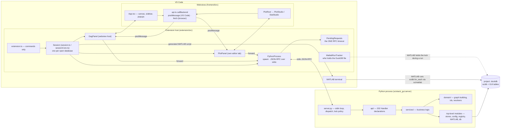
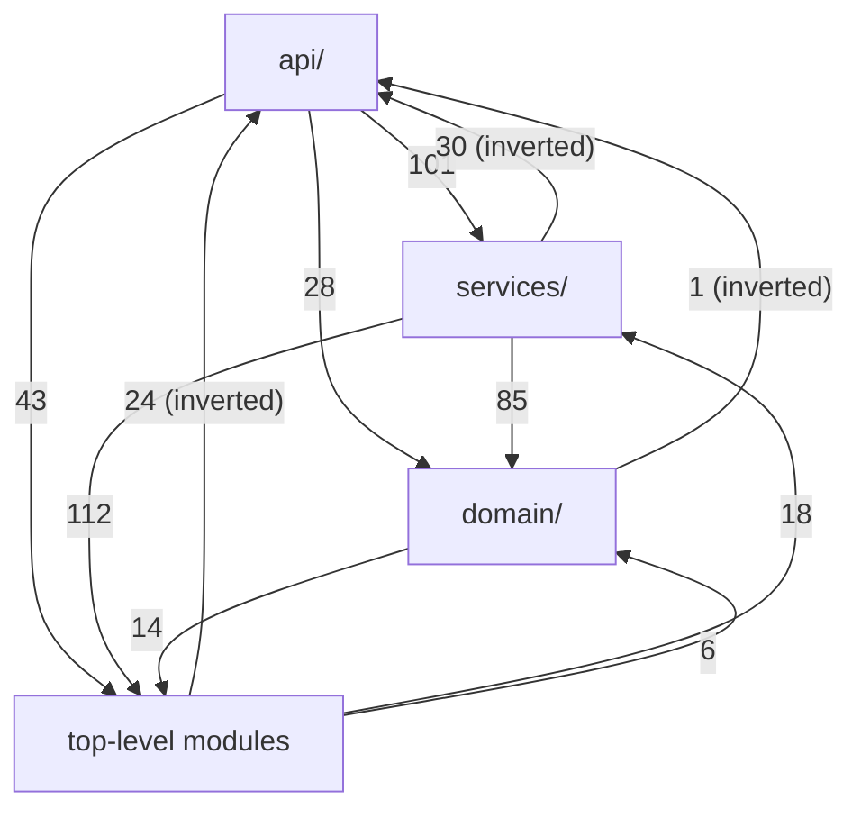
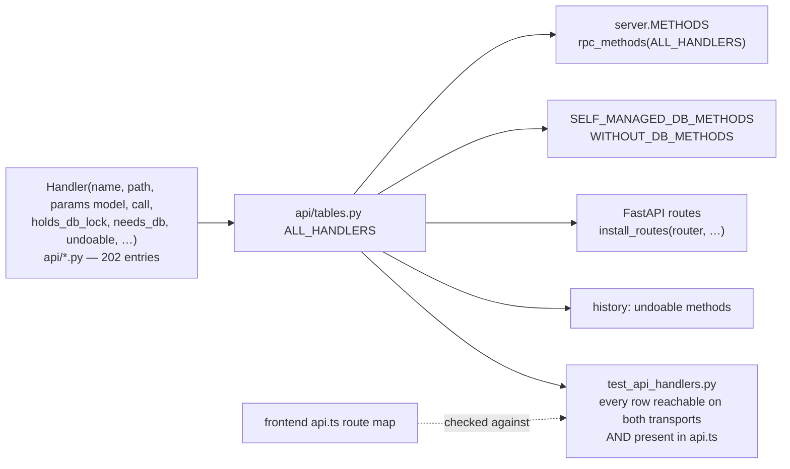
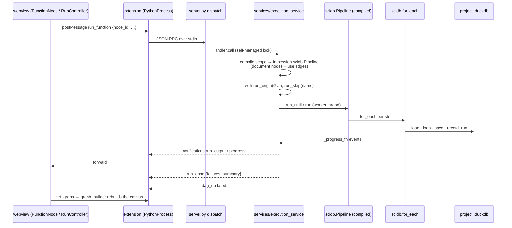
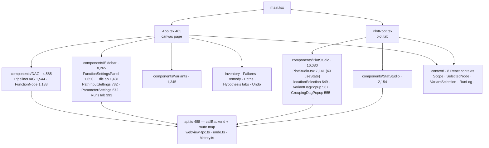

# 07 — scistack-gui: backend, VS Code extension, frontend

**Job.** The visual front end of the whole stack:
- a pipeline **canvas** (functions, variables, parameters, path inputs, and
  the edges between them) that the user wires and runs;
- **Plot Studio** and **StatStudio** for figures and statistics tables;
- panels for variants, inventory, failures, runs, undo, project
  export/import and libraries.

It runs as a VS Code extension (the main target) or as a standalone browser
app.

**Size.** This is the largest package in the repo.

| Part | Language | Source | Tests |
|---|---|---:|---:|
| Python backend (`scistack_gui/`) | Python | 54,656 (110 modules) | 53,137 |
| Frontend (`frontend/src/`) | TypeScript / React | 39,830 | 4,952 |
| Extension host (`extension/src/`) | TypeScript | 5,351 | 1,507 |

---

## The three processes

*Each open database is a **Session**: one Python server, one canvas, and its
plot tabs. A second database gets a second process (`session.ts` explains
why). The webviews never talk to Python directly. Every call is a
`postMessage` that the extension forwards over stdio. In the browser build the
same `callBackend` uses `fetch` against FastAPI (`app.py`). MATLAB runs do not
go through Python's server at all. The extension types a generated script into
a MATLAB terminal, MATLAB opens the database itself, and `MatlabRunTracker`
plus the server's lock-dropping (`db.py`) let the two take turns on the
DuckDB file.*

---

## Python backend

### Shape

| Layer | Files | Lines | What is in it |
|---|---:|---:|---|
| `api/` | 24 | 11,550 | `Handler` tables per area + request models; some large modules carry logic (`matlab_command.py` 2,475, `run.py` 2,197, `pipeline.py` 1,919) |
| `services/` | 39 | 18,288 | `execution_service` 2,629, `plot_service` 2,134, `matlab_command_service` 1,204, `layout_service` 1,171, `library_authoring` 1,020, `target_file_service` 980, … |
| `domain/` | 15 | 7,680 | `graph_builder` 3,932 ("pure graph-building logic"), `edge_resolver` 734, `variant_resolver` 499, `node_identity` 416, `scope_filter` 399, … |
| top level | 32 | 17,138 | `pipeline_store` 2,096, `config` 1,912, `registry` 1,431, `intent_store` 1,288, `matlab_parser` 1,136, `history` 946, `server` 933, `matlab_registry` 848, `db` 796, … |

The internals doc (`docs/claude/scistack-gui-backend-internals.md`) describes
four layers: protocol adapters → services → pure domain → persistence. The
measured import edges between the four groups (counting function-level
imports) show how closely the code follows that:

*The intended direction is api → services → domain. Three edge sets go
upward:*
- *services import `api` 30 times. Most are `api.pipeline._build_graph` (the
  canvas graph assembly lives in an api module) and
  `api.matlab_command`, plus `api.ws.push_message`.*
- *top-level modules import `api` 24 times.*
- *the "top level" is not a layer at all. It is 32 modules that everything
  imports and that import everything, including the persistence stores, the
  project config reader, the code registry and the MATLAB integration.*

*The GUI has **1,402 function-level imports**, the most of any package.*

### What is good here: one handler table, two transports

*This was recommendation 3 of the 2026-09-20 review ("one declarative
handler table") and it has been done. One declaration produces the RPC
method, the HTTP route, the lock policy and the undo label. A test catches a
handler that is missing from either transport or from the frontend. The
handler docstring records the drift it removed: HTTP glue routes broadcast
`dag_updated` and RPC ones did not; a missing self-managed entry once held
the DuckDB lock against MATLAB for 31 seconds.*

### Flow: clicking Run on a canvas node

*A Python run compiles the canvas into a scidb `Pipeline` and runs it in a
worker thread. That reuses scidb's own dependency ordering and staleness
check rather than re-implementing them. The canvas is rebuilt from the
database afterwards (`graph_builder`), so what the user sees is what
provenance recorded. A MATLAB run instead goes through `matlab_command.py` /
`matlab_command_service.py` (3,679 lines together), which **generate MATLAB
`scidb.for_each` source text** for the terminal.*

### The GUI owns tables in the project database

The GUI creates **18 tables** of its own in the user's project `.duckdb`:

| Group | Tables |
|---|---|
| canvas document | `_pipelines`, `_pipeline_nodes`, `_pipeline_node_positions`, `_pipeline_uses`, `_pipeline_hidden_ports`, `_pipeline_notes`, `_pipeline_builtin_functions` |
| parameters & inputs | `_pipeline_palette_parameters`, `_pipeline_parameter_value_groups`, `_pipeline_path_input_history`, `_pipeline_path_input_renames` |
| intent & wiring | `_intent`, `_node_config`, `_node_wiring`, `_adopted` |
| undo / other | `_canvas_change`, `_hypotheses`, `_library_pipelines` |

These are created in five top-level modules (`pipeline_store`, `intent_store`,
`layout`, `node_wiring`, `history`). One crosses a layer the wrong way:
**`_intent` is created by the GUI (`intent_store.py:101`) and read by scidb**
(`scidb.intent.load_statements_sql`, `INTENT_TABLE = "_intent"`). The core
depends on a table only the application creates.

Counting every package, at least five packages now write DDL into one
database: sciduckdb, scidb, scistackplotdb, scistackstatsdb, and the GUI.

### `scistack.toml` has several readers

| Reader | What it reads |
|---|---|
| `scifor.discovery.read_scistack_section` | whole file; returns `None` on parse error |
| `scistack_gui.config` (1,912 lines) | opens the file **itself** twice (`:417`, `:1206`). It owns the meaning of `modules`, `matlab.sources`, packages and plugin discovery |
| `scidb.entities`, `scidb.library`, `scidb.bundle` | their own sections |
| `scifor.machine` | `machine.toml` (separate file) |

Writes are single-owner (`scidb.config_file`, called from `config.py`). Reads
and section meanings are spread across three packages. The GUI holds the
largest share, although these sections describe the *project*, not the GUI.
This is the same "project runtime has no home" problem as scifor group C and
scidb's project cluster ([04a B3](04a-scidb-structure.md)).

### Backend assessment

**Strengths**
- **The handler table** (above) is the strongest structural piece of the
  GUI, and it has a test that covers the frontend too.
- **Runs reuse scidb.** A canvas run compiles to `scidb.Pipeline`, and the
  canvas is rebuilt from provenance. The GUI does not keep its own idea of
  what ran.
- **Identity recipes are imported, not re-spelled.** `graph_builder` and
  `variant_resolver` import `compute_wiring_id`, `CallSite`, `RunOptions` and
  `split_call_site_outputs` from scidb. That was recommendation 1 of the
  September review.
- **Diagnostics are first-class**: startup diagnostics, live timers, and
  journal integration.

**Weaknesses**
1. **The layers are named but not enforced.** 30 service → api imports.
   `_build_graph`, the main read of the whole GUI, lives in `api/pipeline.py`.
   A 17,000-line "top level" sits beside the three layers, and there are
   1,402 lazy imports.
2. **The GUI is a schema owner of the project database** (18 tables), and
   scidb reads one of them (`_intent`).
3. **Project configuration semantics live in the GUI** (`config.py`), with its
   own file reads beside scifor's reader.
4. **MATLAB support is a large second code path.** That covers
   `matlab_command` + service (3,679 lines generating MATLAB source),
   `matlab_parser` (1,136, parsing `.m` files), `matlab_registry` (848),
   `matlab_run_watch` (467), `matlab_sidecar` (369) and `matlab_rewrite`
   (93): about 6,600 lines. Generating `for_each` call text is a fourth place
   that knows `for_each`'s options (after scidb, scifor and scimatlab's
   `split_options`).
5. **`domain/` is not pure.** The docstring of `graph_builder` says "No I/O",
   but `domain/output_order.py:66-68` queries
   `provenance_query.recorded_output_orders(db._duck, …)`, and domain modules
   import scidb 15 times.
6. **The GUI uses scidb internals.** It makes 26 `db._duck` calls and imports
   `provenance_query`, `provenance`, `foreach_config`, `bindings` and
   `state` directly ([04a](04a-scidb-structure.md#contract-what-other-packages-import)).
7. **The internals doc is stale.** `scistack-gui-backend-internals.md`
   (1,422 lines) still says the backend runs `scihist.for_each()`, and its line
   references are to a backend of ~2,300 lines.

---

## VS Code extension

**Shape.** It is small and well-factored. The pieces with logic have
vscode-free cores with unit tests:

| Piece | vscode-free core |
|---|---|
| `Session` | `sessionCore.ts` |
| RPC timeouts | `rpcPending.ts`, "the ONE owner of the 'how long do we wait' backstop" |
| MATLAB run tracking | `matlabRunTracker.ts` |
| startup diagnostics | `startupDiagnostics.ts` |
| bundle import | `bundleImportCore.ts` |

`extension.ts` (392 lines) is "the command layer and nothing else".

**Assessment.** This is the healthiest part of the GUI. Two points:
- `dagPanel.ts` (953) and `session.ts` (892) are the large files, and are the
  natural next split.
- The DuckDB file lock is shared between the Python server and MATLAB by
  convention: the server drops the lock between requests, and the extension
  tracks MATLAB runs. Three components (`db.py`, `matlabRunTracker.ts`,
  scimatlab) cooperate on one invariant that no single place states. It works,
  and is well commented, but is a coordination protocol spread across two
  languages.

---

## Frontend

### Shape

*PlotStudio is 40% of the frontend. `PlotStudio.tsx` alone is 7,141 lines
with 63 `useState` hooks. The 2026-09-20 review measured it at 3,916 lines,
so it has nearly doubled in six weeks.*

### Rules stay in Python

Most PlotStudio helper modules say in their headers that the rule lives in
Python, and they render what the backend reports:
- `continuousKinds.ts`: "Every RULE lives in Python";
- `combine.ts`: Python (`scistackplot/groups.py`) owns what a combine means;
- `showSample.ts`: the rules live in `scistackplot/roles.py`;
- `compare.ts`: `scistackplot.compare` is the one owner;
- `kindTiles.ts`: entries come from `capability.categorical_kind_entries`.

Availability, defaults and refusals come from `capability.py` and
`catalog.py` over RPC. Two exceptions are explicit mirrors:
- `groups.ts`: "The mirror of `PlotSpec.ordered_groups`";
- `locationSelection.ts` (649 lines): the location-filter semantics. Its
  header names the other copies: `scifor.locations`, `scistackplot.reduce`
  and `scistackplot.codegen`. That makes **four** implementations of one rule,
  one more than counted in [06](06-plot-and-stats.md).

### Frontend assessment

**Strengths**
- One backend call surface (`callBackend`, 198 call sites) that hides the
  transport.
- Rules are fetched, not re-implemented, with two declared exceptions.
- Undo and history are built in at the call layer (`undo.ts`, `history.ts`).

**Weaknesses**
1. **`PlotStudio.tsx` is 7,141 lines with 63 pieces of component state.** It
   is the single largest source file in the repo, in any language.
2. **Request and response types are hand-written.** The backend validates
   every request with a pydantic model, but the frontend has no generated
   types from them. `api.ts`'s route map is checked by test only for
   path/method/body. `PlotSpec` has no TypeScript type: there is a
   `CustomPlotSpec` interface inside `PlotStudio.tsx`, and a `StatsSpec`
   interface in `statsSpec.ts` that mirrors the Python dataclass by hand.
3. **Thin frontend tests.** 4,952 test lines against 39,830 source lines
   (12%). The Python backend is close to 1:1 (53,137 test lines for 54,656 source).

---

## GUI refactor candidates

| # | Change | Removes |
|---|---|---|
| G1 | Move `_build_graph` and the other logic in `api/pipeline.py`, `api/run.py` and `api/matlab_command.py` into services, leaving api modules as Handler tables plus request models. Add an import-order test (api → services → domain → stores; no upward edges). | backend weakness 1 |
| G2 | Give the top level a home. `stores/` (pipeline_store, intent_store, layout, node_wiring, history — everything that owns a table), `matlab/` (parser, registry, run_watch, sidecar, rewrite, command generation), `project/` (config, registry, discovery, libraries; see G3), and `runtime/` (server, app, db, startup, bootstrap). | backend weakness 1, 4 (visibility) |
| G3 | Move project-config *meaning* (`modules`, `matlab.sources`, packages) out of `config.py` into the project-runtime home decided in 04a B3 (`scifor.project`). The GUI calls it. | backend weakness 3 |
| G4 | Make scidb own `_intent` (scidb already owns its vocabulary in `scidb.intent`). Then decide one rule for application tables: a GUI-owned table that scidb never reads may stay in the GUI, declared through the same store helper as PD2's `VersionedStore` ([06](06-plot-and-stats.md)). | backend weakness 2 |
| G5 | Generate MATLAB `for_each` command text from one declaration of `for_each`'s options, the same declaration W3 ([04b](04b-scidb-write-path.md)) proposes for the Python signature. scimatlab's `split_options` reads it too (M4 in [05](05-scidb-satellites.md)). | backend weakness 4, the option-list copies |
| G6 | Route GUI reads through `scidb.inspect.Inspector` and drop `db._duck` use (04c Q3). | backend weakness 6 |
| G7 | Split `PlotStudio.tsx` by rail group (the five collapsible groups already exist in the UI), with a reducer (`useReducer`) or store for the spec, instead of 63 `useState`s. | frontend weakness 1 |
| G8 | Generate TypeScript types from the pydantic request models and from `PlotSpec` / `StatsSpec` (JSON Schema → TS). The existing handler test can assert the generated file is current. | frontend weakness 2 |
| G9 | Archive or rewrite `scistack-gui-backend-internals.md` from this document. | backend weakness 7 |

> **Done (2026-11-01, P2 stages 5-6):** G1 — logic moved out of `api/` unchanged: `services/graph_service.py` (from `api/pipeline.py`), `services/run_service.py` (`api/run.py`), `services/project_service.py`, `services/variable_service.py`, `services/matlab_command_format.py` (all of `api/matlab_command.py`), `ws_hub.py` (`api/ws.py`); only `app.py`/`server.py` import `api/`. G2 — `stores/`, `matlab/`, `project/`, `runtime/`; `ids`, `bootstrap`, `headless`, `app` stay top level (their measured layers differ from the proposal). `scistack-gui/tests/test_import_layers.py` enforces core → runtime → stores → project/matlab → domain → services → setup → api → entry, 14 allow-listed pairs.
> **Done (2026-11-01, P3):** G3 — `scifor.project.config.read_project_config` returns typed `ProjectConfig`/`MatlabSection`; the GUI's `load_config` only expands entries into files. No `tomllib` in the GUI (`test_config_reader_owner.py`), none outside scifor.project repo-wide except a listed allow-list (`scifor/tests/test_toml_reader_owner.py`).
> **Done (2026-11-01, P3):** G4 — `_intent` is declared by scidb (`scidb.tables.INTENT`) and created on every writable open; the GUI's 17 other tables are `TableDecl`s with owner `scistack_gui`, created on first use through `tables.ensure`.

**Order.** G1 + G2 are mechanical moves that make every later change smaller.
G7 is independent and is the largest maintainability win on the frontend.
G3, G4 and G5 depend on the project-runtime and `for_each`-options decisions,
which the synthesis (doc 09) will bring together.
