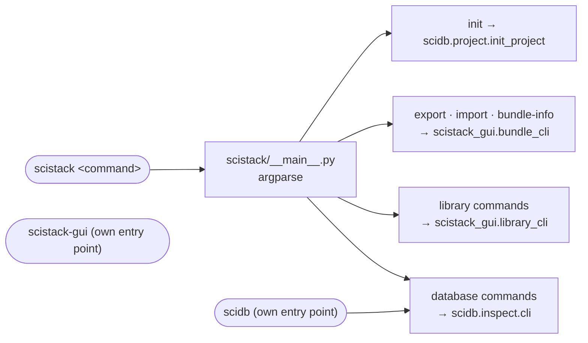
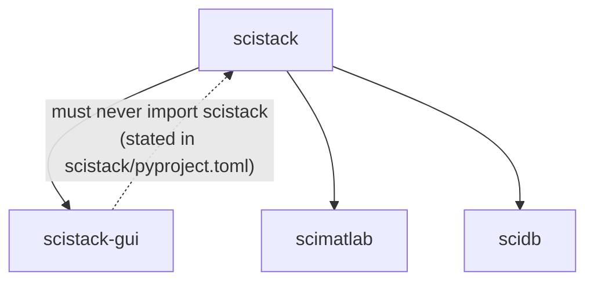

# 08 — scistack: the umbrella package

**Job.** `pip install scistack` is the one-stop install. It depends on
`scistack-db`, `scimatlab` and `scistack-gui`, which pulls in every
sibling. The package also provides the `scistack` command-line tool and a
small user-global config module.

**Size.** 542 source lines in 3 modules; 519 test lines.

| Module | Lines | Contents |
|---|---:|---|
| `__main__.py` | 166 | the `scistack` CLI |
| `user_config.py` | 336 | `~/.scistack/config.toml`: library "taps" (git-cloned package indexes) |
| `__init__.py` | 40 | re-exports `user_config` |

---

## Flow: the `scistack` command

*The CLI owns no behaviour. Every subcommand delegates to a lower package,
which is the right shape. But the delegates show where things live: two of
the four command groups (bundles, libraries) are implemented **in the GUI
package**, so project export/import from a terminal goes through
`scistack_gui`. There are three console scripts in total: `scistack`,
`scidb` (`scidb.inspect.cli:main`) and `scistack-gui`.*

### Dependency direction

*The rule is written down and holds: nothing in the GUI imports `scistack`.
`user_config` (taps) is therefore unreachable from the GUI by design.*

---

## Assessment

**Strengths**
- A real one-command install, with sibling versions in lockstep (CI checks
  `==<version>` pins).
- The CLI is a thin front end. `init` is "a thin front end over
  `scidb.project.init_project`, the one owner of creating a project", and the
  GUI's create-database wizard calls the same owner.

**Weaknesses**
1. **The bundle and library CLIs live in the GUI package.**
   `scistack_gui.bundle_cli` (439 lines) and `library_cli` (241) implement
   terminal commands with no GUI in them. The project-bundle logic itself is
   in `scidb.bundle`. The CLI wrapper and the GUI and code sections
   (`scistack_gui.bundle_section`, `headless.py`) sit in the GUI. This is
   another face of "project runtime has no home" (see 09).
2. **Library taps are unused.** `user_config.py`'s docstring says the tap
   format is "deferred until Phase 7". No code outside `scistack/tests`
   calls `add_tap`, `list_taps` or `load_config`. The design rule above means
   the GUI cannot call them either. So the umbrella's only module of its own
   is a feature with no consumer.
3. **A stray package at the repo root.** `src/scistack/__init__.py` is a
   tracked one-line file (`__version__ = "0.1.0"`), last touched by the
   commit "Renamed to SciStack" (`edff478e`). It is a second `scistack`
   package beside `scistack/src/scistack/`. It does no harm unless `src/` ends
   up on `sys.path`, for example when running from the repo root with a
   `src`-layout tool. When that happens it shadows the real package.
4. **Three entry points with overlapping commands.** `scistack <db command>`
   and `scidb <command>` are the same code, which is fine. `scistack-gui` is
   separate. That makes it hard to say which one is "the" CLI.

**Refactor candidates**

| # | Change | Removes |
|---|---|---|
| U1 | Move `bundle_cli` and `library_cli` out of the GUI, next to `scidb.bundle` / `scidb.library` (the model-bound project runtime, `scidb.project` in 04a B3), and register them from `scistack`. The GUI's bundle *sections* stay in the GUI and register themselves, as plots and stats already do. | weakness 1 |
| U2 | Decide taps: either schedule them (and give the GUI a path to them through a lower package), or mark the module hidden until Phase 7. | weakness 2 |
| U3 | Remove the stray `src/scistack/__init__.py` (and the empty `src/` folder). | weakness 3 |
| U4 | Document `scistack` as the CLI and `scidb` as an alias for its database commands. | weakness 4 |

> **Done (2026-11-01, P1):** U2 — taps (`scistack.user_config`) deleted (D7). U3 — stray `src/scistack/` removed.
