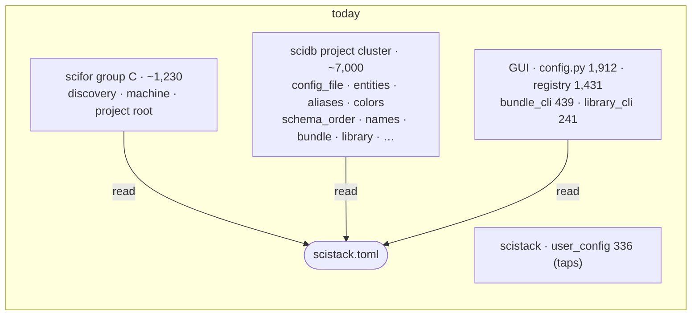
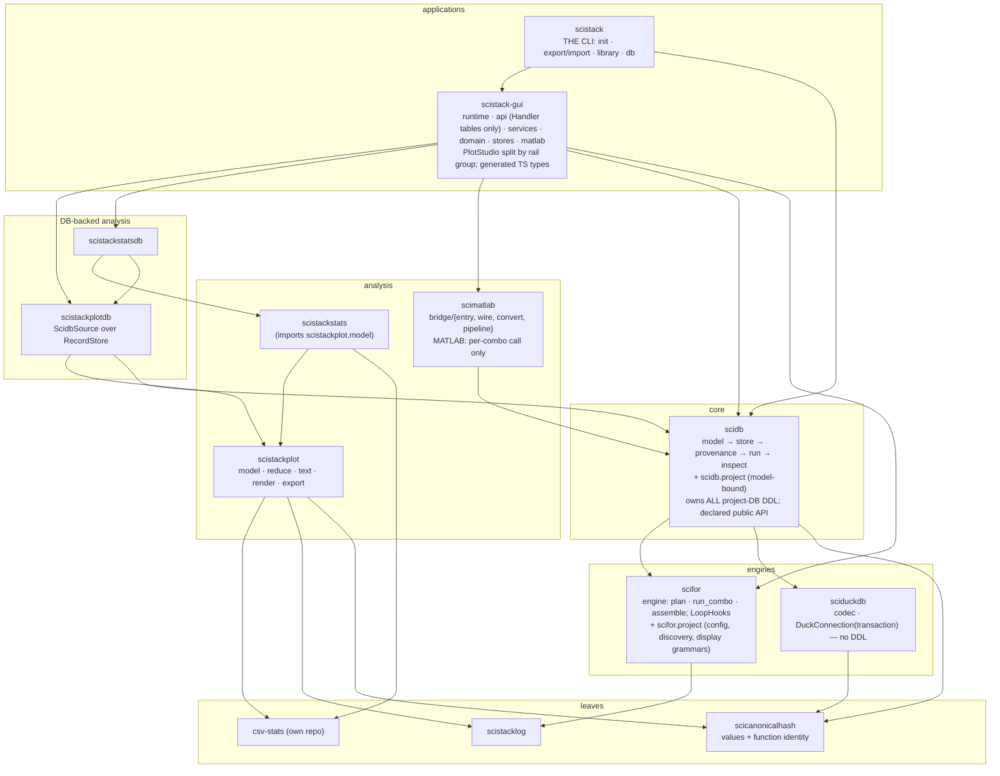

# 09 — Synthesis: what the stack is, what recurs, and a target layering

*Reads docs 01–08 together. Every finding here points back to the document
and refactor ID where its evidence is. Nothing is new measurement except the
roll-up tables.*

## The stack in one paragraph

SciStack is two towers on shared foundations.
- The **data tower** runs a user's function over every location of a nested
  schema and records how each result was made: scifor (loop) → sciduckdb
  (storage codec) → scidb (variables, `for_each`, provenance graph) →
  scimatlab (MATLAB front end).
- The **plot/stats tower** turns the same data into figures and tables from
  serializable specs: csv-stats → scistackplot → scistackstats, with `*db`
  siblings that read scidb.
- The **GUI** joins the two towers.

The foundational ideas are sound and should survive any refactor:
- content-addressed identity;
- one provenance graph as the only source of truth;
- pure computation separated from database access;
- specs as the product of the visual tools;
- "one concept, one owner", stated in module docstrings.

What has gone wrong is almost entirely **where things live and how big
they have grown**, not what they do.

---

## What to keep (the strengths that recur)

| Strength | Where it shows | Docs |
|---|---|---|
| **Pure / DB split per tower** | scifor ↔ scidb; scistackplot ↔ scistackplotdb; scistackstats ↔ scistackstatsdb | 02, 06 |
| **One graph, everything derived** | variants, latest, staleness, branch params all computed from `_record` / `_invocation` / edges | 04b, 04c |
| **Content-addressed, idempotent writes** | re-running writes no new graph rows | 04b |
| **One recipe per identity** | `CallSite`, `compute_wiring_id`, `source_hash` (Python and MATLAB call one recipe) | 04b, 05 |
| **Specs, not pictures** | `PlotSpec` → `resolve` → two renderers; `StatsSpec` → engine | 06 |
| **Declared once, generated twice** | the GUI's `Handler` table makes both transports, lock policy, undo labels, with a test that covers the frontend | 07 |
| **Python owns identity for MATLAB** | prepare and save are shared; MATLAB mirrors only the loop | 04b, 05 |
| **Single-owner modules, named as such** | dozens of "THE / the ONE owner" docstrings in scifor, scidb, scistackplot, scistackstats, extension | all |

Several items from the 2026-09-20 architecture review are **done**:
- the handler table (rec. 3);
- `wiring_id` moved into scidb (rec. 1);
- a typed `_ForEachState` with a small execute phase (rec. 2, partly);
- the rid spine (`bindings.py`).

---

## Eight cross-cutting themes

Each theme appears in three or more packages. The fix for each is therefore
a **rule**, applied everywhere, rather than a per-package refactor.

### T1. Project runtime has no home

"Project runtime" covers config files, entity declarations, display settings,
code discovery, libraries and bundles. It is spread over five packages:

Evidence: 02 (group C, R3), 04a (B3 and its answer), 07 (`config.py` reads
the file itself and owns the meaning of `modules` / `matlab.sources`),
08 (bundle and library CLIs in the GUI).

**Rule:** project runtime lives in **two** subpackages, split by dependency.
- `scifor.project`: everything that imports nothing from scidb's model. That
  is discovery, machine roots, project root, the config file and its section
  meanings, aliases, colours, schema order, names, source_edit, schema_map,
  and the TOML half of entities.
- `scidb.project`: everything that builds on Variables, Parameters or the
  database. That is entity materialization, discover, init, library, bundle,
  environment, verify, table_copy, and the bundle/library CLIs (from the GUI).

The GUI and the umbrella **call** these packages and own none of it. No new
distribution (the answer under B3 in 04a gives the reasoning).

### T2. Nobody owns the project database's schema

| Package | Tables it creates in the project `.duckdb` |
|---|---|
| sciduckdb | 3 (`_schema`, `_variables`, `_variable_groups`) |
| scidb | ~20 (provenance graph, `<Type>_data`, audit, exclusions, pins, …) |
| scistackplotdb | 3 (`_saved_plot`, `_plot_preset`, `_plot_design`) |
| scistackstatsdb | 2 (`_stats_spec`, `_stats_preset`) |
| scistack-gui | 18 (canvas document, intent, wiring, undo, …) |

Plus a reverse dependency: scidb reads `_intent`, which only the GUI creates.

Evidence: 03 (D4), 06 (PD2), 07 (G4).

**Rule:** scidb is the one owner of the project database's DDL.
- Every other package **declares** its tables through one scidb registration
  helper. That helper is the generalized `VersionedStore` (PD2) plus a plain
  table declaration.
- sciduckdb creates none; it becomes codec + connection (D4, option 2).
- A table scidb reads must be declared by scidb (`_intent`, G4).

Consequence: one place lists every table. Bundles (`table_copy`) and
`clear_data` can then be driven from that list instead of from knowledge
spread around the repo.

> **Done (2026-11-01, P3 stage 6 step 7):** each scidb `TableDecl` carries
> `bundle` (history / intent / data / none) and `cleared` or `kept_reason`;
> `bundle.HISTORY_TABLES`, `INTENT_TABLES`, the data section's fixed tables,
> and `clear_data.CLEARED_TABLES` / `KEPT_TABLES` are read from
> `scidb.tables`. `declare` refuses a scidb table that is neither cleared nor
> kept with a reason.

### T3. The real interfaces are private

| Boundary | Measured | Doc |
|---|---|---|
| sciduckdb ← everyone | 153 calls to underscore methods; the public `save`/`load` API unused | 03 |
| scidb ← consumers | 40 different modules imported; `db._duck` used 26× by the GUI | 04a |
| scifor ← scidb / GUI | 8 underscore hook parameters on `for_each` | 02 |
| scistackplotdb ← scistackstatsdb | imports the private `_versioned` module | 06 |
| Inspector | "the one read API", bypassed by the GUI | 04c, 07 |

**Rule:** each package declares its public surface. Each consumer package has
one import-boundary test that fails on an import outside it. Where the
private call *is* the real need, promote it:
- sciduckdb `DuckConnection` with `transaction()` (D2);
- scifor `LoopHooks` (R2);
- scidb `RecordStore` + `Inspector` additions (B2, Q2, Q3).

### T4. Features accrete inside a few giant functions

| Function / file | Lines | Shape | Doc |
|---|---:|---|---|
| `scifor.for_each` | 1,226 | 21 params, numbered step comments with insertions | 02 |
| `scidb._save_results` | 712 | `# PHASE 1…4` banners | 04b |
| `DatabaseManager.save_batch` | 624 | | 04b |
| `scidb.for_each` | 618 | 28 params | 04b |
| `DatabaseManager._find_record` | 404 | | 04c |
| `DatabaseManager` | 91 methods | storage + query + provenance + display config | 04a |
| `PlotStudio.tsx` | 7,141 | 63 `useState`; doubled since 2026-09-20 | 07 |
| `graph_builder.py` | 3,932 | | 07 |
| `scistackplot/codegen.py` | 3,758 | third statement of every figure | 06 |
| `scistackplot/reduce.py` | 3,412 | | 06 |
| `scimatlab/bridge.py` | 3,061 | 58 functions, four jobs | 05 |
| MATLAB `+scifor/for_each.m` | 3,941 | hand mirror of `scifor.for_each` | 05 |

The pattern is the same everywhere. Phases are marked by comments, state is
shared through local variables, and each new feature becomes a block inside
the function.

**Rule:** a function that orchestrates phases is a **composition** of named
phase functions over a typed plan.
- `plan → run_combo → assemble` (scifor R1);
- `SavePlan → apply` (scidb W2);
- `select_records → materialize` (scidb Q2);
- a spec reducer in PlotStudio (G7).

For MATLAB the phase boundaries are the payoff: once they exist, MATLAB can
call Python for plan and assemble and mirror only the per-combo call (M3).

### T5. Concepts with more than one implementation

This is the theme CLAUDE.md note 4 warns about. These copies were found by
reading, so the list is a lower bound:

| Concept | Copies | Where | Doc / fix |
|---|---:|---|---|
| "latest record" (supersession) | 3 (+2 deliberate display rules) | `_find_record` SQL, `get_latest_record_id_for_variant`, `state._get_latest_record_at_location`, `latest_at_location_batch` ("mirrors"); differ on NULL `schema_id` | 04c Q1 |
| location filter | 4 | `scifor.locations`, `scistackplot.reduce`, `scistackplot.codegen`, GUI `locationSelection.ts` | 06 P3 |
| `for_each` options | 4 | scidb signature, scifor signature, MATLAB `split_options`, GUI MATLAB command generation | 04b W3, 05 M4, 07 G5 |
| the per-combo loop | 2 | `scifor.for_each`, `+scifor/for_each.m` | 05 M3 |
| a figure | 3 | `reduce` (+ 2 translating renderers), `codegen` | 06 P2 |
| path template | 3 | `scifor.PathInput`, `scipathgen.PathGenerator`, `PathGenerator.m` | 01 |
| bulk load of a variable | 2 | `DatabaseManager.load_all_as_df`, `scistackplotdb.load.load_variable` | 06 PD1 |
| `Merge` semantics | 2 | positional concat (`for_each`), inner join (`csv_export`) | 02 |
| frame origin, output column name | 2 each | scifor + MATLAB | 05 M1 |
| reading `scistack.toml` | 3 | scifor, GUI `config.py` (×2 opens), scidb sections | T1 |
| storing a variable | 2 | scidb `_record` + `<Type>_data`; dormant `SciDuck.save/load` | 03 D3 |
| `canonical_hash` import name | 3 | `scicanonicalhash`, `scilineage`, `scidb.hashing` | 01, 04a |

**Rule:** for every row, either delete the extra copies or make the copy
**generated or called**. Where a language boundary forces a copy
(TypeScript, MATLAB, emitted code), the cases come from **one data file**
that each language's tests read. `location-filter-cases.json` already does
this for one row; it is the template for the rest.

### T6. Layers named but not enforced

| Package | Lazy (function-level) imports | Cycles |
|---|---:|---|
| scidb | 569 | Storage ↔ Provenance, Run ↔ Provenance, Storage ↔ API; core imports `inspect/` |
| scistack-gui | 1,402 | services → api (30), top → api (24); 17k-line ungrouped top level |
| scistackplot | — | flat 55-module namespace (not cyclic as far as read) |

Evidence: 04a (B1), 07 (G1, G2), 06 (P1).

**Rule:** each large package gets subpackages in a declared order, plus one
import-order test that allows lazy imports only from an explicit, shrinking
list. This is cheap to add, and it turns every future cycle into a test
failure instead of another lazy import.

### T7. Dead code and stale documents

| Item | State | Doc |
|---|---|---|
| scidb-net | cannot import; CI builds it, skips its tests | 05 N1 |
| scihist | deprecated shim (conflicts with the beta rule); 7,961 test lines worth keeping | 05 H1 |
| `scipathgen.PathGenerator`, `PathGenerator.m` | unused | 01 |
| `SciDuck.save/load/list_versions/delete` | unused outside its own tests | 03 D3 |
| `scidb.hashing`, `scidb.paths` | re-export shims | 04a B6 |
| csv-stats `ttest.py` / `anova.py` / `utils/` | ~1,240 lines, unused in the stack (your package, your call) | 06 S1 |
| `scistack.user_config` taps | no consumer; "deferred until Phase 7" | 08 U2 |
| `src/scistack/__init__.py` | stray second package at repo root | 08 U3 |
| stale docs | scilineage README; scidb README (`version_keys`, logging); `docs/claude/scidb-for-each-internals.md` and `scidb-identity-and-data-flow.md` (removed tables); `scistack-gui-backend-internals.md` (`scihist.for_each`, ~2,300-line backend); scistacklog README layer list | 01, 04a, 07 |
| stale code comments | "additive during migration", "legacy `_lineage` writes", `version_keys` docstrings | 04b W5, 04c |

### T8. The one correctness issue

A `for_each` save commits data and provenance in **separate transactions**,
and the provenance write sits in an `except Exception: Log.error(...)`. The
comment there says it is additive "during migration", but that migration
finished in 2026-06. A failed `record_run` leaves records with no provenance
while the run reports success (04b W1). This should not wait for the
refactor.

---

## Target layering

*What changes against the README's stack diagram:*
- *Four packages are gone: scidb-net, scihist, scipathgen, and scilineage
  (its function hash merges into scicanonicalhash, so that one package owns
  all identity hashing).*
- *Project runtime has exactly two homes.*
- *scidb owns the database schema.*
- *Every large package has internal layers with a test that enforces them.*

*What does not change: the two towers, the pure/db split, the dependency
directions between packages, and the number of applications.*

**Package count: 17 → 13 Python distributions.** Every dependency edge that
remains already exists today. No new package is introduced.

---

## A phased plan

Each phase is independently shippable and leaves the tests green. Phases 0–2
are mostly mechanical. Phase 3 needs the decisions listed at the end. Phases
4–5 are where the large maintainability gains are.

| Phase | Content | IDs | Kind |
|---|---|---|---|
| **0 — correctness** | Fail the save on a provenance error; one transaction for data + graph; test with an injected `record_run` failure | 04b W1 | small, urgent |
| **1 — remove dead weight** | delete scidb-net; move scihist tests to scidb, then delete scihist + `+scihist`; delete PathGenerator ×2; hide/remove `SciDuck.save/load`; drop `scidb.hashing`/`paths` shims; remove stray `src/scistack`; merge scilineage into scicanonicalhash; fix stale comments; archive or rewrite stale docs | N1, H1, 01, D3, B6, U3, W5, G9 | mechanical |
| **2 — boundaries, no logic moved** | import-order tests (scidb, GUI, scistackplot) with an allow-list of today's lazy imports; declared public APIs + boundary tests; `DuckConnection` public methods; move logic out of `api/` modules into services; group the GUI's top level | B1, B4, D1, D2, G1, G2, P1 | mechanical, wide |
| **3 — homes** | project runtime → `scifor.project` + `scidb.project` (incl. entities split, GUI `config.py` semantics, bundle/library CLIs); scidb owns DDL (table registration helper, `_intent` to scidb, sciduckdb drops DDL, `VersionedStore` to scidb) | R3′, B3, G3, U1, D4, G4, PD2 | medium; one design step (entities split) |
| **4 — decompose** | scifor `for_each` → plan/run_combo/assemble + `LoopHooks`; scidb save → `SavePlan`/apply; option bundles; `RecordStore` read/write halves with plot-at-scale as acceptance test; one "latest" owner; split `DatabaseManager`; split `bridge.py`; split `PlotStudio.tsx` | R1, R2, W2, W3, Q2, PD1, Q1, B2, M2, G7 | large, each step separate |
| **5 — cross-language** | MATLAB calls Python for plan/assemble/options; small MATLAB rules call scifor; one `for_each` option declaration feeds Python, MATLAB and GUI command generation; location-filter (and other) parity cases from one JSON; generated TS types; codegen prints `reduce`'s plan | M1, M3, M4, G5, P3, G8, P2 | large; depends on phase 4 |

**Why this order.**
- Phase 2's tests make phases 3–4 safe: a move that creates a cycle fails
  immediately.
- Phase 3 settles *where* code goes before phase 4 reshapes it, so nothing is
  decomposed and then moved again.
- Phase 5 depends on phase 4's phase boundaries. MATLAB cannot call Python's
  "plan" until a plan exists.

---

## Decisions that are yours

These are the points where the code cannot decide for us. Each is stated with
my recommendation.

| # | Decision | Recommendation |
|---|---|---|
| 1 | Delete scidb-net, scihist (after moving its tests), PathGenerator ×2 | yes, in phase 1 |
| 2 | Project runtime split: `scifor.project` + `scidb.project`, no new distribution | yes (04a B3 answer) |
| 3 | scidb owns all DDL in the project database; others declare tables through it | yes |
| 4 | Merge scilineage's function hash into scicanonicalhash | yes: one identity-hashing package, one fewer release unit |
| 5 | Keep codegen emitting literal seaborn (no runtime lock-in), at the cost of a third statement of each figure | keep; reduce the cost with P2 rather than drop the principle |
| 6 | csv-stats' legacy file→PDF API | your package; split to `csvstats.legacy` if external users need it, else remove |
| 7 | Library taps (`scistack.user_config`) | mark hidden until the add-library dialog needs them |
| 8 | Allow lazy imports at all after phase 2? | only from an explicit allow-list that shrinks; new entries need a reason in the list |
