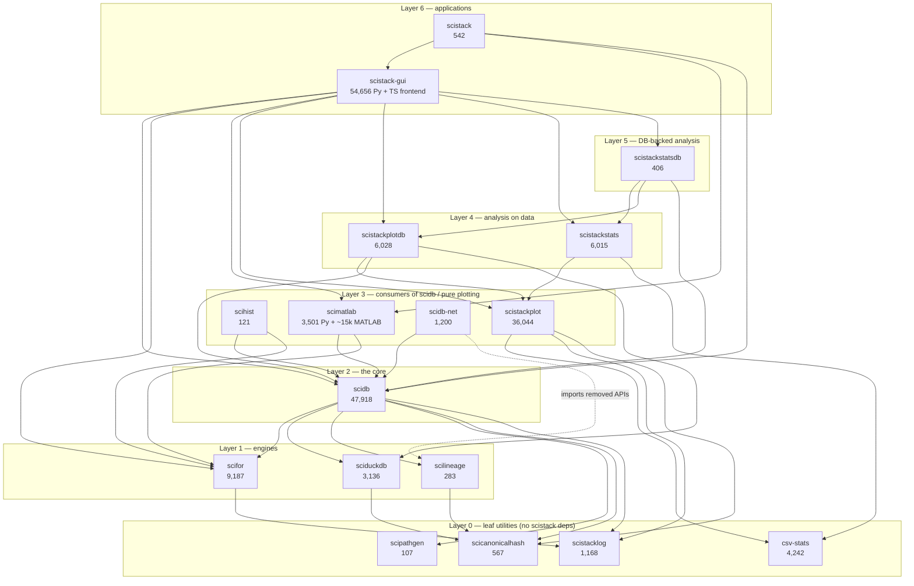

# Design review — the as-built SciStack architecture

> **Follow-up (2026-11-02):** the architecture after plans P0–P5 is reviewed
> in [`docs/design-review-post/`](../design-review-post/README.md), with
> each refactor ID here marked done, in part, or open there.

*Started 2026-11-01 against `main` @ `dd91f8da`. Every number here is measured
(`wc -l`, `grep -c`), not estimated. The diagrams are Mermaid; they render in
VS Code's Markdown preview (with a Mermaid extension) and on GitHub.*

## What this folder is

An inventory of what the code **is** today, package by package, written so we
can decide where the layers of abstraction should change. Each package
document answers the same five questions, in the same order:

1. **Job** — what the package is for, in one paragraph.
2. **Shape** — its modules, how big they are, and how they depend on each other
   (a module map diagram).
3. **Flows** — the main call paths through it, drawn as flowcharts or sequence
   diagrams, each with a caption saying what to look at.
4. **Contract** — what other packages actually use from it (measured by
   grepping importers, not by reading `__all__`).
5. **Assessment** — strengths, weaknesses, and refactor candidates. Weaknesses
   are stated with the evidence that shows them, so each one can be checked.

This is a review of structure, not a bug list. Where a weakness is also a bug
(for example dead code that would fail on import), it is called out.

## Reading order

Packages are reviewed bottom-up, in dependency order, so each document only
relies on concepts already introduced below it.

| # | Document | Packages | Status |
|---|---|---|---|
| 01 | [Foundations](01-foundations.md) | scistacklog, scicanonicalhash, scipathgen, scilineage | done |
| 02 | [scifor](02-scifor.md) | scifor | done |
| 03 | [sciduckdb](03-sciduckdb.md) | sciduckdb | done |
| 04a | [scidb — structure](04a-scidb-structure.md) | scidb | done |
| 04b | [scidb — write path](04b-scidb-write-path.md) | scidb | done |
| 04c | [scidb — read path](04c-scidb-read-path.md) | scidb | done |
| 05 | [scidb satellites](05-scidb-satellites.md) | scihist, scidb-net, scimatlab | done |
| 06 | [Plotting & stats](06-plot-and-stats.md) | csv-stats, scistackplot, scistackplotdb, scistackstats, scistackstatsdb | done |
| 07 | [GUI](07-gui.md) | scistack-gui (Python backend, VS Code extension, React frontend) | done |
| 08 | [Umbrella](08-scistack-umbrella.md) | scistack | done |
| 09 | [Synthesis](09-synthesis.md) | cross-cutting findings and a proposed target layering | done |

## The whole stack on one page

Each box is an installable Python package; the number is its non-test source
size in lines. An arrow `A --> B` means "A imports B" (declared in
`pyproject.toml` and confirmed by grep). The bands are the dependency layers:
nothing imports anything in a band above it.

**How to read it.** The stack has two independent towers that meet only in
the GUI: the **data tower** (scifor → scidb → scimatlab/scihist) and the
**plot/stats tower** (csv-stats → scistackplot → scistackstats). The `*db`
packages (`scistackplotdb`, `scistackstatsdb`) are the bridges that let the
plot/stats tower read from scidb. That split — pure computation in one
package, database access in a sibling `*db` package — is the project's
cleanest structural idea and is worth keeping.

The dotted edge is a defect, not a dependency: `scidb-net` imports
`scilineage.LineageFcnResult` and `scilineage.lineage`, which no longer exist
(see [01-foundations](01-foundations.md#scilineage)).

### Where the code is

| Package | Source lines | Test lines | Share of all source |
|---|---:|---:|---:|
| scistack-gui (Python only) | 54,656 | 53,137 | 30% |
| scidb | 47,918 | 41,558 | 27% |
| scistackplot | 36,044 | 30,752 | 20% |
| scifor | 9,187 | 9,220 | 5% |
| scistackplotdb | 6,028 | 7,950 | 3% |
| scistackstats | 6,015 | 2,199 | 3% |
| csv-stats | 4,242 | 3,086 | 2% |
| scimatlab (Python only) | 3,501 | 4,802 | 2% |
| sciduckdb | 3,136 | 2,300 | 2% |
| everything else (8 packages) | 4,394 | — | 2% |

Three packages hold 77% of the source. Most of the refactoring value will be
in those three; the small packages are reviewed mainly so the big ones can be
described in terms of them.

### Who imports whom (measured)

Count of non-test source files in the importing package that import the
target. This is the *real* contract, which can differ from `pyproject.toml`.

| Target | Imported by (files) |
|---|---|
| scistacklog | scistackplot 37, scistackstats 12, scidb 11, scistackplotdb 10, scifor 9, scistackstatsdb 3, gui 1 |
| scicanonicalhash | scidb 6, sciduckdb 2, scilineage 1, scimatlab 1, scistackplot 1, gui 1 |
| scipathgen | scidb 1 |
| scilineage | scidb 3, scidb-net 3 (broken) |
| scifor | scidb 35, **gui 23**, scimatlab 2, scihist 1 |
| sciduckdb | scidb 3, scistackplotdb 1 |
| scidb | **gui 58**, scistackplotdb 5, scihist 4, scimatlab 3, scidb-net 3, scistack 1 |
| scihist | **nobody** (tests only) |

Two rows stand out and recur in later documents: the GUI imports `scifor`
directly in 23 files (bypassing scidb), and nothing outside its own tests
imports `scihist`.

## Conventions used in the diagrams

- **Rectangles** are modules or functions; **rounded boxes** are data
  (records, tables, events); **cylinders** are persistent storage.
- A **dashed arrow** is a callback or hook (control passes *down* but the
  code lives *up*), or a defect where labelled.
- Line counts in boxes are `wc -l` of that file.
