# Best Popcorn

One hundred shoppers in a grocery store each tasted three brands of popcorn and rated each one from 1 (awful) to 10 (amazing). Which brand is best, and is the difference big enough to be more than chance?

This walkthrough answers that question entirely in the SciStack GUI. In the Code version, you wrote a function for each step: importing the data, summarising each brand, and running each test. Here you write **no code at all**. The canvas imports the CSV into a database, Plot Studio draws the figure, and Stat Studio runs the statistics. Each step explains *why* as well as *what*, so you can apply the same reasoning to your own data.

**What you'll learn**

- How to choose a **schema** for a real dataset, and why its names matter.
- How to **import a CSV** on the canvas with a library function, so each row becomes its own record.
- How **roles** in Plot Studio turn the same data into different figures.
- How Stat Studio picks the right **statistical test** from your study's design, and when to choose differently.
- How a figure and its statistics stay **linked**.

Before you start, [install](../getting-started/installation.md) the VS Code extension and the `scistack` package.

## The data

The dataset has 300 rows: 100 participants × 3 brands. It's in *long* format, meaning one row per rating:

| participant | brand       | rating |
| ----------- | ----------- | ------ |
| P001        | Butterburst | 5      |
| P001        | KettleKing  | 5      |
| P001        | SeaSaltCo   | 4      |
| P002        | Butterburst | 7      |
| …           | …           | …      |

**Download:** [popcorn_ratings.csv](data/popcorn_ratings.csv){ download="popcorn_ratings.csv" }

If the download doesn't work for you, expand the box below, copy the contents (the copy button is in the top-right corner of the code block), and save them as `popcorn_ratings.csv`.

/// details | popcorn_ratings.csv (click to expand)
type: example

```text
participant,brand,rating
P001,Butterburst,5
P001,KettleKing,5
P001,SeaSaltCo,4
P002,Butterburst,7
P002,KettleKing,7
P002,SeaSaltCo,6
P003,Butterburst,8
P003,KettleKing,6
P003,SeaSaltCo,6
P004,Butterburst,7
P004,KettleKing,8
P004,SeaSaltCo,8
P005,Butterburst,6
P005,KettleKing,6
P005,SeaSaltCo,6
P006,Butterburst,5
P006,KettleKing,7
P006,SeaSaltCo,4
P007,Butterburst,9
P007,KettleKing,9
P007,SeaSaltCo,8
P008,Butterburst,9
P008,KettleKing,6
P008,SeaSaltCo,4
P009,Butterburst,8
P009,KettleKing,8
P009,SeaSaltCo,3
P010,Butterburst,10
P010,KettleKing,8
P010,SeaSaltCo,8
P011,Butterburst,8
P011,KettleKing,5
P011,SeaSaltCo,3
P012,Butterburst,9
P012,KettleKing,10
P012,SeaSaltCo,8
P013,Butterburst,10
P013,KettleKing,7
P013,SeaSaltCo,5
P014,Butterburst,8
P014,KettleKing,9
P014,SeaSaltCo,4
P015,Butterburst,8
P015,KettleKing,8
P015,SeaSaltCo,6
P016,Butterburst,7
P016,KettleKing,6
P016,SeaSaltCo,5
P017,Butterburst,9
P017,KettleKing,9
P017,SeaSaltCo,8
P018,Butterburst,8
P018,KettleKing,8
P018,SeaSaltCo,8
P019,Butterburst,8
P019,KettleKing,5
P019,SeaSaltCo,3
P020,Butterburst,5
P020,KettleKing,6
P020,SeaSaltCo,5
P021,Butterburst,9
P021,KettleKing,7
P021,SeaSaltCo,6
P022,Butterburst,8
P022,KettleKing,8
P022,SeaSaltCo,5
P023,Butterburst,6
P023,KettleKing,4
P023,SeaSaltCo,3
P024,Butterburst,6
P024,KettleKing,5
P024,SeaSaltCo,3
P025,Butterburst,8
P025,KettleKing,6
P025,SeaSaltCo,5
P026,Butterburst,10
P026,KettleKing,5
P026,SeaSaltCo,7
P027,Butterburst,6
P027,KettleKing,6
P027,SeaSaltCo,6
P028,Butterburst,8
P028,KettleKing,8
P028,SeaSaltCo,9
P029,Butterburst,9
P029,KettleKing,5
P029,SeaSaltCo,6
P030,Butterburst,5
P030,KettleKing,6
P030,SeaSaltCo,5
P031,Butterburst,8
P031,KettleKing,9
P031,SeaSaltCo,5
P032,Butterburst,7
P032,KettleKing,6
P032,SeaSaltCo,7
P033,Butterburst,3
P033,KettleKing,6
P033,SeaSaltCo,5
P034,Butterburst,10
P034,KettleKing,9
P034,SeaSaltCo,6
P035,Butterburst,8
P035,KettleKing,6
P035,SeaSaltCo,8
P036,Butterburst,10
P036,KettleKing,9
P036,SeaSaltCo,7
P037,Butterburst,5
P037,KettleKing,3
P037,SeaSaltCo,6
P038,Butterburst,10
P038,KettleKing,8
P038,SeaSaltCo,7
P039,Butterburst,9
P039,KettleKing,9
P039,SeaSaltCo,7
P040,Butterburst,8
P040,KettleKing,8
P040,SeaSaltCo,6
P041,Butterburst,6
P041,KettleKing,6
P041,SeaSaltCo,4
P042,Butterburst,5
P042,KettleKing,5
P042,SeaSaltCo,4
P043,Butterburst,5
P043,KettleKing,7
P043,SeaSaltCo,5
P044,Butterburst,4
P044,KettleKing,6
P044,SeaSaltCo,2
P045,Butterburst,5
P045,KettleKing,7
P045,SeaSaltCo,4
P046,Butterburst,7
P046,KettleKing,5
P046,SeaSaltCo,6
P047,Butterburst,9
P047,KettleKing,5
P047,SeaSaltCo,5
P048,Butterburst,6
P048,KettleKing,7
P048,SeaSaltCo,7
P049,Butterburst,5
P049,KettleKing,5
P049,SeaSaltCo,5
P050,Butterburst,8
P050,KettleKing,5
P050,SeaSaltCo,6
P051,Butterburst,8
P051,KettleKing,9
P051,SeaSaltCo,6
P052,Butterburst,7
P052,KettleKing,7
P052,SeaSaltCo,6
P053,Butterburst,6
P053,KettleKing,5
P053,SeaSaltCo,6
P054,Butterburst,5
P054,KettleKing,6
P054,SeaSaltCo,6
P055,Butterburst,7
P055,KettleKing,5
P055,SeaSaltCo,3
P056,Butterburst,10
P056,KettleKing,8
P056,SeaSaltCo,9
P057,Butterburst,6
P057,KettleKing,6
P057,SeaSaltCo,3
P058,Butterburst,8
P058,KettleKing,7
P058,SeaSaltCo,8
P059,Butterburst,10
P059,KettleKing,9
P059,SeaSaltCo,7
P060,Butterburst,10
P060,KettleKing,5
P060,SeaSaltCo,3
P061,Butterburst,9
P061,KettleKing,9
P061,SeaSaltCo,7
P062,Butterburst,6
P062,KettleKing,6
P062,SeaSaltCo,5
P063,Butterburst,9
P063,KettleKing,8
P063,SeaSaltCo,6
P064,Butterburst,10
P064,KettleKing,5
P064,SeaSaltCo,5
P065,Butterburst,8
P065,KettleKing,5
P065,SeaSaltCo,5
P066,Butterburst,9
P066,KettleKing,7
P066,SeaSaltCo,7
P067,Butterburst,8
P067,KettleKing,7
P067,SeaSaltCo,8
P068,Butterburst,8
P068,KettleKing,7
P068,SeaSaltCo,3
P069,Butterburst,7
P069,KettleKing,6
P069,SeaSaltCo,5
P070,Butterburst,6
P070,KettleKing,6
P070,SeaSaltCo,4
P071,Butterburst,4
P071,KettleKing,6
P071,SeaSaltCo,5
P072,Butterburst,7
P072,KettleKing,7
P072,SeaSaltCo,6
P073,Butterburst,5
P073,KettleKing,6
P073,SeaSaltCo,6
P074,Butterburst,7
P074,KettleKing,5
P074,SeaSaltCo,6
P075,Butterburst,7
P075,KettleKing,6
P075,SeaSaltCo,5
P076,Butterburst,9
P076,KettleKing,9
P076,SeaSaltCo,9
P077,Butterburst,7
P077,KettleKing,7
P077,SeaSaltCo,2
P078,Butterburst,10
P078,KettleKing,7
P078,SeaSaltCo,9
P079,Butterburst,7
P079,KettleKing,6
P079,SeaSaltCo,7
P080,Butterburst,4
P080,KettleKing,4
P080,SeaSaltCo,2
P081,Butterburst,6
P081,KettleKing,4
P081,SeaSaltCo,3
P082,Butterburst,5
P082,KettleKing,2
P082,SeaSaltCo,3
P083,Butterburst,9
P083,KettleKing,5
P083,SeaSaltCo,5
P084,Butterburst,7
P084,KettleKing,6
P084,SeaSaltCo,4
P085,Butterburst,6
P085,KettleKing,4
P085,SeaSaltCo,7
P086,Butterburst,6
P086,KettleKing,6
P086,SeaSaltCo,5
P087,Butterburst,7
P087,KettleKing,8
P087,SeaSaltCo,5
P088,Butterburst,8
P088,KettleKing,6
P088,SeaSaltCo,6
P089,Butterburst,10
P089,KettleKing,5
P089,SeaSaltCo,4
P090,Butterburst,6
P090,KettleKing,3
P090,SeaSaltCo,2
P091,Butterburst,10
P091,KettleKing,8
P091,SeaSaltCo,6
P092,Butterburst,4
P092,KettleKing,4
P092,SeaSaltCo,5
P093,Butterburst,4
P093,KettleKing,1
P093,SeaSaltCo,4
P094,Butterburst,7
P094,KettleKing,6
P094,SeaSaltCo,7
P095,Butterburst,6
P095,KettleKing,6
P095,SeaSaltCo,6
P096,Butterburst,8
P096,KettleKing,6
P096,SeaSaltCo,6
P097,Butterburst,10
P097,KettleKing,4
P097,SeaSaltCo,4
P098,Butterburst,5
P098,KettleKing,7
P098,SeaSaltCo,6
P099,Butterburst,7
P099,KettleKing,5
P099,SeaSaltCo,5
P100,Butterburst,8
P100,KettleKing,9
P100,SeaSaltCo,7
```

///

## Step 1: Set up a folder

Make a new folder called `best-popcorn`, with a `data` folder inside it, and put `popcorn_ratings.csv` in `data`:

```text
best-popcorn/
└── data/
    └── popcorn_ratings.csv
```

Open the `best-popcorn` folder in VS Code (**File > Open Folder…**). SciStack treats the open folder as your project, and everything it creates goes inside it.

## Step 2: Create the database and choose the schema

Run **SciStack: Open Pipeline** from the Command Palette and choose to create a new database. SciStack asks where to put it: select the `best-popcorn` folder and click **Select Folder**.

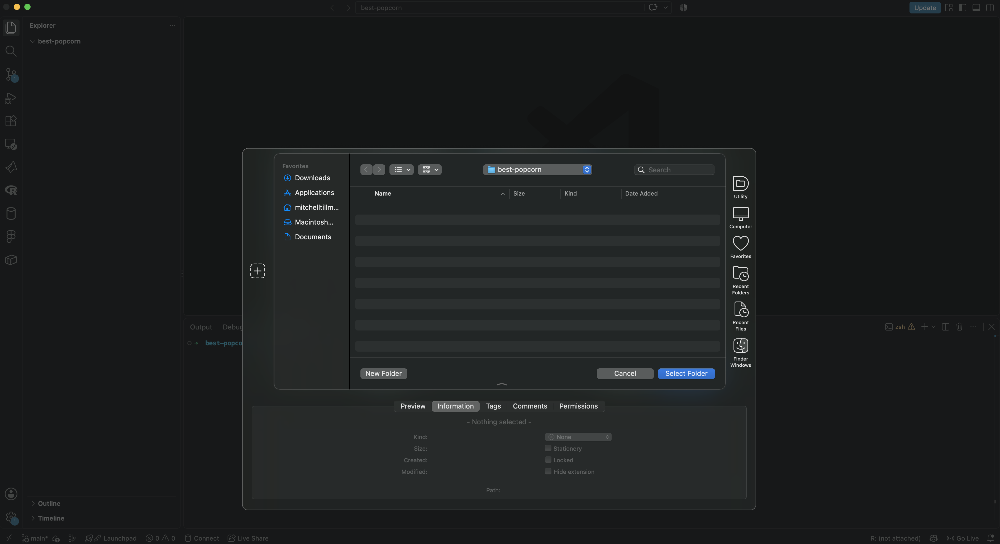

Then name the database `best-popcorn` and press Enter.

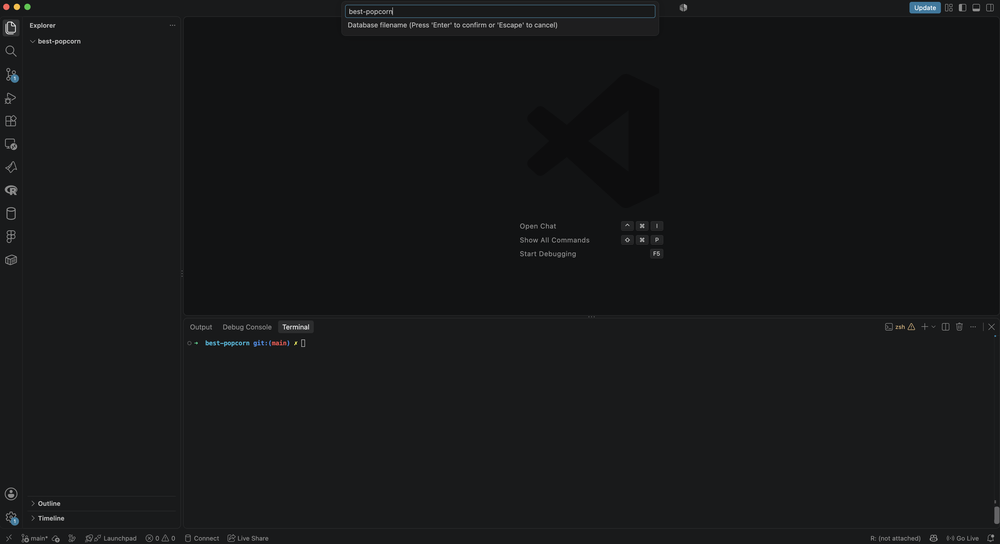

Next, SciStack asks for your **schema keys**. The [schema](../getting-started/whats-a-schema.md) describes how the dataset is organised: the things that identify each rating. Here, each rating is identified by **who** gave it and **which brand** it's for, so enter:

```text
participant, brand
```

`rating` isn't part of the schema. It's the value that was measured, not part of how the data is organised.

/// warning | Use the CSV's column names exactly
When SciStack imports a table, it looks for columns named after your schema keys to work out where each row belongs. Name the keys `participant` and `brand`, matching the CSV's column headers exactly. If you used `person` instead of `participant`, SciStack wouldn't recognise the `participant` column, and the ratings would be filed in the wrong places.
///

You now have a blank canvas. SciStack has also created a few files in the folder: the database (`best-popcorn.duckdb`), a settings file (`scistack.toml`), and a `src` folder for any code you add later. The database holds your data and the record of how every result was made.

## Step 3: Point SciStack at the CSV

The first job is to get the ratings into the database. Start by telling SciStack where the file is.

In the sidebar, open the **Path Inputs** tab (📁), click **+**, and name the new path input `data`. Click it, and in its settings set the **Path Template** to:

```text
data/popcorn_ratings.csv
```

Drag `data` from the sidebar onto the canvas.

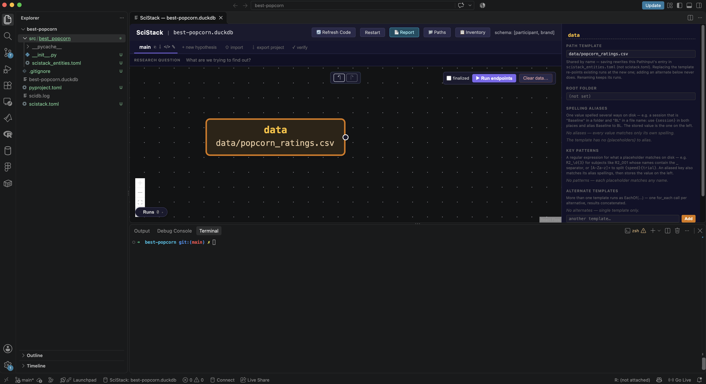

A path input can contain schema keys in curly braces, such as `data/{participant}.csv`, when the data is split across one file per participant. This dataset is all in one file, so the template is just the path.

## Step 4: Add a function to read it

Reading a CSV is a solved problem, so there's no need to write a function for it. Use pandas' `read_csv`.

Open the **Functions** tab (`f(x)`), click **+**, and enter `pandas.read_csv`. Drag it onto the canvas.

Now connect them: drag from the handle on `data` to `read_csv`'s first input, `filepath_or_buffer`. The arrow says that this function reads this file.

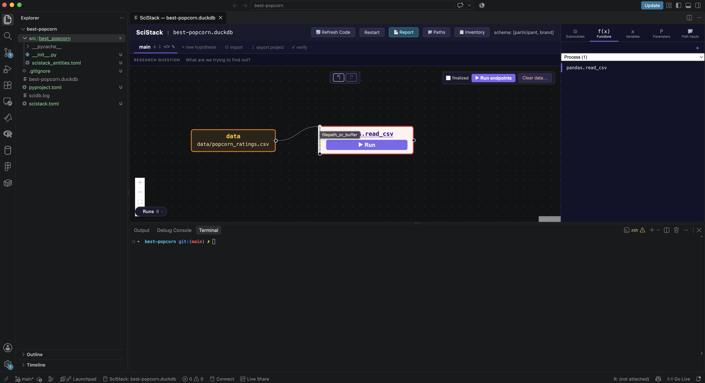

/// tip | Why not just open the file?
Running the import through the canvas means SciStack records that the ratings came from `popcorn_ratings.csv`, read by `pandas.read_csv`. Every result you calculate later can be traced back to this file.
///

## Step 5: Create the Rating variable

A **variable** is a named kind of data that the database stores, such as "a rating". Open the **Variables** tab (`x`), click **+**, and name it `Rating`. Drag it onto the canvas, then connect `read_csv`'s output to it.

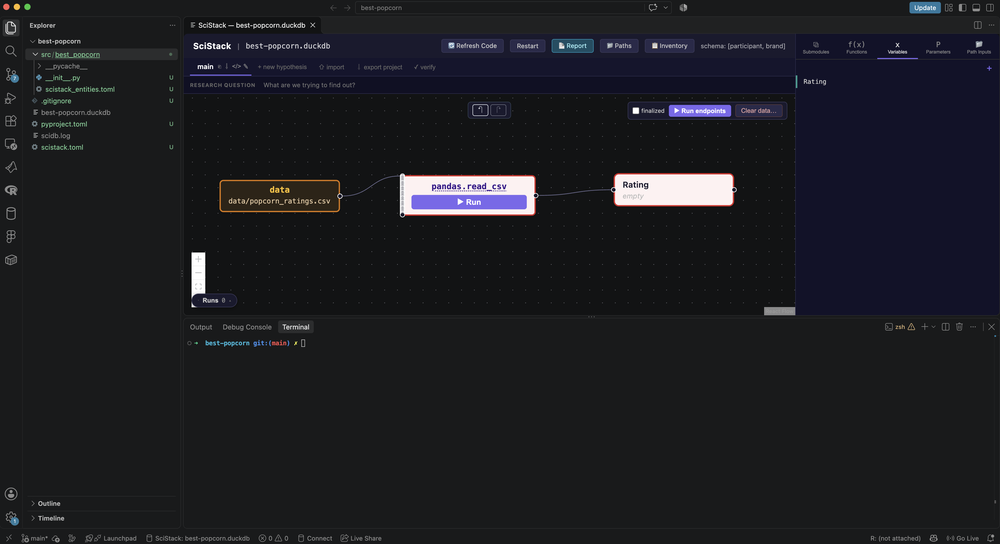

The `read_csv` node is **red**. That's expected: red means the step has no results yet. It turns green once it has run.

## Step 6: Run the import

Click **▶ Run** on the `read_csv` node.

Here's what happens:

1. `read_csv` runs **once** and returns the whole 300-row table. It runs once because the path input points at a single file.
2. SciStack sees that the table has `participant` and `brand` columns, which match your schema keys, so it treats **each row as its own record**. The row `P001, Butterburst, 5` is saved as a `Rating` of 5 at `participant = P001, brand = Butterburst`.
3. The node turns **green**, and the Runs dock reports the run as finished.

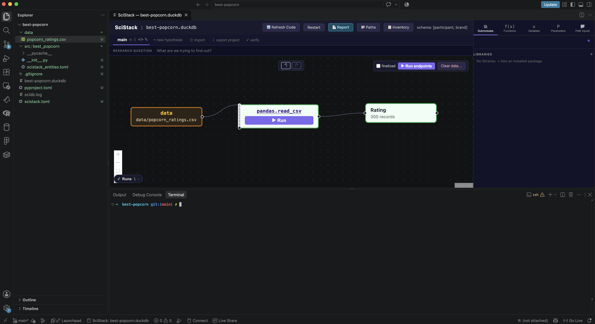

Check the result: right-click `Rating` and choose **View Schema Locations**. The dialog should say **300/300 locations green**: all 100 participants × 3 brands have a rating.

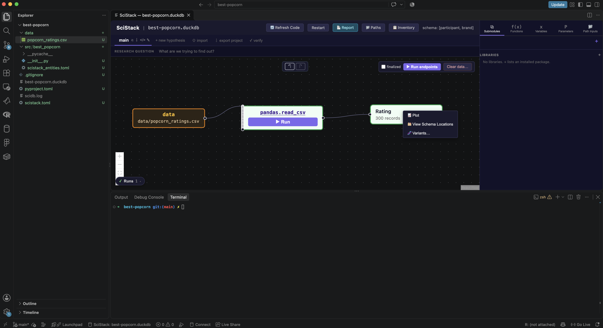

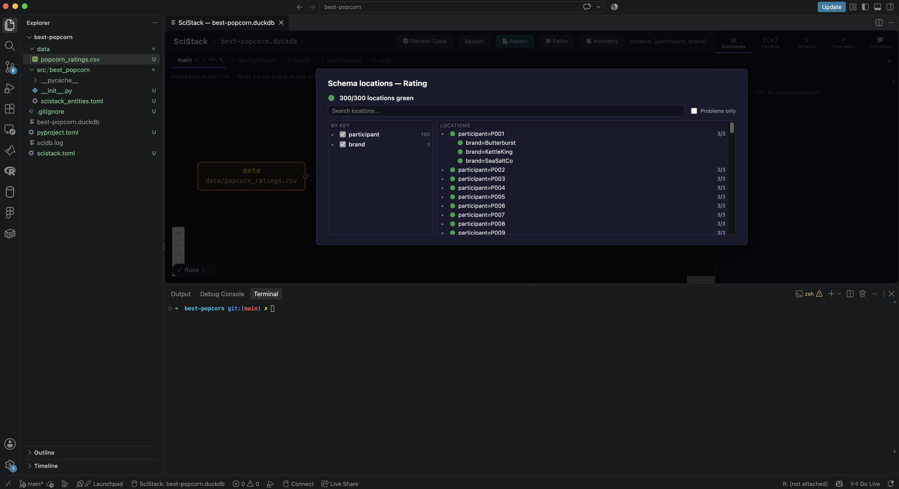

From here on, nothing reads the CSV again. Every later step reads `Rating` from the database.

## Step 7: Look at the raw data

Click `Rating`, then **Open Plot Studio →** in the sidebar. Plot Studio opens in a new tab.

Look at the **Structure** group in the left rail. Plot Studio has put `brand` in **Grouping**, so there's one mark per brand. `participant` is set to **Separate figures**, so there's one figure per participant. Use **◀** and **▶** above the figure to step through them: P001, P002, and so on. The counter beside them shows which of the 100 you're on.

This is a good habit: look at individual data before averaging it. A participant who rated every brand 10, or a typo such as a rating of 55, is easy to spot here and hard to spot in an average.

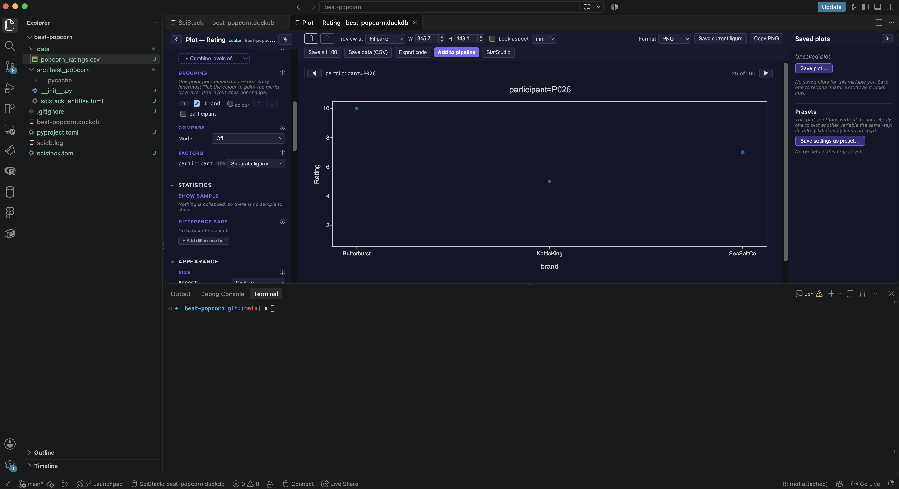

## Step 8: Summarise each brand in a figure

To compare the brands across everyone, average over the participants. In **Structure > Factors**, change `participant` from **Separate figures** to **Collapse (average)**.

There's now a single figure, with each brand summarising all 100 participants. Then:

1. In **Chart**, choose **Bar + error**.
2. In **Statistics > Summary**, set **Centre** to **Mean** and **Spread** to **SD**.

    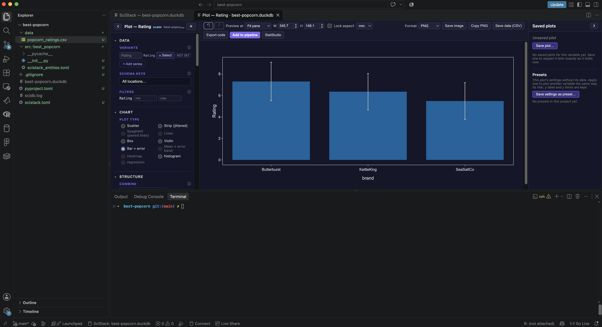

3. In **Statistics > Show sample**, tick `participant` and leave **Join points** on **Auto (lines)**.

The lines are worth a moment. Each line is **one participant**, joining their three ratings. This shows the study's most important feature: every person rated every brand. Because of that, the fair comparison is *within* each person, as in "did this person prefer Butterburst to KettleKing?", rather than between the three bars as if they were separate groups of people. Keep that in mind for the statistics.

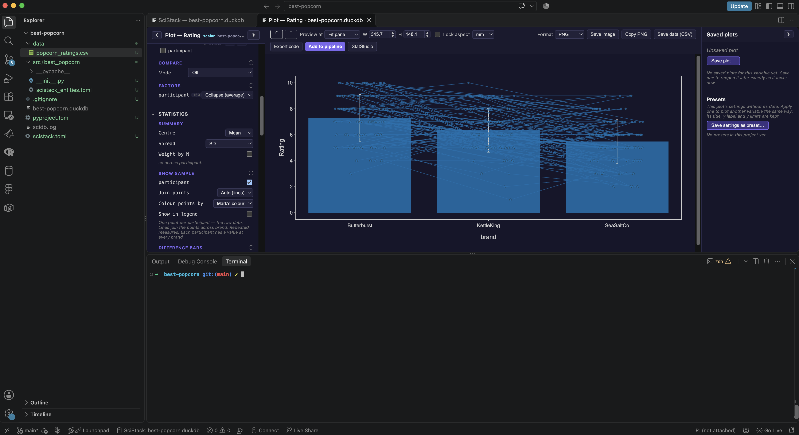

To tell the participants apart, set **Colour points by** to `participant`, which gives each person's line its own colour.

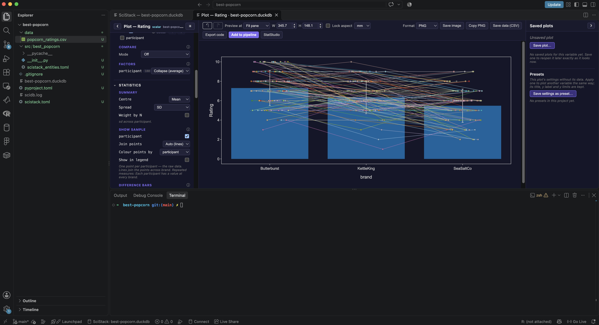

The means are about **7.3** for Butterburst, **6.3** for KettleKing and **5.5** for SeaSaltCo. Butterburst looks best, but is the difference more than chance?

Before moving on, save the figure. In the **Saved plots** rail on the right, name it `Ratings by brand` and save it. Saving it lets the statistics link to it in the next step. Use **Save image** in the toolbar if you want a file for a slide.

## Step 9: Describe the study to Stat Studio

Click **StatStudio** in Plot Studio's toolbar. Stat Studio opens in a new tab, already set up from the figure: `Rating` as the measure, `brand` grouped, and `participant` collapsed.

A new table opens in the **Step by step** view. Each screen asks one question, shows what Stat Studio found in your data, and recommends an answer. **What does this mean?** explains any idea a screen names. Press **Next →** to go on, or **← Back** to change an earlier answer. The first five screens describe the study:

- **What did you measure?** `Rating`: 300 values from 100 participants.

    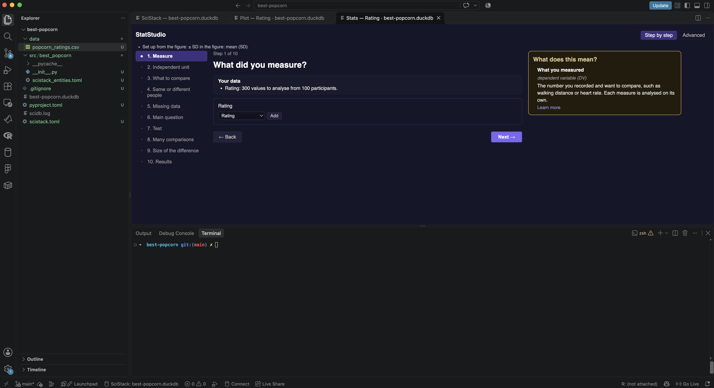

- **What is one independent thing you measured?** *Each participant counts once: 100 participants in total.* This is the most important question in statistics. Each person's three ratings belong together. A test that treated 300 ratings as 300 separate people would be far too sure of itself.

    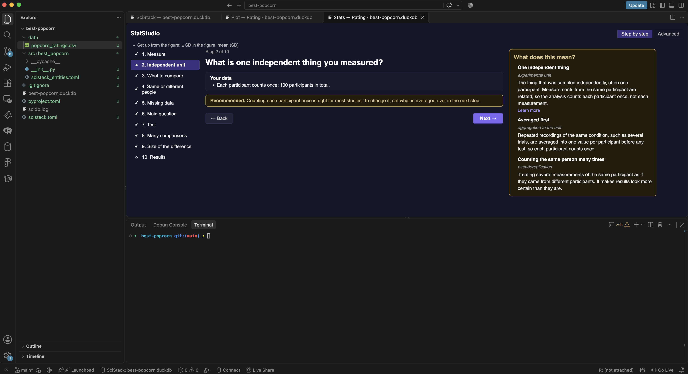

- **What are you comparing?** `brand` is set to **Compare**, and `participant` to **Average over**. These are the roles from Plot Studio, in Stat Studio's words.

    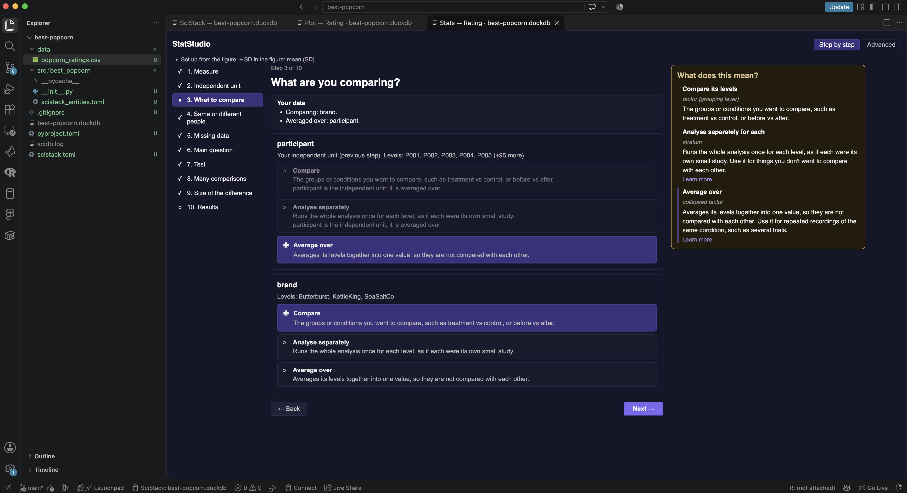

- **Was each participant measured at every level?** Stat Studio recommends **Same participants, measured repeatedly**, because each of the 100 participants rated every brand. This is what the lines in the figure showed.

    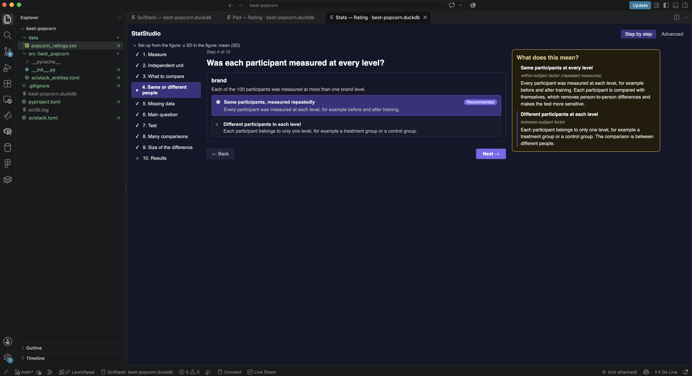

- **Is anything missing?** *Every participant was measured at every level.* Nothing to decide.

    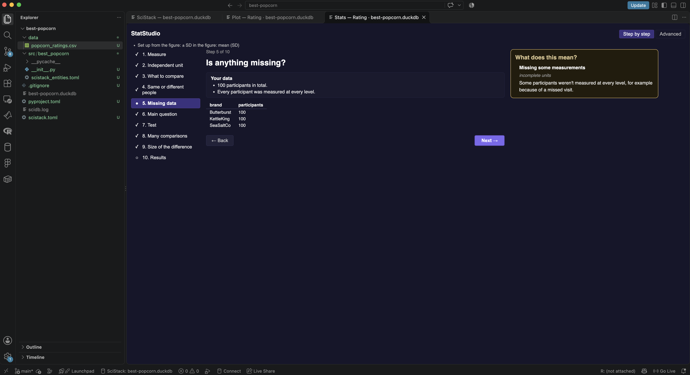

## Step 10: Choose the test

The next screens choose and run the tests.

- **What is your main question?** Every pair of brands, which is 3 comparisons. Keep **Yes, an overall test and then the pairs**: first ask whether the brands differ at all, then which pairs differ.

    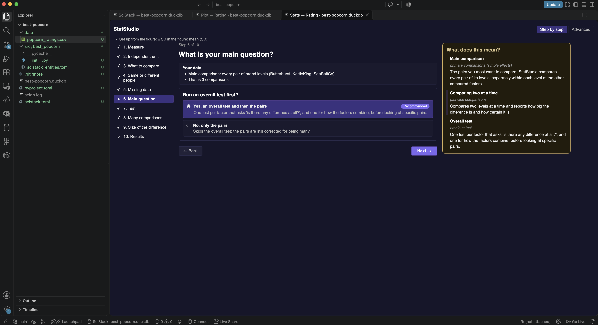

- **Which test?** Stat Studio checks the shape of the data and finds that *the values are roughly bell-shaped*, so it recommends a **paired t-test** for the pairs and an **ANOVA** overall, and selects them for you. Keep them.

    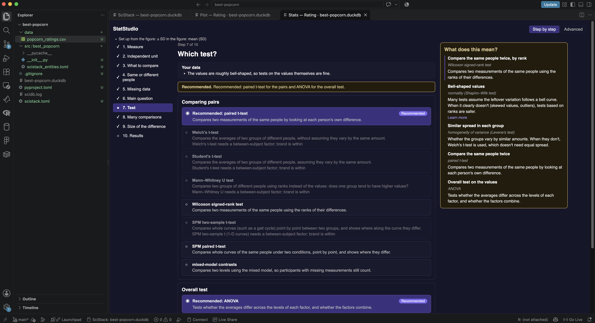

    Both are paired: the paired t-test compares each person's own two ratings, and the ANOVA treats `brand` as measured within each participant. Tests for separate groups of people, such as Welch's t-test and the Mann–Whitney U test, are greyed out, and each one says why underneath: *brand is within*.

/// tip | Ratings are ranks
A 1–10 taste score is a ranking, not a physical measurement: a 6 is better than a 5, but the step from 5 to 6 isn't guaranteed to equal the step from 9 to 10. Tests based on **ranks** don't assume equal steps. If you'd rather not assume them either, choose **Wilcoxon signed-rank test** under **Comparing pairs** and **Friedman test** under **Overall test**. For this data the conclusion is the same.
///

- **How should false alarms be kept rare?** Three comparisons mean three chances of a fluke. Keep the recommended **Holm correction**, which adjusts the p values for that.

    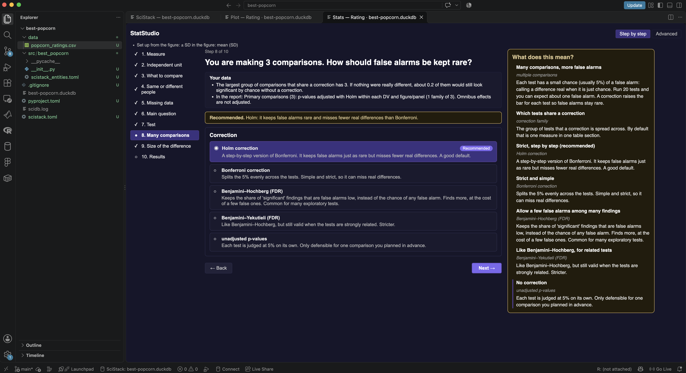

- **How should the size of each difference be reported?** For a paired t-test, Stat Studio recommends **Cohen's d_z**: the average difference divided by how much the differences vary between people. Keep it, and keep the **95% CI of the difference** for the uncertainty.

    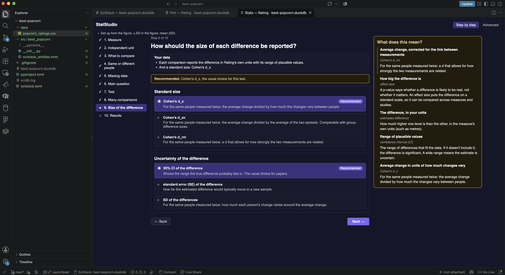

## Step 11: Read the results

- **Your results.** *3 of 3 comparisons ran; 3 significant at α = 0.05 after the correction.*

    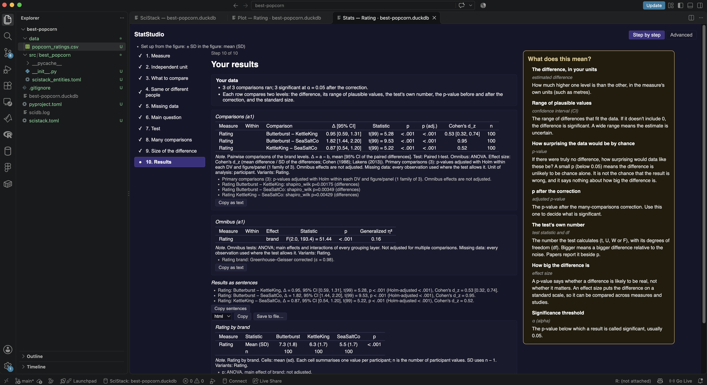

The pairs come first, under **Comparisons**:

| Comparison | Δ [95% CI] | Statistic | p (adj.) | Cohen's d_z |
|---|---|---|---|---|
| Butterburst − KettleKing | 0.95 [0.59, 1.31] | t(99) = 5.28 | < .001 | 0.53 [0.32, 0.74] |
| Butterburst − SeaSaltCo | 1.82 [1.44, 2.20] | t(99) = 9.53 | < .001 | 0.95 |
| KettleKing − SeaSaltCo | 0.87 [0.54, 1.20] | t(99) = 5.22 | < .001 | 0.52 |

Butterburst is rated higher than both other brands, by about one point over KettleKing and nearly two over SeaSaltCo. Each row gives the difference with its direction (Butterburst − KettleKing), its confidence interval, the test statistic, and the effect size. The note under the table records everything a reader needs to know, such as the tests, the unit, n and the correction, and also the checks the tests relied on, such as a Shapiro–Wilk normality check of each pair's differences.

The overall test is under **Omnibus**: the ANOVA gives F(2.0, 193.4) = 51.44, p < .001, generalised η² = 0.16. The brands are not equally liked. The note under it says the degrees of freedom are Greenhouse–Geisser corrected (ε = 0.98), a small adjustment that repeated-measures ANOVA makes when the brands' differences vary unevenly.

Under the tables, **Results as sentences** writes the same findings in words. Click **Copy sentences** to start your results section. The **Rating by brand** table below it shows each brand's mean (SD): 7.3 (1.8), 6.3 (1.7) and 5.5 (1.7). To put a table in a paper, choose **html** and click **Copy**. It pastes into Word as a formatted table, with its note.

/// note | A small difference from the Code version
The Code version used rank-based tests (Friedman overall, then Wilcoxon), compared the best brand with each of the other two, and used a Bonferroni correction. Here Stat Studio uses its recommended paired t-tests and ANOVA, compares **every** pair (including KettleKing against SeaSaltCo), and uses Holm, which is slightly less strict but still guards against flukes across all three comparisons. The conclusion is the same. To match the Code version, choose **Wilcoxon signed-rank test** and **Friedman test** on the "Which test?" screen and **Bonferroni correction** on the false-alarms screen.
///

Name the table `Popcorn statistics` and save it.

## Step 12: Put the result on the figure

Click **Advanced** at the top of Stat Studio. It shows every setting at once, including the answers you just gave. Under **Brackets on the figure**, tick **Draw test brackets on the linked figure**, keep **Pairs** on the significant ones and **Label** on stars, and save the table again.

Switch back to the Plot Studio tab. `Ratings by brand` now has brackets between the brands that differ, drawn from the test results rather than typed by hand. If the data or the test settings change, the brackets follow.

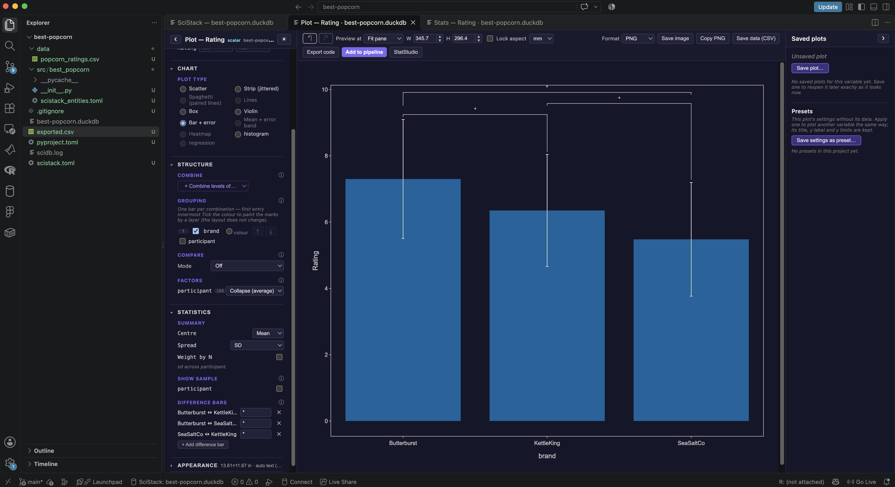

## Step 13 (optional): Make it part of the pipeline

So far, the figure and the table are saved views of the data. To make them **steps** in the pipeline, click **Add to pipeline**: in Plot Studio's toolbar for the figure, and in Stat Studio for the table. Each one appears on the canvas, connected to `Rating`.

The difference is that pipeline steps are recorded like any other result. If the ratings change, they turn red until you re-run them, and **📄 Report** collects them into a single web page with a note of where each came from.

## Summary

Here's how the same analysis looks in code and in the GUI:

| | Code (`scidb`) | GUI |
|---|---|---|
| Setup | `configure_database("popcorn.duckdb", ["participant", "brand"])` | **SciStack: Open Pipeline**, schema keys `participant, brand` |
| Import | A `load_ratings` function, run with `for_each` | A path input wired into `pandas.read_csv`, wired into `Rating` |
| Summary per brand | A `summarize_ratings` function, run once per brand | Plot Studio: `brand` grouped, `participant` collapsed |
| Overall test | A `friedman_test` function | Stat Studio Step by step: within-subject from the design; the recommended repeated-measures ANOVA |
| Which is best | A `compare_to_best` function, Wilcoxon, Bonferroni | Stat Studio pairwise paired t-tests, Holm |
| Afterwards | `load(...)` any result; `get_provenance` | Saved plot and saved table; **Add to pipeline** for recorded steps |

## Conclusion

The analysis supports a write-up like this:

> Taste ratings differed across the three brands (repeated-measures ANOVA, Greenhouse–Geisser corrected: F(2.0, 193.4) = 51.4, p < 0.001, generalised η² = 0.16). Butterburst (mean 7.3/10) was rated higher than both KettleKing (mean 6.3; Δ = 0.95, 95% CI [0.59, 1.31], d_z = 0.53) and SeaSaltCo (mean 5.5; Δ = 1.82, 95% CI [1.44, 2.20], d_z = 0.95; paired t-tests, Holm-adjusted p < 0.001 for both).

**Butterburst is the best popcorn.**

## Where to go next

- [Process](../gui/process.md), [Visualize](../gui/visualize.md) and [Summarize](../gui/summarize.md) describe each part of the GUI in more detail.
- [Best Player](best-player.md): a second example, with missing data, leaving a player out, and statistics on groups of different people.
