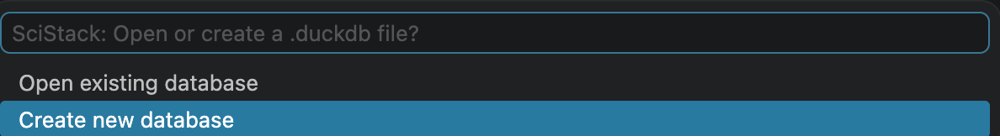
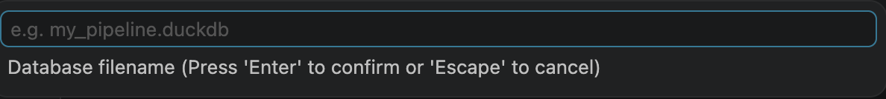
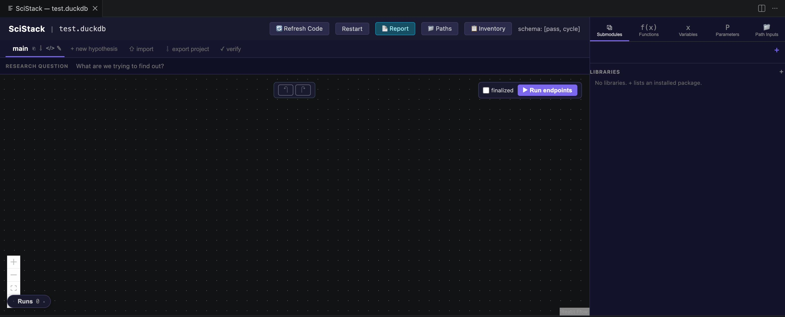

# Create New Project

This page assumes that you have already [installed](installation.md) the VS Code extension and the `scistack` package.

# Create new database

Run `SciStack: Open Pipeline` in the Command Palette.

See [Process](../gui/process.md) for a tour of the canvas and how to build your first pipeline.
